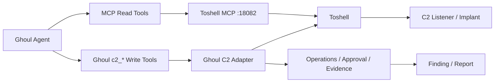

# Ghoul C2 集成路线决策

> 状态：Phase A-C implemented
> 日期：2026-11-09
> 结论：继续使用 Toshell，不原生重写 C2。
> 推荐路线：Toshell sidecar + MCP 只读能力面 + Ghoul Adapter 写操作/审批/证据。

当前实现：

- Compose 自动启动 Toshell `v1.4.3` sidecar，Release 包按 SHA256 校验。
- 首启生成 API Key、MCP Token、管理员密码和密钥修订号。
- Toshell MCP 白名单为 13 个只读工具，Ghoul 侧 MCP 再按同一白名单过滤。
- `c2-mcp-readonly` Skill 按需解锁 Toshell MCP。
- Ghoul 原生工具面扩展为 10 个，新增 `c2_listener` 和 `c2_payload`。
- `redteam-ops` 已按 Ghoul 审批、证据和秘密引用模型改造。
- C2 页面显示 MCP 只读状态、缺失工具和高级控制台入口。

## 1. 决策摘要

Ghoul 不应在现阶段重写一套完整 C2 内核。Toshell 已经覆盖监听器、植入端、载荷构建、会话、任务、文件、凭据、插件、隧道和 AV-Ops，重写会带来数月工作量和高安全风险。

也不建议把 Toshell MCP 的 38 个工具全部直接暴露给 Ghoul Agent。Toshell MCP 的默认白名单只放行只读工具；一旦把 Confirm/Danger 工具加入 `allowed_tools`，这些工具会直接执行，不再经过 Toshell 的 ConsentGate。Ghoul 的通用 intercept 虽然能拦截 MCP 工具，但不能替代 C2 专用的会话绑定、操作审计和证据物化。

因此推荐三层分工：

| 层 | 责任 |
|---|---|
| Toshell sidecar | C2 内核、监听器、植入端、载荷、会话、任务和高级控制台 |
| Toshell MCP | 只读工具发现、会话态势、结果回读和低风险查询 |
| Ghoul Adapter | Confirm/Danger 操作、审批、证据、Finding 绑定和报告闭环 |

## 2. 为什么不选原生 C2

### Pojun

Pojun 的 C2 主要是一个回连接收器，不提供 Toshell 这样的完整交互式 C2。它的价值在 `redteam-ops` 后渗透方法论和证据纪律，不在 C2 内核。按 Pojun 原生实现无法直接满足完整 C2 需求。

### CyberStrikeAI

CyberStrikeAI 的内置 C2 覆盖 Listener、Session、Task、Payload、Profile、Event 和 File，但它仍然是一套需要长期维护的 C2 实现。照搬到 Ghoul 会重复实现：

- 多通道监听器和协议处理。
- 多平台植入端和载荷构建。
- 加密、心跳、重连、结果回读。
- 文件传输、终端、截图、屏幕流。
- 凭据、持久化、插件、注入和 AV-Ops。
- 跨平台测试和安全审计。

这会显著扩大 Ghoul 的维护面，而且与 Ghoul 当前“任务、探索图、Finding、证据和报告”的核心优势不一致。

### 原生 C2 的合理场景

只有在以下条件同时成立时才考虑原生实现：

- Toshell 停止维护，或核心协议无法满足需求。
- 需要完全定制植入端和通信协议。
- 有长期专职 C2 开发和安全审计资源。
- 能接受数月开发和持续维护成本。

## 3. 为什么不选“MCP 全量直连”

Toshell MCP 当前行为：

- 未配置 `allowed_tools` 时只放行只读工具。
- Confirm/Danger 工具不在白名单时返回 `needs_consent`。
- 工具加入 `allowed_tools` 后直接执行。
- 默认 `DenyConsentGate` 只是兜底，不会让未白名单工具执行。

这意味着：

1. 只读 MCP 接入是安全的，适合直接使用。
2. 全量 MCP 直连会把 Ghoul 的 C2 审批绕过。
3. Ghoul intercept 可以配置 `ask`，但缺少 C2 专用参数哈希、会话绑定、两阶段审批和证据物化。

因此 MCP 适合做能力面，不适合独立承担 C2 控制面。

## 4. 推荐架构



### 4.1 MCP 只读面

Toshell MCP 白名单只放行只读工具，例如：

- `session_list`
- `session_context`
- `attack_suggest`
- `intel_query`
- `task_result`
- `task_wait`
- `tunnel_list`
- `plugin_list`
- `result_read`

这些工具通过 Ghoul 的外部 MCP 客户端接入，使用 skill-gated 或 deferred tools，避免每轮固定注入全部 schema。

### 4.2 Ghoul Adapter 写操作

继续使用现有 Ghoul C2 Adapter 处理：

- 文件操作。
- 进程操作。
- 截图。
- 命令执行。
- 隧道启停。
- 监听器和载荷构建。
- 凭据、插件和 AV-Ops。

所有写操作继续经过：

- 任务绑定。
- 会话绑定。
- 参数哈希。
- 风险等级。
- 审批中心。
- 证据物化。
- Finding 绑定。

### 4.3 Toshell 控制台

高级管理继续使用 Toshell 控制台：

- 载荷高级选项。
- 监听器高级配置。
- 插件和模块。
- AV-Ops L1+。
- 屏幕流和交互 Shell 排障。

Ghoul UI 只保留常用会话、审批、证据和深链接，不重复实现全部 Toshell 页面。

## 5. 版本更新策略

不把 Toshell 源码固化到 Ghoul 仓库。

推荐使用带版本变量的 sidecar：

```yaml
services:
  toshell:
    image: ${TOSHELL_IMAGE:-ghoul-toshell-runtime:${TOSHELL_VERSION:-v1.4.3}}
    environment:
      TOSHELL_MCP_ENABLED: "true"
      TOSHELL_MCP_BIND: "0.0.0.0:18082"
    restart: unless-stopped
```

如果 Toshell 没有官方镜像，使用仓库内的小型 runtime Dockerfile 下载并校验指定 Release 包，不复制源码：

```text
TOSHELL_VERSION=v1.4.3
TOSHELL_SHA256=<release checksum>
```

升级流程：

1. 修改 `TOSHELL_VERSION` 和校验和。
2. 重建 sidecar。
3. 运行 MCP 工具清单契约测试。
4. 对比 read/confirm/danger 工具变化。
5. 运行最小会话和只读工具 smoke test。
6. 更新 Ghoul skill 中引用的工具名。

这样既不需要固定源码，也不需要手工维护完整 Toshell 分支。

## 6. 实施计划

### Phase A：自动启动与只读 MCP

预计 3 到 5 天。

- Compose 增加 `toshell` sidecar。
- 使用 `TOSHELL_VERSION` 变量和健康检查。
- 生成并挂载 MCP token。
- Ghoul 配置外部 MCP：`http://toshell:18082/mcp`。
- 只放行只读工具。
- 增加 `c2-mcp-readonly` skill，按需解锁 MCP 工具。

验收：

- `docker compose up -d` 后 Toshell 和 Ghoul 都自动启动。
- Ghoul 能看到 Toshell MCP 只读工具。
- Agent 不能调用 Confirm/Danger MCP 工具。

### Phase B：现有 Adapter 收敛

预计 3 到 5 天。

- 保留现有 8 个 Ghoul 原生 `c2_*` 工具。
- 修正 Confirm 工具的只读标记。
- 增加 `c2_listener` 和 `c2_payload` 两个核心写工具。
- 让 `redteam-ops` 使用 MCP 只读工具加 Ghoul 写工具。
- 增加升级契约测试。

验收：

- 读取会话和结果优先走 MCP。
- 命令、文件、进程、截图、隧道和载荷构建仍走 Ghoul 审批。
- C2 证据和 Finding 绑定不丢失。

### Phase C：UI 与体验优化

预计 5 到 8 天。

- C2 总览增加 MCP 连接状态和工具数量。
- 会话页增加只读上下文和结果回读。
- 审批中心增加 Toshell 操作来源。
- 高级操作使用 Toshell 控制台深链接。
- 增加版本升级和工具差异提示。

验收：

- 日常查看和只读侦察可在 Ghoul 完成。
- 写操作和审批不绕开 Ghoul。
- 高级操作有明确入口。

### Phase D：可选全量 MCP 策略代理

仅在确实需要让 Agent 使用全部 Toshell 工具时实施，预计 2 到 3 周。

- 在 Ghoul 内实现 MCP 工具代理。
- 为每个工具映射风险等级。
- Confirm/Danger 调用先创建 Ghoul operation。
- 审批通过后再转发到 Toshell MCP。
- 输出统一脱敏、证据物化和审计。

该阶段不是第一版必需项。

## 7. 方案对比

| 方案 | 工作量 | Toshell 更新 | 审批/证据 | 完整 C2 | 推荐 |
|---|---:|---|---|---|---|
| MCP 只读 + Ghoul Adapter 写操作 | 2 到 3 周 | 容易 | 强 | 通过 Adapter 和 Toshell 控制台完整覆盖 | 推荐 |
| MCP 全量直连 | 3 到 7 天 | 很容易 | 弱，存在审批绕过风险 | Agent 可调用全部工具 | 不推荐 |
| 继续纯 Ghoul Adapter 扩展 | 4 到 6 周 | 中等 | 强 | UI 和 API 可完整覆盖 | 可接受但工作量大 |
| 原生重写 C2 | 2 到 4 个月以上 | 无 | 可完全定制 | 完全自主 | 当前不推荐 |

## 8. 最终建议

1. 继续使用 Toshell。
2. 不原生重写 C2。
3. Toshell MCP 只作为只读能力面。
4. Confirm/Danger 继续走 Ghoul Adapter。
5. Toshell 使用版本变量和健康检查自动启动，不固化源码。
6. `redteam-ops` 使用 MCP 只读工具和 Ghoul 写工具的组合。

这条路线能在较低工作量下实现自动启动、动态跟进 Toshell 更新，并保留 Ghoul 最重要的审批、证据和报告能力。
