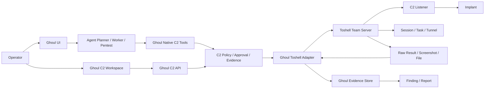

# Ghoul 内嵌 Toshell 与全量 C2 优化方案

> 已被 `GHOUL_C2_INTEGRATION_DECISION.md` 取代。该文档保留为“全量源码内嵌”的备选方案，不作为当前实施路线。

> 状态：Draft
> 日期：2026-11-09
> Ghoul 基线：`7de4442`
> Toshell 基线：`v1.4.3 / 8bf4643`
> Pojun 参考：`9a1f67a`
> CyberStrikeAI 参考：`697e875f`

## 1. 结论

目标是让用户执行一次 `docker compose up -d` 或启动一次 Ghoul，就同时获得完整 C2 能力，不再手工安装、配置和启动 Toshell。

推荐架构不是把 Toshell 的 Go 模块直接编进 Ghoul 二进制，而是：

1. Toshell 源码固定版本随 Ghoul 仓库交付。
2. Docker Compose 中增加 `toshell` 服务，Ghoul 启动时自动拉起并等待健康检查。
3. Ghoul 通过服务端 C2 Adapter 调用 Toshell，浏览器和 Agent 永远拿不到 Toshell API Key。
4. Ghoul 提供统一 C2 UI、审批、证据、Finding 关联和审计。
5. 原生二进制发布包同时包含 `ghoul` 和 `toserver`，由 `start.sh` / `start.bat` 统一监管。
6. Toshell 高级控制台保留为可选运维入口，不通过 iframe 嵌入 Ghoul。

这样能获得与 Pojun、CyberStrikeAI 接近的“开箱即用”体验，同时避免把两个独立数据库、两个 HTTP 服务、两类生命周期和两套升级逻辑硬塞进一个进程。

## 2. 现状与差距

### 2.1 Ghoul 已有基础

- C2 配置、安全自检、Toshell REST/WS 客户端和事件同步已存在。
- 已有会话、监听器、任务、事件、操作、审批、证据和 Finding 绑定表。
- 已有 Confirm/Danger 两阶段审批、参数哈希、TTL、限流、输出脱敏和危险操作禁止自动重试。
- 已有 8 个原生 `c2_*` 工具，但只覆盖会话、侦察、文件列表、进程、截图、隧道和命令执行。
- 已有 `/function/c2`、`/system/c2/approvals` 页面。

### 2.2 主要缺口

| 缺口 | 当前状态 | 目标状态 |
|---|---|---|
| Toshell 启动 | 手工 sidecar | Compose 或启动脚本自动拉起 |
| Toshell 版本 | 外部目录手工构建 | 固定源码随仓库交付并进入镜像 |
| 密钥 | `.env` 为空时 C2 无法初始化 | 首启自动生成、文件权限 0600、双端注入 |
| 监听器管理 | 只读展示 | 创建、编辑、启动、停止、删除、恢复 |
| Payload 构建 | 无 | 平台、架构、格式、通道、profile、签名、下载、哈希 |
| 会话操作 | 少量 | Shell、文件、进程、截图、屏幕流、凭据、持久化、插件、AV-Ops |
| 任务闭环 | 只读同步 | 异步提交、等待、取消、分页回读、证据物化 |
| UI | 只读和有限审批 | 完整 C2 工作台 |
| 技能 | 只有 C2 操作说明 | 吸收并改造 Pojun `redteam-ops` |
| Agent 工具面 | 固定 8 个 | 按角色分层，UI 全量，Agent 裁剪 |

### 2.3 Pojun 可吸收点

- `redteam-ops` 把后渗透拆成落地稳定化、提权、凭据、横向、域内专项、数据获取和收尾。
- 强调每一步写回事实、记录 provenance、失败也留证，避免重复尝试。
- 强调回连地址由平台解析，Agent 不自建公网 C2。
- 强调权限维持只做可行性和证据证明，不实际部署长期后门。

### 2.4 Pojun 不应直接照搬的点

- `redteam-ops` 原文要求把凭据全文写入 fact。这会把高敏秘密写入模型上下文、transcript 和备份，必须改为加密证据和秘密引用。
- Pojun 只做回连接收器，不做完整交互式 C2，不能满足本需求。
- Pojun 的 C2 代码不应合并进 Ghoul，C2 内核继续由 Toshell 承担。

### 2.5 CyberStrikeAI 可吸收点

- 内置 C2 生命周期清晰：授权、Profile、Listener、Payload、Session、Task、结果归档、清理。
- C2 对象和 Web API 统一在平台内管理，而不是只提供外部深链接。
- 任务分级、HITL、结果文件、事件复盘和清理清单适合直接转成 Ghoul 的审批与证据模型。

### 2.6 Toshell 能提供的完整能力

- 监听器：TCP、HTTP(S)、WebSocket、MQTT，支持 TLS、拟态和载荷托管。
- 植入端：Windows、Linux、macOS，支持 full/light、exec_module、签名和加载器建议。
- 会话：交互 Shell、文件、进程、截图、屏幕流、凭据、持久化、注入、插件、内存执行。
- 组网：SOCKS5 隧道、多跳中继。
- 任务：同步执行、异步任务、等待、结果句柄和分页回读。
- 风险分级：38 个工具，read 13、confirm 14、danger 11。
- AV-Ops：L0 到 L4 分级，L2+ 默认关闭。

## 3. 目标架构



### 3.1 架构决策

| 决策 | 方案 | 原因 |
|---|---|---|
| 交付形态 | Toshell 源码随仓库固定版本交付 | 用户无需另装 sidecar |
| 运行形态 | 默认独立容器，独立数据库 | 故障隔离、升级隔离、端口隔离 |
| 启动入口 | 同一 Compose 项目或同一启动脚本 | 用户感知为完整内置 |
| Ghoul 调用 | 服务端 REST/WS Adapter | 统一审批、审计和证据 |
| Toshell MCP | 默认关闭 | 避免绕过 Ghoul 审批 |
| Toshell AI | 默认关闭 | 避免双 Agent 编排 |
| UI | Ghoul 原生 C2 工作台 | 完整内置体验 |
| 高级控制台 | 可选、仅回环或运维网 | 保留排障和高级能力 |
| Agent 工具面 | 按角色裁剪 | 防止 38 个 schema 灌爆上下文 |
| 证据归属 | Toshell 为原始执行源，Ghoul 为交付证据源 | 保证报告和审计闭环 |

## 4. 部署与启动

### 4.1 推荐模式：同一 Compose 项目

```yaml
services:
  postgres:
    ...

  toshell:
    build:
      context: .
      target: toshell-runtime
    depends_on:
      toshell-bootstrap:
        condition: service_completed_successfully
    ports:
      - "127.0.0.1:18081:18081"
      - "${TOSHELL_LISTENER_BIND:-127.0.0.1}:${TOSHELL_LISTENER_PORT:-8080}:8080"
      - "${TOSHELL_PAYLOAD_BIND:-127.0.0.1}:${TOSHELL_PAYLOAD_PORT:-8081}:8081"
    volumes:
      - ./toshell/configs:/app/configs
      - ./toshell/data:/app/data
      - ./toshell/implants:/app/implants
      - ./toshell/plugins:/app/plugins
      - ./toshell/logs:/app/logs
    healthcheck:
      test: ["CMD-SHELL", "wget -qO- http://127.0.0.1:18081/api/v1/health || exit 1"]
    restart: unless-stopped

  ghoul:
    depends_on:
      toshell:
        condition: service_healthy
    environment:
      GHOUL_C2_BASE_URL: http://toshell:18081
      GHOUL_C2_API_KEY_FILE: /run/secrets/toshell_api_key
    volumes:
      - ./toshell/secrets/toshell_api_key:/run/secrets/toshell_api_key:ro
```

用户只需执行：

```bash
docker compose up -d
```

### 4.2 启动顺序

1. `toshell-bootstrap` 检查配置、数据库目录、API Key、JWT Key 和加密密钥。
2. 缺少密钥时使用密码学随机源生成，写入权限为 `0600` 的文件。
3. `toshell` 启动管理 API、监听器、载荷托管端口和事件流。
4. 健康检查通过后启动 Ghoul。
5. Ghoul 读取 `file:` 密钥引用，初始化 C2 Adapter。
6. Ghoul 注册 C2 实例、同步会话、监听器和任务。
7. UI 显示 `connected`，Agent 才可加载 C2 工具。

### 4.3 原生二进制模式

发布包增加 `toserver`：

```text
ghoul
toserver
start.sh
config.json
toshell/
  configs/server.yaml
  data/
  implants/
```

`start.sh` 负责：

- 启动 `toserver -config ./toshell/configs/server.yaml`
- 等待 `/api/v1/health`
- 启动 `ghoul`
- 将 SIGTERM 同时转发给两个子进程
- 任一进程异常时记录并重启对应进程
- Ghoul 更新重启时不重建 Toshell 数据目录

`start.bat` 使用相同语义。Windows 上优先使用 PowerShell 进程监管，避免批处理信号转发缺陷。

### 4.4 配置模型

建议扩展 `c2` 配置：

```json
{
  "c2": {
    "enabled": true,
    "mode": "embedded",
    "provider": "toshell",
    "base_url": "http://toshell:18081",
    "api_key_ref": "file:/run/secrets/toshell_api_key",
    "allowed_hosts": ["toshell"],
    "allow_insecure_http": true,
    "auto_start": true,
    "listener_public_host": "",
    "listener_bind": "127.0.0.1",
    "listener_port": 8080,
    "payload_host_bind": "127.0.0.1",
    "payload_host_port": 8081
  }
}
```

`mode` 支持：

| 模式 | 行为 |
|---|---|
| `embedded` | 自动启动本地 Toshell，只允许本机或 Compose 内网访问 |
| `external` | 连接远程 Toshell，需要 HTTPS 或显式允许内网 HTTP |
| `disabled` | 不初始化 C2，不加载 C2 工具 |

## 5. C2 能力范围

### 5.1 UI 全量能力

| 模块 | 功能 |
|---|---|
| Overview | 实例健康、通道状态、在线会话、待审批、错误和版本 |
| Listeners | 创建、编辑、启动、停止、删除、恢复、TLS、拟态、公网地址 |
| Payloads | 平台、架构、格式、通道、profile、sleep/jitter、启动延迟、签名、下载和 SHA256 |
| Sessions | 列表、筛选、绑定任务/资产、上下文、能力位 |
| Shell | xterm 终端、命令历史、审计、危险操作提示 |
| Files | 目录、上传、下载、预览、断点续传 |
| Processes | 列表、筛选、结束进程、注入入口 |
| Screen | 截图、屏幕流 |
| Credentials | 凭据收集、脱敏、秘密引用、证据绑定 |
| Persistence | 持久化可行性检查、受控演示、清理清单 |
| Tunnels | SOCKS5 启动、停止、本地端口、连通性测试 |
| Plugins | 上传、注册、加载、模块列表 |
| AV-Ops | L0 到 L4 目录、当前可用性、原因和审批 |
| Tasks | 异步任务、等待、取消、结果分页 |
| Evidence | 脱敏、哈希、时间线、Finding 绑定 |
| Cleanup | 停止监听器、关闭隧道、清理载荷、结束会话和导出清单 |

### 5.2 Agent 工具面

不把 Toshell 的 38 个工具全部注入 Agent。建议分层：

| 角色 | 工具面 |
|---|---|
| Planner | `c2_status`、`c2_session_list`、`c2_session_context`、`c2_recon` |
| Worker | 上述 4 个加 `c2_task`、`c2_file`、`c2_process`、`c2_screenshot`、`c2_tunnel`、`c2_exec` |
| Pentest | Worker 工具面加 `c2_listener`、`c2_payload`、`c2_credential`、`c2_plugin`、`c2_av_ops` |
| Reporter | 只读取证据和会话摘要，不加载执行工具 |
| UI | 全量能力，不受 Agent schema 预算限制 |

建议将 Worker 固定 schema 控制在 3,000 tokens 以内，Pentest 控制在 5,000 tokens 以内。超出部分通过 skill-gated 或 deferred tools 按需加载。

### 5.3 工具语义修正

当前 `c2_file_list`、`c2_process_list`、`c2_screenshot` 和 `c2_tunnel` 使用只读工具包装器，但业务语义是 Confirm 操作。应改为显式风险等级工具：

- `read`: 不接触目标，可直接执行。
- `confirm`: 接触目标，但影响可逆，需要一次审批。
- `danger`: 执行变更或不可逆，需要完整审批，默认关闭。

## 6. Ghoul C2 工作台

建议新增或扩展页面：

| 路由 | 内容 |
|---|---|
| `/function/c2` | C2 总览 |
| `/function/c2/listeners` | 监听器管理 |
| `/function/c2/payloads` | 载荷构建与下载 |
| `/function/c2/sessions` | 会话列表与绑定 |
| `/function/c2/sessions/[id]` | 会话详情与多标签操作 |
| `/function/c2/tasks` | 任务与结果 |
| `/function/c2/evidence` | C2 证据时间线 |
| `/system/c2/settings` | C2 配置、安全自检和策略 |
| `/system/c2/approvals` | 审批中心，现有页面扩展 |

终端使用 xterm.js，通过 Ghoul 服务端 WebSocket 代理到 Toshell。浏览器不直接访问 Toshell，也不接触 Toshell Cookie 或 API Key。

## 7. 吸收 Pojun `redteam-ops`

### 7.1 改造原则

- 保留六阶段方法论和证据纪律。
- 将 Pojun 工具名替换为 Ghoul 的 `record_fact`、`insert_assets`、`report_finding`、`save_evidence` 和 `c2_*`。
- 凭据不再全文写入 fact，只写入来源、账号标识、服务、适用主机和秘密引用。
- 所有 Confirm/Danger 操作必须经过 Ghoul 审批。
- 每阶段结束必须写回事实或明确的否定结论。

### 7.2 阶段映射

| 阶段 | Ghoul 工具 | 产出 |
|---|---|---|
| 落地稳定化 | `c2_session_context`、`c2_recon` | 身份、权限、网络位置、防御面 |
| 提权 | `c2_task`、`c2_file`、`search_vulns` | 提权路径、失败原因、证据 |
| 凭据收集 | `c2_credential`、`insert_assets` | 凭据资产、来源、适用范围 |
| 横向移动 | `c2_tunnel`、`c2_task`、`insert_assets` | 跳板、凭据、目标、provenance |
| 域内专项 | `c2_task`、`c2_credential` | AD 路径、Kerberos 证据、资产图 |
| 数据获取 | `c2_file`、`save_evidence` | 最小证明样本和证据 |
| 清理收尾 | `c2_listener`、`c2_tunnel`、`c2_task` | 清理清单和残留风险 |

### 7.3 后渗透链模板

增加一个可复用的意图链：

```text
获得初始访问
  -> 确认身份与网络位置
  -> 枚举防御面和提权路径
  -> 最小凭据验证
  -> 受控横向或隧道
  -> 证明影响
  -> 关联 Finding
  -> 清理和报告
```

该链由 Planner 根据已有事实逐步展开，不预先把所有步骤写成一次性命令清单。

### 7.4 Skill 绑定

建议默认绑定：

| Skill | Agent |
|---|---|
| `redteam-ops` | `worker`、`pentest` |
| `c2-readonly` | `planner` |
| `c2-operations` | `worker`、`pentest` |

`redteam-ops` 不绑定 Reporter，避免报告 Agent 重新执行后渗透动作。

## 8. 数据与 API

### 8.1 复用现有表

- `c2_instances`
- `c2_sessions`
- `c2_session_bindings`
- `c2_listeners`
- `c2_tasks`
- `c2_events`
- `c2_operations`
- `c2_operation_approvals`
- `c2_evidence`

### 8.2 新增表

| 表 | 用途 |
|---|---|
| `c2_payloads` | 构建参数、产物元数据、SHA256、审批、过期时间 |
| `c2_profiles` | 通信 profile 摘要和版本 |
| `c2_capability_cache` | 会话能力位和探测时间 |
| `c2_terminal_sessions` | 交互终端审计元数据，不保存完整流 |
| `c2_cleanup_items` | 监听器、隧道、会话、载荷的清理状态 |
| `c2_secret_refs` | 秘密引用和轮换状态，不保存秘密明文 |

### 8.3 Ghoul C2 API

在现有只读和审批 API 上增加：

- `POST /api/c2/listeners`
- `PATCH /api/c2/listeners/{id}`
- `POST /api/c2/listeners/{id}/start`
- `POST /api/c2/listeners/{id}/stop`
- `DELETE /api/c2/listeners/{id}`
- `POST /api/c2/payloads/build`
- `GET /api/c2/payloads`
- `GET /api/c2/payloads/{id}/download`
- `GET /api/c2/sessions/{id}/capabilities`
- `POST /api/c2/sessions/{id}/tasks`
- `GET /api/c2/tasks/{id}/wait`
- `POST /api/c2/tasks/{id}/cancel`
- `GET /api/c2/tasks/{id}/result`
- `GET /api/c2/terminal/{sessionId}` WebSocket
- `POST /api/c2/files`
- `GET /api/c2/files`
- `GET /api/c2/plugins`
- `POST /api/c2/plugins`
- `GET /api/c2/av-ops`
- `POST /api/c2/cleanup`

所有写 API 必须经过策略层，不允许 UI 直接代理任意 Toshell 路径。

## 9. 实施阶段

### Phase 0：基线、许可证与构建

预计 2 天。

- 将 Toshell `8bf4643` 固定为 `third_party/toshell` 或 Git submodule。
- 保留 MIT License 和 THIRD-PARTY-NOTICES。
- 增加 Toshell Web 构建阶段和 `toshell-runtime` Docker target。
- 更新 `.dockerignore`、`.gitignore`、README 和发布脚本。

验收：

- 干净 clone 可构建 Ghoul 和 Toshell。
- 构建产物版本固定，不追踪 upstream main。
- 许可证和来源记录完整。

### Phase 1：自动启动与密钥闭环

预计 4 到 6 天。

- 增加 `toshell-bootstrap` 或 entrypoint 初始化逻辑。
- 自动生成 API Key、JWT Key、Listener Encryption Key。
- Compose 增加 `toshell` 服务、健康检查和 `depends_on`。
- Ghoul 支持 `file:` 密钥引用和 `allowed_hosts`。
- 原生启动脚本支持双进程监管。

验收：

- `docker compose up -d` 后 30 秒内 C2 状态为 `connected`。
- 重启后密钥、SQLite、监听器和隧道状态保持。
- UI、日志、浏览器和 Agent 中无 API Key。

### Phase 2：完整 C2 控制面

预计 7 到 10 天。

- 扩展 Toshell REST 客户端到监听器、payload、任务、文件、进程、截图、凭据、插件、AV-Ops 和清理。
- 扩展 `c2_operations` 动作目录和参数校验。
- 增加 payload、listener、terminal、cleanup 数据模型。
- 实现任务等待、取消、分页回读和证据物化。

验收：

- 在 Ghoul 内完成 listener 创建、payload 构建、session 接入、task 执行、结果读取和清理。
- 所有写操作都有 operation、审批、参数哈希和审计。
- Toshell 断线时 Ghoul 不崩溃，C2 工具熔断。

### Phase 3：原生 C2 UI

预计 8 到 12 天。

- 完成总览、监听器、载荷、会话、任务、证据和设置页面。
- 增加 xterm 终端、文件管理、进程、截图、屏幕流和隧道面板。
- 增加危险操作确认、审批状态和证据绑定。
- 保留 Toshell 高级控制台深链接，不嵌入 iframe。

验收：

- 日常 C2 工作流不离开 Ghoul。
- 所有按钮有加载、失败、空态和权限状态。
- 移动端和桌面端文本不溢出，危险操作有明确确认。

### Phase 4：`redteam-ops` 与后渗透链

预计 3 到 5 天。

- 新增改造后的 `skills/redteam-ops/SKILL.md`。
- 更新 `builtinSkillVisibility` 绑定。
- 增加后渗透链意图模板和清理清单。
- 更新 `c2-operations` 与 `c2-readonly`，避免工具名和策略漂移。

验收：

- Worker 和 Pentest 能按阶段调用 C2 工具并写回事实。
- 凭据不进入普通 fact 或 transcript。
- 每条横向移动都有来源、凭据引用、目标资产和证据。
- 清理阶段生成可核验清单。

### Phase 5：安全加固与发布

预计 4 到 6 天。

- 网络隔离、端口默认回环、控制台来源限制。
- 秘密轮换、配置备份和恢复。
- 契约测试、故障注入、审批绕过测试、脱敏测试。
- 发布包、升级脚本、回滚文档和演练手册。

验收：

- 未授权来源无法访问 Toshell 控制台。
- Danger 操作缺少审批时全部失败。
- C2 输出中的凭据、Token、Cookie 和私钥被脱敏。
- 升级 Ghoul 不丢 Toshell 数据，回滚只关闭 C2 不改历史证据。

## 10. 测试策略

### 单元测试

- 配置默认值、模式切换、密钥引用和 fail-closed。
- 每个 Toshell 客户端方法的请求路径、鉴权、超时和错误映射。
- 策略等级、参数校验、参数哈希和幂等键。
- 输出脱敏、不可信内容边界和证据物化。

### 集成测试

- Compose 启动顺序、健康检查、重启和停止信号。
- 真实 Toshell sidecar 加假会话。
- Listener 创建、Payload 构建、Session 绑定、Task 执行和结果读取。
- Ghoul 重启后的 C2 实例、会话和任务对账。

### 安全测试

- API Key 不出现在浏览器、日志、任务目录和 Agent 上下文。
- Confirm/Danger 不能通过直接调用 API 绕过审批。
- 会话不能跨任务绑定或跨资产复用。
- 恶意 C2 输出不能改变 Agent 指令。
- L2+ AV-Ops 默认不可用。

### UI 测试

- 桌面和移动端布局。
- 终端重连、长输出、断线提示。
- 文件上传下载进度和失败恢复。
- 危险操作二次确认和审批状态。

## 11. 风险与对策

| 风险 | 对策 |
|---|---|
| 同一容器双进程导致生命周期混乱 | 默认使用两个 Compose 服务 |
| Toshell 升级破坏契约 | 固定 commit，运行契约测试，不自动追踪 main |
| API Key 泄漏 | 文件密钥、0600、服务端注入、日志脱敏 |
| C2 工具面过大 | UI 全量，Agent 分层和 deferred tools |
| Danger 操作误执行 | 默认关闭、两阶段审批、参数哈希、禁止自动重试 |
| C2 输出污染上下文 | 摘要加句柄，完整结果落证据 |
| 监听器公网暴露 | 默认回环，显式配置公网绑定和防火墙说明 |
| 两个数据库状态不一致 | Toshell 是 C2 真相源，Ghoul 只做索引和证据 |
| 原生启动脚本跨平台复杂 | 先完成 Compose，再实现 PowerShell 和 shell 监管 |

## 12. 迁移与回滚

### 迁移

1. 备份 Ghoul PostgreSQL、`data/` 和 `jwt.key`。
2. 备份现有 Toshell `configs/`、`data/` 和 `implants/`。
3. 将 Toshell 配置迁移到 `toshell/configs/server.yaml`。
4. 生成新的 API Key 并同时写入 Toshell 配置和 Ghoul `file:` 引用。
5. 启动 Compose，确认 C2 健康、会话和监听器同步。

### 回滚

1. 设置 `c2.enabled=false`，停止新的 C2 操作。
2. 保留 `c2_operations`、`c2_operation_approvals` 和 `c2_evidence`。
3. 停止 Toshell 服务，不删除数据目录。
4. 回退 Ghoul 镜像和 Compose 配置。
5. 确认非 C2 任务不受影响。

## 13. 优先级与工作量

总计约 28 到 41 个工程日。

| 优先级 | 工作 | 价值 |
|---|---|---|
| P0 | Phase 0 和 Phase 1 | 一条命令启动，解决当前 C2 不可用 |
| P1 | Phase 2 和 Phase 3 核心页面 | 真正完整内置 C2 |
| P2 | Phase 4 | 后渗透方法论和自主链 |
| P3 | Phase 5 | 安全加固和稳定发布 |

## 14. 建议的下一步

1. 先实现 Phase 0 和 Phase 1，完成 Toshell 源码固定、Compose 自动启动和密钥自动生成。
2. 打通 Listener、Payload、Session、Task 四条最小闭环。
3. 再扩展完整 UI 和 `redteam-ops`，避免先做大量页面却无法端到端执行。
4. 每个阶段完成后更新契约快照、token 基线和安全自检结果。
