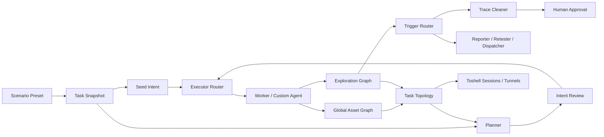

# Ghoul x artex-ld 流程控制能力吸收方案

> 状态：Ready for design review  
> 版本：1.0  
> 日期：2026-11-11  
> 适用仓库：`E:\SecTools\AI-Agent\Ghoul`  
> 参考仓库：`E:\SecTools\AI-Agent\ARTEX-fork\artex-ld`  
> 关联计划：`GHOUL_TOSHELL_MERGE_PLAN.md`  
> 建议分支：`codex/ghoul-ld-workflow`

---

## 1. 目标

吸收 artex-ld 的五项流程控制能力：

1. 多场景。
2. 首个意图与自定义执行器。
3. fact/finding 触发自定义 Agent。
4. 任务级内网拓扑。
5. 意图审核。

目标不是复制 artex-ld 页面或替换 Ghoul 核心，而是把当前以 AI 自由推进为主的流程，升级为**场景可配置、执行者可选择、过程可审核、结果可编排、路径可追踪**的 Ghoul 工作流。

实施完成后，Ghoul 应形成以下闭环：

```text
选择场景
  -> 读取场景预设并生成任务快照
  -> 首个意图由默认 Worker 或指定 Agent 执行
  -> Planner 生成意图
  -> 可选 AI 预审与人工审核
  -> Worker / 自定义 Agent 执行
  -> fact / finding 写回探索图
  -> 定向唤醒报告、复测、清理、场景派发 Agent
  -> 更新资产覆盖图与任务拓扑
  -> 任务拓扑关联 Toshell 会话和隧道
  -> 继续规划或完成目标
```

---

## 2. 参考依据与结论

### 2.1 参考资料

- [Artex 二开系列：思路落地](https://mp.weixin.qq.com/s/GMWAKO14kSoNUtGw36-ywg)，2026-10-27。
- [Artex 二开系列：Artex-ld 使用介绍](https://mp.weixin.qq.com/s/QIwEw-gMxSphD4JrgpoIrA)，2026-11-06。
- artex-ld 本地源码快照：`0.1.4+2 / f3b75d7`。

文章用于理解产品设计，最终实现和字段以源码为准。文章中的 Token 节省数据、场景效果和功能说明均需重新验证，不能直接视为 Ghoul 的收益承诺。

### 2.2 吸收结论

| 能力 | 结论 | 原因 |
|---|---|---|
| 多场景 | 直接吸收主体设计 | 与 Ghoul 现有 `task_categories`、任务模板和 Agent 配置兼容 |
| 首个意图 | 改造后吸收 | 可降低固定首步规划成本，但原设计的无条件绕过审核需要收紧 |
| 触发自定义 Agent | 吸收框架并增加路由治理 | 水位线、合并、显式派发很有价值；全量唤醒会增加 Token |
| 内网拓扑 | 改造后吸收 | 适合作为任务作战视图，不能替代全局资产图 |
| 意图审核 | 重点吸收 | 是高约束任务和 C2 操作的基础治理能力 |

### 2.3 不直接照搬的内容

- 不把 ld 的整个 Planner/Worker 核心覆盖到 Ghoul。
- 不复制 `task_scenarios` 历史设计；继续复用 `task_categories`。
- 不允许所有种子意图无条件跳过意图审核。
- 不恢复“每个 fact/finding 唤醒所有订阅 Agent”的模式。
- 不把完整探索图、完整任务拓扑、完整 Finding 清单写入每轮 Prompt。
- 不自动删除未确认归属的痕迹，不把 `trace_cleaner` 作为无审批自动清理器。
- 不把 Toshell session/tunnel 实现复制到拓扑层；Toshell 仍是唯一 C2 后端。

---

## 3. 设计原则

| 原则 | 要求 |
|---|---|
| 单一主模型 | 场景复用 `task_categories`；Finding 沿用统一主模型；拓扑只保存任务级引用 |
| 最小侵入 | 新增表、工具和策略模块，不整体替换 Ghoul 核心 |
| 向后兼容 | 新功能默认关闭或沿用原行为，老任务保持原流程 |
| 配置快照 | 模板、场景、首意图、审核策略在任务创建时快照，不回溯在跑任务 |
| 审核前置 | 高风险操作在执行前拦截，不采用“先执行再补救” |
| Token 可预算 | 工具面、预审、触发、拓扑摘要和 Agent 调用都有独立预算 |
| 代码裁决 | 审核状态、范围、审批、幂等、触发水位线由代码保证，不只靠提示词 |
| 证据完整 | 场景切换、人工决策、Agent 触发、拓扑变化均保留活动流和证据 |
| 可回滚 | 开关、迁移、恢复、归档和回滚在实现时同步设计 |

---

## 4. 总体架构



职责边界：

- **全局资产图**：保存资产事实和关系。
- **探索图**：保存目标、意图、事实、漏洞和血缘。
- **任务拓扑**：保存本任务的网段、入口、突破、可达和人工标注。
- **场景快照**：决定本任务的规划方式、工具面、审核策略和首步。
- **触发路由器**：决定何时、是否、以何种预算调用哪个 Agent。
- **Toshell**：提供实际 C2 会话和隧道，不成为拓扑数据的第二主系统。

---

## 5. 多场景吸收方案

### 5.1 复用模型

继续使用 Ghoul 的 `task_categories`，扩展为场景预设，不新增 `task_scenarios`。

建议扩展字段：

| 字段 | 作用 |
|---|---|
| `default_planner_template_id` | 场景默认 Planner 模板 |
| `default_worker_template_id` | 场景默认 Worker 模板 |
| `default_review_enabled` | 默认是否开启意图审核 |
| `default_review_auto` | 默认是否允许 AI 自动处置 |
| `default_worker_count` | 场景默认 Worker 并发 |
| `asset_mode` | 资产与任务展示模式 |
| `default_description` | 默认任务说明和场景约束 |
| `seed_first_intent` | 默认是否启用首个意图 |
| `seed_intent_summary` | 默认首步任务说明 |
| `seed_executor` | 默认首步执行器 key |
| `default_tool_policy` | 默认工具面策略 |
| `default_trigger_policy` | 默认 Agent 触发策略 |
| `version` | 场景预设版本，用于快照与兼容 |

任务侧保存 `planner_prompt_override`、`worker_prompt_override`、`review_enabled`、`review_auto`、`asset_mode`、`worker_count` 和场景版本快照。已有字段继续沿用。

### 5.2 模板链

Planner/Worker 模板按以下优先级解析：

```text
任务创建时快照
  > 当前任务显式覆盖
  > 场景默认模板
  > 全局默认模板
  > Ghoul 内置默认
```

要求：

- 创建任务时保存模板正文和场景版本。
- 修改模板只影响之后创建的任务。
- 删除模板不影响历史任务。
- 模板变量使用结构化解析和试渲染，禁止字符串拼接未知字段。
- 运行期变量必须明确区分：目标、范围、资产摘要、数据目录、当前时间、场景 key。
- 缺少运行期值时使用明确空值，不把预览数据当成真实资产数据。
- 模板正文、工具策略、审核策略、触发策略分别管理，避免单个巨型 Prompt。

### 5.3 首批场景

| 场景 | 主要规划方向 | 默认意图审核 | 默认执行方式 | 资产模式 |
|---|---|---|---|---|
| 外网渗透 | 外部攻击面、漏洞验证、立足点 | 关，风险规则仍可送审 | Planner + Worker | `pentest` |
| 内网渗透 | 立足点后的侦察、凭据、横向路径 | 开 | 首意图 + 审核 + Worker | `intranet` |
| 权限提升 | 现有权限下的提权路径与验证 | 开 | 指定执行器 + 审核 | `intranet` |
| 漏洞利用 | 已知漏洞的复现、验证、影响确认 | 开 | 指定执行器 + 审核 | `vulnerability` |
| 漏洞挖掘 | 攻击面发现、假设验证、同类变体 | 关 | Planner + Worker | `vulnerability` |
| 代码审计 | 代码入口、调用链、漏洞线索 | 关 | 首意图 + Planner | `code` |

“外网渗透默认关审”不代表降低 RoE、工具审批和 C2 Danger 操作要求。工具级审批与意图级审核是两层独立控制。

### 5.4 实施内容

- [ ] 扩展场景 CRUD 和模板管理。
- [ ] 新建任务页面增加场景选择和高级配置。
- [ ] 场景选择后带出默认模板、审核、首意图和执行器。
- [ ] 用户可覆盖本次配置，但不修改原场景预设。
- [ ] 任务详情展示场景、模板版本和实际生效策略。
- [ ] 归档包保存场景快照和版本。
- [ ] 自定义场景支持复制、编辑、试渲染、停用和删除保护。

### 5.5 验收

- 未配置场景时，行为与 Ghoul 原流程一致。
- 修改模板后，老任务 Prompt 快照不变。
- 各场景只加载自己的模板和工具策略。
- `asset_mode` 不只作为标签，至少能影响 UI 和任务工具策略；未实现的模式不展示虚假能力。

---

## 6. 首个意图与自定义执行器

### 6.1 目标

把重复、固定、边界明确的首步工作交给专用 Agent，减少无意义的首轮 Planner 调用，并让结果仍回到 Ghoul 探索图主循环。

适用示例：

- 外网资产与业务侦察。
- 代码目录、入口点、鉴权边界梳理。
- 已有漏洞、资产和历史证据整理。
- 立足点后的只读内网信息收集。

不适用示例：

- 任意命令执行。
- 凭据收集、注入、持久化、驱动和 AV-Ops。
- 未审批的内网扩展、隧道创建和危险利用。
- 目标、范围、工具或退出条件不明确的首步。

### 6.2 数据模型

任务增加或复用以下快照字段：

- `seed_first_intent`
- `seed_intent_summary`
- `seed_intent_detail`
- `seed_executor`
- `seed_success_criteria`
- `seed_tool_policy`
- `seed_requires_review`

种子意图节点增加：

- `payload.seed = true`
- `payload.executor`
- `payload.success_criteria`
- `payload.requires_review`
- `payload.scope_snapshot`

### 6.3 执行路径

```text
创建任务
  -> 读取场景或用户指定的 seed_executor
  -> 校验 executor 存在、启用、非内置且预算有效
  -> 创建 seed intent
  -> 只读且低风险：直接进入 open
  -> 有写入/利用/C2/扩 scope 影响：进入 proposed 或工具审批
  -> Engine 按 executor 路由到默认 Worker 或 Custom Agent
  -> Agent 使用自己的提示词、工具、Skill 和预算
  -> record_fact / report_finding 写回探索图
  -> 满足 success_criteria 后结束首步
  -> Planner 读取事实，进入标准循环
```

### 6.4 安全与 Token

- 种子意图不再是无条件审核例外；是否直接 `open` 由 `seed_requires_review` 和风险分类决定。
- 默认只允许只读首步直接进入 `open`。
- 自定义 Agent 只加载自身工具面，不继承全部平台工具。
- 种子 Agent 的循环次数、运行时长、输入 Token 和输出 Token 独立设限。
- 种子执行只保留最终事实、必要证据和失败原因，不把全过程重新注入 Planner。
- 首步失败不自动无限重试；Planner 必须看到失败原因和未完成项。

### 6.5 验收

- 未指定执行器时使用默认 Worker。
- 执行器非法、停用或不存在时创建任务失败并明确报错。
- 种子意图直接进入 `open` 的范围仅限只读、低风险任务。
- 首步产物可由 Planner 读取，后续仍走原探索图机制。
- 同一首步配置下，规划轮数和 Token 不高于原流程基线。

---

## 7. fact/finding 触发自定义 Agent

### 7.1 统一触发框架

保留并扩展 Ghoul 现有 `agent_triggers`，支持：

- `interval`
- `on_finding`
- `on_fact`（本方案新增）
- `on_goal_met`
- `on_task_timeout`
- `on_tool_call`
- `on_task_create`
- 显式 `dispatch_finding_to_agent`
- 显式 `dispatch_fact_to_agent`（本方案新增）

每次运行使用独立 Agent 会话，不把被触发 Agent 的执行结果再次当成普通工具调用无限触发自己。

### 7.2 持久化与幂等

- 使用水位线记录已消费的 finding/fact/tool call/task id。
- 水位线只在成功提交消费记录后推进。
- 启用新触发器时不回放启用前历史记录。
- `finding_agent_invocations` 保存 finding、agent、conversation、幂等键和状态。
- `fact_agent_invocations` 使用同一模式。
- 同 finding + 同 agent + 同用途 + 同证据版本只能产生一个有效派发。
- 服务重启后通过持久化记录对账，禁止重复 Danger 操作。
- 对迟到、重复、证据过期和任务删除的事件做明确终态处理。

### 7.3 路由摘要

触发前先用确定性字段生成路由摘要：

- `vulnclass`
- `severity`
- `confidence` / `evidence_level`
- `asset_id`、资产类型、公司、任务场景
- `finding_id`、`evidence_version`
- `tags`
- 是否立足点、是否已有子任务、是否已有报告、是否已有清理记录
- 当前任务约束和 C2 session 状态

路由匹配先做代码过滤，再决定是否需要 Agent 判断。不要把所有原始 fact/finding 全文注入路由 Prompt。

### 7.4 推荐触发策略

| Agent | 推荐方式 | 条件 | 默认策略 |
|---|---|---|---|
| `reporter` | `on_tool_call(report_finding)` 或显式派发 | 证据可用、报告不存在或过期 | 并行，单漏洞一个报告 |
| `retester` | 人工发起为主 | 用户明确选择复测 | 不默认自动触发 |
| `vuln_dispatcher` | 显式派发优先 | 立足点类 finding、严重度达标、约束允许 | 同任务串行 + by_task 合并 |
| `trace_cleaner` | 显式派发 + 人工确认 | 立足点验证、归属明确、证据已落库 | 默认关闭自动清理 |
| 自定义只读 Agent | 路由后的 on_fact/on_finding | 类型、标签、场景匹配 | 独立预算与最大并发 |
| 自定义写操作 Agent | 显式派发 | 范围与审批通过 | 默认关闭 |

### 7.5 场景切换

外网到内网：

1. 确认立足点证据，不把单次 RCE 回显等同于稳定 foothold。
2. 检查任务约束，禁止内网时直接结束。
3. 检查同资产或同立足点是否已有子任务。
4. 已存在子任务时只同步新的 finding 和相关证据，不重复创建。
5. 新子任务只复制当前 finding 沿 `yields/derived_from` 可达的相关祖先子图。
6. 子任务携带新场景、Planner/Worker 模板、首意图、执行器、审核策略和 Worker 数。
7. 子任务审核只能继承或增强，不能因父任务关闭而自动放宽。

去重不能只依赖提示词。增加 `dispatch_targets` 或等价持久化约束，记录 `source_finding_id`、`target_asset_id`、`child_task_id`、`dispatch_key`。

### 7.6 痕迹清理

- 清理前必须有 `[投放]` 事实或结构化投放台账。
- 核对归属、用途是否完成、证据是否落库。
- 立足点不可用、归属不清、证据不全时只列残留，不删除。
- Webshell、立足点和成果证据默认保留。
- 新账号、配置改动、计划任务、服务状态只生成人工残留清单。
- 每项处理写 `[清理]` 事实和汇总，不修改原 `[投放]` 事实。
- 自动删除动作必须经过 Ghoul 工具审批；Toshell 侧执行仍走 C2 Adapter。

### 7.7 Token 控制

- 不用宽泛 `on_finding` 作为默认全局订阅。
- 优先显式派发，路由匹配后才创建 Agent 会话。
- 同任务突发 finding 使用 `serial + by_task` 合并和去抖。
- 同证据版本不重复运行；证据更新后才允许重新评估。
- 每个 Agent 配置输入、输出、运行时长、最大并发和每日/每任务调用上限。
- 记录“收到事件数、代码过滤数、实际触发数、合并数、跳过数、Token 消耗”。
- 对文章中的触发次数优化数据重新做 Ghoul A/B 测试，不预设收益。

---

## 8. 任务级内网拓扑

### 8.1 定位

任务拓扑是**本任务的作战路径视图**，不是第二套全局资产图。

- 全局资产图回答“有哪些资产”。
- 任务拓扑回答“从哪里进入、突破了什么、下一步可达哪里”。
- Toshell 回答“当前有哪些真实 C2 会话和隧道”。

### 8.2 数据模型

建议新增：

#### `task_topology_nodes`

- `id`
- `task_id`
- `asset_id`（可空）
- `node_key`（任务内稳定 key，例如 IP 或自定义节点 id）
- `ip`
- `display_label`
- `hostname`
- `description`
- `entry_status`：`unknown/candidate/foothold/breached/blocked`
- `group_id`
- `color`
- `position_x/y`
- `source`：`asset/finding/fact/c2/manual`
- `source_ref`
- `c2_session_id`（可空，引用 Ghoul C2 session）
- `metadata_json`
- `created_at`
- `updated_at`
- `updated_by`

#### `task_topology_edges`

- `id`
- `task_id`
- `src_node_id`
- `dst_node_id`
- `kind`：`reachable/breached`
- `evidence_ref`
- `evidence_type`：`finding/fact/c2_tunnel/manual`
- `label`
- `source`
- `created_at`
- `updated_at`
- `updated_by`

#### `task_topology_groups`

- `id`
- `task_id`
- `name`
- `kind`：`c24/custom`
- `cidr`
- `color`
- `position_x/y`
- `metadata_json`

约束：

- 节点必须属于当前任务或经显式引用绑定。
- 边两端必须属于同一任务。
- `breached` 必须有 finding、fact 或 Toshell session 证据；人工边标记 `updated_by=user`。
- 全局资产更新不覆盖人工拓扑布局、备注和入口状态。
- C2 session 失效后保留历史拓扑，但显示离线，不自动删除节点。

### 8.3 功能

- 从任务资产和 finding 一键初始化拓扑。
- C 段 `/24` 一键归组。
- 添加节点、联系、分组、框选建组。
- 自动整理，且不与手动布局互相覆盖。
- 节点维护显示名、主机名、描述、入口状态、分组、颜色、来源和人工备注。
- 实线表示已突破，虚线表示可达。
- JSON 导入导出，包含 schema version、任务 id 校验和冲突处理。
- 节点点击可查看关联资产、Finding、fact、Toshell 会话和操作。
- 支持从 Toshell session/tunnel 事件更新拓扑，但不复制 C2 原始状态。

### 8.4 Planner/Worker 使用方式

提供 `task_topology_overview` 摘要：

- 节点数、网段数、分组数。
- 入口节点、已突破节点、阻塞节点。
- 每个网段的已突破/可达摘要。
- 当前未覆盖的候选方向。
- 关联 finding/session 的引用 id。

完整拓扑通过 `task_topology_detail` 或按节点查询，不默认注入 Prompt。

### 8.5 验收

- 拓扑节点和边严格限定在当前任务。
- C 段归组可重复执行且防重入。
- 手工归组后，自动整理不会意外恢复原分组。
- `breached` 边都有可追踪证据。
- 大型拓扑下 Planner 只读取摘要，Token 不随节点数线性增长。
- Toshell session/tunnel 可关联但不存在第二套 C2 状态模型。

---

## 9. 意图审核

### 9.1 状态机

```text
Planner add_intent
  -> open -> Worker / Custom Executor

Planner add_review_intent
  -> proposed + executor=review + review_status=pending
       -> AI 预审：pass / revise，只写建议
       -> 人工 approve -> open
       -> 人工 reject -> review_status=rejected
       -> Planner update_intent 修订原意图
       -> review_status=pending，重新送审
       -> 可选 review_auto=on 时由服务端 CAS 自动处置
```

Worker 只能领取 `open` 意图。`executor=review` 只是待审占位符，不是执行器；自定义执行器使用 `pending_executor`，批准后转为正式 `executor`。

### 9.2 审核工具

建议吸收并适配：

- `add_review_intent`
- `list_intents`
- `update_intent`
- `cancel_intent`
- `set_intent_status`
- `send_planner_hint`
- `list_task_constraints`

行为约束：

- `add_review_intent` 是送审唯一入口。
- 未开启任务审核时调用送审工具必须明确报错，不静默直投。
- `update_intent` 只修订 `open/rejected` 意图，使用 `expected_version`。
- 被驳回意图必须修订原节点，不允许新建替代节点逃避血缘。
- `cancel_intent` 软删除并保留原因，运行中意图拒绝取消。
- `set_intent_status` 只用于 approve/reject，由 Review 通道持有。
- 批准接口不接受临时更换执行器；执行器在送审或修订时确定。

### 9.3 Review Agent 三种模式

| 模式 | 触发 | 工具 | 输出 | 生效方式 |
|---|---|---|---|---|
| 预审 | 送审即时唤醒 + 有界轮询 | 只读 | `pass/revise + reason` | 只写建议，不批准 |
| 自动处置 | `review_auto=true` 且任务允许 | 只读 | `approve/reject + reason` | 服务端 CAS 执行，未决留人工 |
| 审核对话 | 用户在审核面板发起 | 只读 + 审核写工具 | 讨论、修订、审批动作 | 写操作必须人工确认 |

预审默认只读取：

- 当前意图。
- 任务目标、范围和约束。
- 相关资产摘要。
- 与当前意图直接相关的最近事实。
- 候选执行器和工具策略。

不默认读取完整探索图、完整拓扑和全部 Finding。

### 9.4 并发与一致性

- `content_version` 乐观锁。
- 每任务审核槽位单飞。
- 预审租约与对话租约分离，对话优先。
- 待审期间抑制 Planner 继续批量派单。
- 审核旧版本时，即使模型返回通过也不得覆盖新稿。
- 连续未决必须告警并留人工。
- 服务重启后根据数据库恢复待审项，不重复执行。
- 驳回理由必填；修订次数记录 `revision_count`，可配置告警阈值。

### 9.5 默认策略

| 场景 | review_enabled | review_auto | 说明 |
|---|---|---|---|
| 外网渗透 | 默认关 | 关 | 风险规则和 C2 仍可送审 |
| 内网渗透 | 开 | 关 | 人审为主 |
| 权限提升 | 开 | 关 | 人审为主 |
| 漏洞利用 | 开 | 关 | 人审为主 |
| 漏洞挖掘 | 关 | 关 | 按需开启 |
| 代码审计 | 关 | 关 | 按需开启 |

自动处置只作为后续可选能力，首版不作为默认上线范围。

### 9.6 Token 控制

- 只对 `proposed` 意图调用预审。
- 预审输出短 JSON，限制理由长度。
- 同 `content_version` 不重复预审。
- 未变更、已取消、任务已删除的意图不再调用模型。
- Review Agent 可绑定独立低成本模型。
- 人工审核不调用模型。
- 记录预审 Token、驳回率、修订次数和因审核避免的错误执行数，评估真实收益。

---

## 10. API 与 UI 方案

### 10.1 场景与模板

```text
GET/POST       /api/scenarios
GET/PATCH/DELETE /api/scenarios/{id}
POST           /api/scenarios/{id}/preview
GET/POST       /api/planner-templates
GET/PATCH/DELETE /api/planner-templates/{id}
POST           /api/planner-templates/{id}/preview
GET/POST       /api/worker-templates
GET/PATCH/DELETE /api/worker-templates/{id}
POST           /api/worker-templates/{id}/preview
```

UI：

- 场景管理。
- Planner/Worker 模板管理。
- 新建任务场景选择和高级配置。
- 任务实际生效快照。

### 10.2 审核

```text
GET  /api/tasks/{id}/review/proposed
POST /api/tasks/{id}/review/{intentID}/approve
POST /api/tasks/{id}/review/{intentID}/reject
POST /api/tasks/{id}/review/messages
GET  /api/tasks/{id}/review/messages
```

UI：

- 任务详情常驻“审核”页签。
- 待审数量、预审建议、预选执行器、修订血缘。
- 批准、驳回、修订对话。
- 写动作确认卡，展示工具、参数、风险和过期时间。
- 探索图显示待审和待修订状态。

### 10.3 触发与派发

```text
GET/POST       /api/agents/{key}/triggers
PATCH/DELETE   /api/triggers/{id}
GET            /api/agents/{key}/trigger-runs
GET            /api/findings/{id}/invocations
POST           /api/findings/{id}/dispatch
```

UI：

- Agent 触发条件、合并策略、并发和预算。
- 路由命中、过滤、合并、跳过原因。
- 派发历史和关联会话。
- 同资产子任务去重状态。

### 10.4 拓扑

```text
GET/POST       /api/tasks/{id}/topology/seed
GET            /api/tasks/{id}/topology
POST           /api/tasks/{id}/topology/nodes
PATCH/DELETE   /api/tasks/{id}/topology/nodes/{nodeID}
POST           /api/tasks/{id}/topology/edges
PATCH/DELETE   /api/tasks/{id}/topology/edges/{edgeID}
POST           /api/tasks/{id}/topology/groups
PATCH/DELETE   /api/tasks/{id}/topology/groups/{groupID}
POST           /api/tasks/{id}/topology/notes
POST           /api/tasks/{id}/topology/import
GET            /api/tasks/{id}/topology/export
```

UI：

- 资产覆盖图 / 内网拓扑切换。
- C 段归组、自动整理、手动画边、框选建组。
- 节点详情和关联 Finding/Toshell 会话。
- JSON 导入导出。

---

## 11. Token 与性能预算

### 11.1 预算原则

本方案不承诺 Token 零增长。目标是让 Token 用在高价值审核和证据处理上，避免重复规划、无效触发和完整状态注入。

| 项目 | 预算/约束 |
|---|---|
| 场景 Prompt | 只加载当前场景模板和必要策略，不合并多个场景 |
| 首意图 | 默认最多一次首步执行；独立轮数、时长、输入输出预算 |
| 执行器工具面 | 按自定义 Agent 绑定加载，不继承全量工具 |
| Review 预审 | 每个 `content_version` 最多一次，短 JSON |
| Finding 路由 | 先代码过滤，再调用 Agent；完整原文不进入路由摘要 |
| Agent 触发 | 每任务、每 Agent 调用次数与并发上限，支持合并去抖 |
| 拓扑 | Planner 只读摘要，节点详情按需查询 |
| 子任务交接 | 只复制当前 Finding 的相关祖先子图 |
| 清理 | 不把全部历史输出重新注入，只读投放和清理台账 |

### 11.2 必测指标

- 场景模板和工具 Schema 的固定 Token。
- 首意图节省的 Planner 调用和总 Token。
- 每个 finding 的代码过滤率、实际触发率、合并率。
- Review 预审 Token 与避免的无效 Worker 执行数。
- 拓扑节点数与 Planner 摘要 Token 的关系。
- 场景切换前后总 Token、墙钟、发现数、误报数。

### 11.3 A/B 基线

- 原 Ghoul 无场景流程。
- 只开启场景和首意图。
- 再加入定向触发。
- 再加入意图审核。
- 最后加入拓扑摘要。

每组使用同一授权靶场、相同模型、相同目标和相同预算，至少运行 3 次，记录中位数，不只用单次最好结果。

---

## 12. 实施阶段

### WP-LD-00：基线与兼容设计

预计：3-5 天。

- [ ] 冻结 Ghoul 原任务生命周期和 Token 基线。
- [ ] 对照 ld 字段整理映射表。
- [ ] 确认 `task_categories` 扩展与数据库迁移方案。
- [ ] 明确新功能默认开关。
- [ ] 建立测试靶场和评价指标。

退出条件：迁移、回滚、测试和 Token 基线可执行。

### WP-LD-01：多场景与首意图

预计：2-3 周。

- [ ] 场景预设 CRUD。
- [ ] Planner/Worker 模板链和任务快照。
- [ ] 新建任务场景 UI。
- [ ] `executor_key` 和自定义执行器路由。
- [ ] 种子意图、风险分类和成功条件。
- [ ] 首批场景 seed 与兼容测试。

退出条件：老任务不变；新场景可创建；首意图可执行并回写探索图；高风险首步不会绕过审核。

### WP-LD-02：意图审核

预计：2-3 周。

- [ ] `proposed` 状态和待审查询。
- [ ] 审核工具集。
- [ ] Review Agent 预审。
- [ ] 人工批准、驳回、修订。
- [ ] `content_version` CAS 和审核槽位。
- [ ] 审核面板与探索图状态。
- [ ] 自动处置仅做可选实验开关，不默认启用。

退出条件：Worker 只领取 open；驳回修订闭环可用；并发和重启测试通过。

### WP-LD-03：触发路由与场景派发

预计：2-3 周。

- [ ] 触发水位线和幂等记录。
- [ ] fact/finding 路由摘要。
- [ ] 合并、去抖、并发和预算。
- [ ] 显式 `dispatch_finding_to_agent`。
- [ ] 子任务相关血缘复制。
- [ ] `dispatch_targets` 持久化去重。
- [ ] 报告、复测、派发、清理策略接入。

退出条件：无历史重放、无同 finding 重复派发、无无关 Agent 全量唤醒、场景切换可追踪。

### WP-LD-04：任务拓扑

预计：2-3 周。

- [ ] 拓扑表和 API。
- [ ] 资产/finding/fact 初始化。
- [ ] C 段归组和手动编辑。
- [ ] 导入导出。
- [ ] 拓扑摘要工具。
- [ ] 与 Toshell session/tunnel 引用联动。

退出条件：拓扑与全局资产一致关联，人工编辑不被覆盖，Planner Token 不随节点数线性增长。

### WP-LD-05：联调、评估与发布

预计：1-2 周。

- [ ] 五能力联合流程测试。
- [ ] Token 与性能 A/B 测试。
- [ ] 安全评审。
- [ ] 归档、恢复、迁移和回滚测试。
- [ ] 文档、发布说明和运维手册。

退出条件：验收指标通过，无高危问题，默认关闭时可完全回到原行为。

总估算：单人约 **10-14 周**。可与 Toshell 可靠性、证据工作并行，但数据库和 Planner/Engine 相关改动必须串行集成，避免同时改同一状态机。

---

## 13. 测试计划

### 13.1 单元测试

- [ ] 场景默认值、模板优先级、快照不变性。
- [ ] 首意图执行器校验和风险分类。
- [ ] `proposed/open/rejected` 状态转换。
- [ ] `pending_executor` 批准转正。
- [ ] `content_version` 冲突。
- [ ] 水位线、幂等键、合并去抖。
- [ ] 路由摘要和代码过滤。
- [ ] 拓扑任务隔离、C 段归组、边证据约束。

### 13.2 数据库集成测试

- [ ] 迁移可重复执行。
- [ ] 场景 seed 不覆盖用户修改。
- [ ] 任务创建快照。
- [ ] 审核并发和重启恢复。
- [ ] 触发重启不重复。
- [ ] 子任务派发去重。
- [ ] 拓扑手工编辑和自动整理并发。
- [ ] 归档与恢复保留场景、审核、触发和拓扑。

### 13.3 Agent 行为测试

- [ ] 首意图只加载指定 Agent 的工具和预算。
- [ ] Review 预审只读且短输出。
- [ ] 无关 finding 不触发 Agent。
- [ ] 同 finding 证据更新才可重新评估。
- [ ] 非立足点 finding 不创建内网子任务。
- [ ] 禁止内网约束不会被场景切换绕过。
- [ ] 清理 Agent 不删除未登记、未确认归属的对象。

### 13.4 UI/E2E 测试

- [ ] 新建任务场景配置完整生效。
- [ ] 首意图执行器选择与运行。
- [ ] 审核批准、驳回、修订和确认卡。
- [ ] 拓扑 C 段归组、手动画边、备注和导入导出。
- [ ] Toshell 会话在拓扑中显示和跳转。
- [ ] 移动端和桌面端无重叠、无不可达操作。

### 13.5 Token 与安全测试

- [ ] 未开启场景能力时无新增固定 Schema Token。
- [ ] 完整拓扑不进入 Planner Prompt。
- [ ] 无关 finding 不产生模型调用。
- [ ] 同版本意图不重复预审。
- [ ] 未授权执行器不可调用。
- [ ] 首意图不可绕过 RoE 和工具审批。
- [ ] 清理操作不可未经审批执行。

---

## 14. 验收标准

1. 未启用新功能时，Ghoul 原任务流程和 Token 基线不回归。
2. 场景只影响新任务，历史任务的 Prompt 和策略快照不被修改。
3. 首意图可由自定义 Agent 执行，并正常写回探索图。
4. 高风险首意图、C2 和扩 scope 操作不能绕过审核。
5. Worker 只能领取 `open` 意图。
6. 意图审核支持预审、批准、驳回、修订和 CAS，重启后不重复执行。
7. fact/finding 触发有水位线、幂等、合并、路由和预算，不无差别唤醒全部 Agent。
8. 场景切换只携带相关 Finding 血缘，同立足点不重复创建子任务。
9. 拓扑支持 C 段归组、手动编辑、证据关联和导入导出。
10. 拓扑可以引用 Toshell session/tunnel，但不形成第二套 C2 状态。
11. Planner 只读取场景和拓扑摘要，Token 不随资产/节点数量无界增长。
12. 清理 Agent 不删除未登记、未确认归属或证据未落库的对象。
13. 五能力联合流程在授权靶场完成端到端验证。
14. 所有新能力均有开关、审计、迁移和回滚路径。

---

## 15. 风险与对策

| 风险 | 影响 | 对策 |
|---|---|---|
| 同时改场景、审核、触发和 Engine 状态机 | 回归范围大 | 分 WP 串行合并，先场景/首意图，再审核，再触发，再拓扑 |
| 多套场景模型并存 | 数据迁移和 UI 混乱 | 只复用 `task_categories` 和任务快照 |
| 种子意图成为审核后门 | 高风险首步直接执行 | 风险分类，只有只读低风险可直接 open |
| 自定义执行器绕过权限 | 工具越权 | executor 白名单、工具绑定、RoE、预算、审计 |
| 触发器引发 Token 风暴 | 多 Agent 重复运行 | 代码路由、显式派发、合并去抖、调用预算 |
| 历史 finding 重放 | 重复报告、派发、清理 | 水位线从启用时开始，幂等记录 |
| 同资产重复派生任务 | 重复测试和 Token 浪费 | `dispatch_targets` 持久化去重，不只靠提示词 |
| 拓扑成为第二资产图 | 数据不一致 | 只保存任务级节点引用和作战关系 |
| 全量拓扑注入 Prompt | Token 随节点数增长 | 摘要工具 + 节点按需查询 |
| 自动审核误批准 | 错误动作被执行 | 首版人工为主，自动处置默认关闭，CAS 执行 |
| 清理误删真实数据 | 不可逆损失 | 归属登记、证据落库、人工审批、残留清单 |
| 与 Toshell 计划冲突 | C2 状态重复 | 拓扑只引用 `c2_sessions`，Toshell 为唯一 C2 后端 |

---

## 16. 迁移与回滚

- 新表和字段使用幂等迁移，执行前备份 PostgreSQL。
- 场景 seed 只在对应场景不存在时创建，不覆盖用户修改。
- 老任务缺少场景快照时使用 Ghoul 内置默认，不回填为高风险场景。
- 老意图保持原状态，不自动改为 `proposed`。
- 老 finding 不自动进入新触发器水位线之前的消费队列。
- 拓扑初始化只能由用户或任务策略显式触发。
- 归档包含场景快照、审核状态、触发引用、拓扑和 schema version。
- 回滚只关闭功能开关，不删除历史审核、触发、拓扑和审计数据。
- 新功能回滚后，已处于 `open` 的合法意图可按原流程继续；待审意图保持待审，不自动放行。

---

## 17. 决策记录

| 编号 | 决策 | 状态 |
|---|---|---|
| LD-001 | 五项能力均吸收，但不复制 ld 核心 | Accepted |
| LD-002 | 场景复用 `task_categories`，不新增场景表 | Accepted |
| LD-003 | 场景和模板在任务创建时快照 | Accepted |
| LD-004 | 首个意图保留自定义执行器能力，但按风险决定是否直接 open | Accepted |
| LD-005 | finding 路由优先代码过滤和显式派发 | Accepted |
| LD-006 | 子任务只复制相关 Finding 血缘 | Accepted |
| LD-007 | 任务拓扑与全局资产图分离 | Accepted |
| LD-008 | Toshell 会话和隧道只做引用 | Accepted |
| LD-009 | Worker 只领取 open 意图 | Accepted |
| LD-010 | 自动处置默认关闭，人工审核优先 | Accepted |
| LD-011 | 清理操作默认关闭自动删除 | Accepted |
| LD-012 | 所有摘要和触发均有 Token 预算与 A/B 评估 | Accepted |

---

## 18. 进度跟踪

### 当前状态

- [x] 阅读两篇 artex-ld 公众号文章。
- [x] 回到 artex-ld 源码核对五项能力。
- [x] 确定五项能力值得吸收。
- [x] 明确不直接照搬的边界。
- [ ] WP-LD-00 开始。

### WP-LD-00

- [ ] 原流程基线。
- [ ] Token 基线。
- [ ] 字段映射和迁移设计。
- [ ] 默认开关。
- [ ] 测试靶场。

### WP-LD-01

- [ ] 多场景。
- [ ] 模板链。
- [ ] 任务快照。
- [ ] 首意图。
- [ ] 自定义执行器。

### WP-LD-02

- [ ] proposed 状态。
- [ ] 审核工具。
- [ ] Review 预审。
- [ ] 人工审核闭环。
- [ ] CAS 与重启恢复。

### WP-LD-03

- [ ] 水位线。
- [ ] 路由摘要。
- [ ] 显式派发。
- [ ] 合并与预算。
- [ ] 场景派发去重。

### WP-LD-04

- [ ] 拓扑表与 API。
- [ ] C 段归组。
- [ ] 手动编辑。
- [ ] 拓扑摘要。
- [ ] Toshell 引用。

### WP-LD-05

- [ ] 联合流程。
- [ ] Token A/B。
- [ ] 安全评审。
- [ ] 归档与回滚。
- [ ] 发布文档。

---

## 19. 与 Toshell 合并计划的衔接

- 本方案的 **WP-LD-01/02** 对应 Toshell 计划的可靠性基础和审批治理，可共用任务状态、CAS 和审核基础设施。
- **WP-LD-03** 先于 Toshell C2 场景切换上线，确保立足点、证据、任务约束和子任务去重可靠。
- **WP-LD-04** 与 Toshell 的 C2 只读接入并行时，先完成 `c2_sessions` 外部 ID 映射，再建立拓扑引用。
- Toshell 的 C2 Danger 操作仍遵守 `GHOUL_TOSHELL_MERGE_PLAN.md` 的一次性审批，不因场景为外网渗透或种子意图而放宽。
- 拓扑只记录 C2 引用，listener、session、tunnel 的真实状态继续由 Toshell 管理。
- `trace_cleaner` 的删除动作必须通过 Ghoul C2 Adapter 和人工审批，不能直接连接 Toshell。

---

## 20. 文档维护

- 每个 WP 完成后更新勾选状态、实际差异和验收结果。
- 场景、首意图、触发器、审核工具和拓扑 API 变更必须同步本文。
- Token 预算和 A/B 结果写入实施记录，不把预估值当成结论。
- artex-ld 升级后重新核对代码和本方案映射，不仅依据公众号文章。
- 与 Toshell 架构或 C2 权限冲突时，以统一任务状态、统一证据模型和 Ghoul 审批边界为准。
