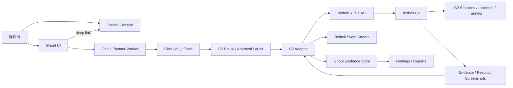

# Ghoul x Toshell 合并执行计划

> 状态：Draft for execution  
> 版本：1.1  
> 日期：2026-11-07  
> 适用仓库：`E:\SecTools\AI-Agent\Ghoul`  
> 建议分支：`codex/ghoul-toshell-integration`  
> 目标：将 Toshell 作为 Ghoul 的唯一 C2 后端，不合并 Pojun/artex-ymh 的 C2 代码。

---

## 1. 目标

本计划用于推进 Ghoul 后续多源能力吸收与 Toshell C2 集成，最终形成以下能力：

- Ghoul 负责任务、目标、资产图、探索图、Finding、证据、报告和审批。
- Toshell 负责 C2 会话、监听器、植入端、任务、隧道、插件和载荷构建。
- Ghoul Agent 不直接持有 Toshell API Key。
- Ghoul 通过受控 C2 Adapter 调用 Toshell REST API。
- Toshell MCP 仅作为可选的外部运维接口，不进入 Agent 主路径。
- Pojun、artex-ymh 的 C2 代码不进入合并范围。
- C2 工具面必须按角色和任务阶段裁剪，不能把 Toshell 全部工具暴露给 Agent。
- 日常 C2 管理在 Ghoul UI 完成，高级和高风险操作保留在 Toshell 控制台。

---

## 2. 范围

### 2.1 纳入范围

- ARTEX-main：可靠性、Planner handoff、完成审计、Worker 池、Repeater。
- Pojun：漏洞情报、证据硬闸、意图预算、重复调用拦截、DOCX 报告、工具/Skill。
- artex-ymh：LLM 墙钟、deadline 冻结感知、chains、RoE、伪装门控、蜜罐识别、doctor。
- artex-ld：意图审核、场景模板、自定义执行器、Finding 派发、证据版本。
- RuoJi6/ARTEX：Basic Auth、日历任务、代理池、Egress Probe、Finding 归并。
- Toshell：唯一 C2 后端。

### 2.2 不纳入范围

- 不合并 Pojun 的 `listener`、`hostd`、`hosttools` 等 C2 代码。
- 不合并 artex-ymh 的 `session`、`tunnel`、`stage`、`honeydetect` 中与 C2 重叠的部分。
- 不把 Toshell 的 C2 内核直接 vendoring 到 Ghoul。
- 不把 Toshell Web 控制台嵌入 Ghoul 页面。
- 不启用 Toshell 自带 AI/Copilot 作为自动编排器。
- 不允许 Agent 直接调用 Toshell MCP 的 confirm/danger 工具。
- 不把 Toshell API Key 暴露给浏览器、Agent 或任务工作目录。
- 不把 Toshell 的 38 个工具全量注入 Planner/Worker 上下文。
- 不使用 iframe 嵌入 Toshell Web 控制台。
- 第一版不承诺在 Ghoul UI 内完成 Toshell 的全部高级管理功能。

---

## 3. 已确定架构决策

| 决策 | 结论 | 原因 |
|---|---|---|
| Toshell 部署方式 | 独立 sidecar 容器或独立二进制 | 避免两套 Go 模块、数据库、Web 控制台和构建链耦合 |
| Ghoul 调用方式 | Ghoul C2 Adapter 调用 Toshell REST | Toshell MCP 默认审批门会拒绝 confirm/danger；REST 更适合由 Ghoul 统一审批和审计 |
| Agent 工具面 | Ghoul 暴露 `c2_*` 工具 | 统一命名、策略、限流、审计和证据映射 |
| Toshell MCP | 关闭，或只读模式 | 降低攻击面；Toshell API Key 等价 root 凭据 |
| Toshell AI | 关闭 | 避免 Ghoul Planner 与 Toshell Agent 双编排 |
| C2 会话绑定 | 默认人工绑定，允许策略自动绑定 | 防止跨任务、跨资产误用 C2 会话 |
| Danger 工具 | 默认关闭，显式审批 | 命令执行、凭据、插件、文件内存执行不可逆风险高 |
| 证据归属 | Toshell 为原始源，Ghoul 为证据索引和报告源 | 防止 Ghoul 复制全部 C2 数据 |
| 数据库 | Ghoul PostgreSQL，Toshell SQLite 或 PostgreSQL | 保持两套系统独立，禁止跨库写 |
| 版本锁定 | 锁 Toshell commit，不只看版本号 | Toshell MCP 内部版本字符串存在 1.4.2/1.4.3 漂移 |
| C2 工具面 | 仅暴露 6-8 个 Ghoul 原生 `c2_*` 工具 | 降低固定 schema token 开销和工具选择错误 |
| 工具加载方式 | 按角色、任务阶段和 skill 延迟加载 | 避免所有 Agent 每轮携带全部 C2 工具 |
| C2 输出进入上下文 | 摘要 + handle，按需 `result_read` | 防止长命令、文件和凭据输出灌爆上下文 |
| Ghoul UI 范围 | 常用 C2 管理 + 审批 + 证据 | 满足日常任务闭环，不重做 Toshell 控制台 |
| Toshell 高级操作 | 独立控制台，新窗口深链接 | 避免 iframe、SSO、CSP 和高风险 UI 耦合 |
| 人工 C2 操作 | 记录为 `c2_operations`，`actor=user` | 人工操作也必须可审计，不能绕过策略 |

---

## 4. 系统边界

| 数据/能力 | 主系统 | Ghoul 中的表示 |
|---|---|---|
| 任务、目标、任务范围 | Ghoul | 原生表 |
| 资产、公司、探索图 | Ghoul | 原生表 |
| Finding、报告、复测 | Ghoul | 原生表 |
| 审批、拦截、审计 | Ghoul | 原生表 + C2 审批扩展 |
| C2 会话 | Toshell | `c2_sessions` 引用 |
| C2 监听器、植入端 | Toshell | 只读状态引用 |
| C2 任务与原始输出 | Toshell | `c2_operations` 引用 |
| C2 隧道、插件 | Toshell | `c2_operations` 或只读引用 |
| C2 截图、文件、凭据 | Toshell | Ghoul 证据元数据和物化副本 |
| 证据到 Finding 的绑定 | Ghoul | `c2_evidence` + Finding 关联 |
| 日常 C2 会话、审批、常用操作 | Ghoul UI | 原生 C2 管理页面 |
| 载荷构建、监听器高级配置、插件、AV-Ops、驱动、注入 | Toshell 控制台 | 通过深链接进入，不嵌入 |

原则：Toshell 是 C2 真相源，Ghoul 是任务与证据真相源。Ghoul 不复制 Toshell 的全部内部状态。

---

## 5. 目标架构



部署网络建议：

| 网络 | 成员 | 暴露方式 |
|---|---|---|
| `ghoul_control` | Ghoul、PostgreSQL | 仅内网 |
| `c2_control` | Ghoul C2 Adapter、Toshell API | 仅内网，Ghoul 可访问 Toshell |
| `c2_listener` | Toshell listener 端口 | 按演练需要公开 |
| `operator` | Toshell Web 控制台 | 仅运维网或 VPN |

---

## 6. 源快照

以下快照用于本轮合并起点，后续升级前必须重新记录 commit。

| 项目 | 版本/提交 | 本地路径 |
|---|---|---|
| Ghoul | `v0.3.15-8-ga9d11cb` | `E:\SecTools\AI-Agent\Ghoul` |
| ARTEX-main | `v0.4.5 / cf084b8` | `E:\SecTools\AI-Agent\ARTEX-fork\ARTEX-main` |
| Pojun | `v0.4.62+1 / 9a1f67a` | `E:\SecTools\AI-Agent\ARTEX-fork\Pojun` |
| artex-ymh | `48adc7f` | `E:\SecTools\AI-Agent\ARTEX-fork\artex-ymh` |
| artex-ld | `0.1.4+2 / f3b75d7` | `E:\SecTools\AI-Agent\ARTEX-fork\artex-ld` |
| RuoJi6/ARTEX | `v0.3.27 / 459a484` | `E:\SecTools\AI-Agent\ARTEX-fork\ARTEX` |
| Toshell | `v1.4.3 / 8bf4643` | `E:\SecTools\AI-Agent\ARTEX-fork\Toshell` |

许可证：

- Ghoul 及 ARTEX 系列：AGPL-3.0。
- Toshell：MIT。
- 本计划不复制 Toshell 源码。若后续需要 vendoring 或修改 Toshell，必须保留 MIT notice 并记录变更。

---

## 7. 工作包

| 编号 | 工作包 | 依赖 | 产物 |
|---|---|---|---|
| WP-00 | 基线冻结与契约测试 | 无 | Toshell 契约快照、版本检查、分支 |
| WP-01 | 可靠性基础合并 | WP-00 | Planner handoff、完成审计、预算、超时、恢复 |
| WP-02 | 证据与漏洞闭环 | WP-01 | Finding case、证据硬闸、报告、复测 |
| WP-03 | C2 只读适配器与 Token 基线 | WP-00、WP-01 | session 同步、事件、资产绑定、只读 UI、工具面预算 |
| WP-04 | C2 审批式操作与人工管理 | WP-03、WP-02 | policy、approval、operation、evidence、审批中心 |
| WP-05 | 高级 C2、半自主与 UI 边界 | WP-04 | c2_recon、隧道、C2 skill、常用管理 UI、深链接 |
| WP-06 | Token/UI 治理、加固与发布 | WP-05 | token 回归、UI 范围评审、安全评审、部署文档、Release |

---

## 8. 阶段计划

### Phase 0：基线冻结与契约

预计：3-5 天。

- [x] 从 Ghoul `main` 创建 `codex/ghoul-toshell-integration`。
- [x] 记录 Toshell commit `8bf4643` 和配置模板。
- [x] 保存 Toshell `/api/v1/health`、`/api/v1/mcp/tools`、`/api/v1/sessions` 响应快照。
- [x] 编写 Toshell 契约测试，校验关键字段和工具等级。
- [x] 增加 `c2.enabled=false`、`c2.provider=toshell` 配置开关。
- [x] 编写 `integrations/toshell/README.md` 和部署示例。
- [x] 确认 Ghoul 当前测试基线（记录既有 PostgreSQL 环境与 Windows 路径断言问题）。
- [x] 测量 Toshell 全量 38 个工具 schema 的 token 基线。
- [x] 确定第一版 C2 工具面为 6-8 个 Ghoul 原生 `c2_*` 工具。
- [x] 确定 UI 边界：Ghoul 原生管理常用操作，Toshell 控制台保留高级操作。

退出条件：

- Ghoul 现有构建和测试通过。
- Toshell sidecar 可启动并健康检查。
- 只读 REST 调用成功。
- 契约测试可重复执行。
- 已记录全量工具和裁剪工具面的 token 基线。
- UI 边界和深链接策略已确认。

### Phase 1：可靠性基础

预计：2 周。

- [x] 吸收 ARTEX-main 的 Planner handoff、完成审计、Worker 池、Repeater。
- [x] 吸收 Pojun 的意图预算、重复调用拦截、idle-stop。
- [x] 吸收 artex-ymh 的 LLM 调用墙钟、deadline 冻结感知；会话探活随 Toshell 只读接入在 Phase 3 落地。
- [x] 吸收 artex-ld 的审核 CAS、版本化、执行模式。
- [x] 吸收 RuoJi6 的 Basic Auth、代理池、Egress Probe；日历任务复用现有 trigger scheduler。
- [x] 统一任务预算层级：任务预算 -> 意图预算 -> 单次 LLM 调用预算。
- [x] 增加 C2 工具结果 token 预算配置。
- [x] 保证 C2 工具描述和系统提示前缀稳定，兼容 provider prompt caching。
- [x] 禁止把完整 C2 session 列表每轮写入 system prompt。

退出条件：

- 长任务重启、暂停、恢复、超时、重复调用测试通过。
- 原有任务状态机无回归。
- 关键路径具备可观测日志和审计。
- C2 工具 schema 和动态状态注入有明确预算。

### Phase 2：证据与漏洞闭环

预计：2-3 周。

- [x] 吸收 Pojun 的 vulnintel、NVD/KEV/GHSA/PoC、nuclei 模板同步。
- [x] 吸收 Pojun 的证据硬闸、机械验证凭据、DOCX 报告。
- [x] 吸收 ARTEX-main 的 Finding case、完成证据审核。
- [x] 吸收 artex-ymh 的 chains verifier、反证清单、pivot hints。
- [x] 吸收 artex-ld 的 Finding 显式派发、证据版本。
- [x] 吸收 RuoJi6 的 Finding 归并、人工整理。
- [x] 统一 Finding/Evidence 主模型，禁止保留三套并行模型。

退出条件：

- Finding 从发现、验证、复测、归并到报告全链路可追踪。
- 证据版本冲突可检测。
- DOCX 报告可生成并包含截图和复测记录。

### Phase 3：C2 只读接入

预计：2 周。

- [x] 新增 `integrations/toshell/client` REST 客户端。
- [x] 新增 `c2_instances`、`c2_sessions`、`c2_session_bindings`、`c2_event_cursor`。
- [x] 同步 Toshell `/sessions`、`/tasks`、`/listeners`、`/channels/health`。
- [x] 接入 Toshell `/api/v1/ws/events`，处理 `session_online`、`session_offline`、`task_completed`、`task_failed`。
- [x] 支持事件断点恢复和全量对账。
- [x] C2 session 与 Ghoul asset/task 绑定。
- [x] 新增 Ghoul C2 只读页面：实例健康、会话、监听器、绑定关系、事件。
- [x] Planner 默认只加载 3 个只读 C2 工具。
- [x] Worker 按任务阶段加载裁剪后的 C2 工具，不加载全部 38 个工具。
- [x] 使用 deferred/skill-gated 方式加载 C2 工具。
- [x] 记录只读接入后的 token 基线。

退出条件：

- 可查看 C2 会话、任务、监听器和事件。
- 未绑定 session 不能执行任何写操作。
- Toshell 或 Ghoul 重启后可恢复同步。
- C2 固定工具 schema 开销不超过预设预算。
- 只读页面可完成日常会话查看和绑定。

### Phase 4：C2 审批式操作

预计：3 周。

- [ ] 新增 `c2_operations`、`c2_operation_approvals`、`c2_evidence`。
- [ ] 新增 C2 policy engine：任务范围、RoE、session 绑定、工具等级、限流。
- [ ] 新增一次性审批令牌：TTL、参数哈希、任务快照、session 快照。
- [ ] 接入 Confirm 工具：文件、进程、截图、隧道、系统信息。
- [ ] 实现 C2 输出脱敏、注入防护、证据物化。
- [ ] 实现操作幂等键，危险操作禁止自动重试。
- [ ] 新增 C2 审批中心和操作详情页。
- [ ] 新增人工操作入口：会话、文件、进程、截图、隧道、命令执行。
- [ ] 人工操作记录为 `c2_operations`，标记 `actor=user`。
- [ ] 审批中心展示命令、目标、范围、影响、风险、过期时间和参数哈希。
- [ ] 不在 Ghoul UI 中嵌入 Toshell 页面，使用新窗口深链接。

退出条件：

- 所有 Confirm 操作必须绑定任务和 session。
- 所有操作可审计、可回放、可关联证据。
- Danger 工具仍默认关闭。
- 操作员可以在 Ghoul UI 完成常用 C2 管理和审批。
- 人工操作与 Agent 操作使用同一套审计和证据模型。

### Phase 5：高级 C2 与半自主

预计：2-3 周。

- [ ] 新增 `c2_recon` 只读命令白名单。
- [ ] 新增 `c2_exec` 任意命令执行，固定走 Danger 审批。
- [ ] 接入隧道和 SOCKS5，任务级隔离。
- [ ] 新增 C2 skill 和 Worker 使用纪律。
- [ ] C2 证据绑定 Finding，支持报告引用。
- [ ] 可选开放部分 Danger 工具，按实例和任务单独授权。
- [ ] 不开放 `exec_module`、BYOVD、EDR、PPL、持久化、注入、AV-Ops L1+ 给 Agent。
- [ ] 增加常用管理 UI：会话操作、任务结果、文件、进程、截图、隧道。
- [ ] 增加 Toshell 高级控制台深链接，保留载荷构建、监听器高级配置、插件、AV-Ops、驱动和注入。
- [ ] 执行 C2 接入前后 token、轮数、发现数、误报数 A/B 对比。

退出条件：

- 授权靶场完成上线、侦察、立足点、内网访问和证据回传。
- 无跨任务 session 复用。
- 无未审批 Danger 操作。
- C2 集成后 token 增量在预算内，且没有因工具面膨胀导致规划质量下降。
- 常用操作可在 Ghoul UI 完成，高级操作有明确深链接。

### Phase 6：加固与发布

预计：1-2 周。

- [ ] 网络分区、TLS、密钥管理、最小权限。
- [ ] 双人审批可选开关。
- [ ] 故障注入：Toshell 重启、Ghoul 重启、WS 断线、任务超时。
- [ ] 负载测试和长任务测试。
- [ ] Token 回归测试：工具 schema、输出裁剪、handle 回读、deferred 加载。
- [ ] UI 范围评审：确认第一版不追求 Toshell 全量管理。
- [ ] 安全评审和渗透式自测。
- [ ] 文档、迁移、回滚、发布说明。
- [ ] 更新 CHANGELOG 和 README。

退出条件：

- 安全评审通过。
- 发布包和容器可部署。
- 回滚路径明确。
- 现有 Ghoul 功能无回归。
- Token 预算和 UI 管理边界通过验收。

---

## 9. Ghoul 侧模块设计

建议目录：

```text
integrations/toshell/
  client/
    client.go
    auth.go
    retry.go
    circuit_breaker.go
  models/
    session.go
    task.go
    listener.go
    operation.go
    evidence.go
  events/
    consumer.go
    cursor.go
    reconcile.go
  policy/
    levels.go
    scope.go
    approval.go
    rate_limit.go
  evidence/
    materialize.go
    redact.go
    hash.go
  tools/
    session_list.go
    session_context.go
    recon.go
    exec.go
    file.go
    process.go
    screenshot.go
    tunnel.go
  doctor/
    doctor.go
```

新增 Ghoul API 建议：

```text
GET    /api/c2/health
GET    /api/c2/instances
GET    /api/c2/sessions
POST   /api/c2/sessions/{id}/bind
DELETE /api/c2/sessions/{id}/bind
GET    /api/c2/operations
POST   /api/c2/operations
GET    /api/c2/operations/{id}
POST   /api/c2/operations/{id}/approve
POST   /api/c2/operations/{id}/reject
GET    /api/c2/evidence
GET    /api/c2/events
```

所有 API 必须走 Ghoul JWT 鉴权，并复用现有审计和权限边界。

---

## 10. 数据库设计

### 10.1 c2_instances

- `id`
- `name`
- `base_url`
- `mcp_url`
- `version`
- `commit`
- `api_key_ref`
- `enabled`
- `status`
- `last_health_at`
- `created_at`
- `updated_at`

### 10.2 c2_sessions

- `id`
- `instance_id`
- `external_session_id`
- `hostname`
- `username`
- `os`
- `arch`
- `remote_addr`
- `listener_id`
- `status`
- `capabilities_json`
- `last_seen_at`
- `raw_hash`

### 10.3 c2_session_bindings

- `id`
- `c2_session_id`
- `task_id`
- `asset_id`
- `company_id`
- `binding_reason`
- `bound_by`
- `bound_at`
- `expires_at`
- `active`

### 10.4 c2_operations

- `id`
- `instance_id`
- `c2_session_id`
- `task_id`
- `intent_id`
- `tool`
- `level`
- `args_hash`
- `args_redacted`
- `external_task_id`
- `idempotency_key`
- `status`
- `exit_code`
- `output_handle`
- `output_sha256`
- `started_at`
- `ended_at`
- `error`

### 10.5 c2_operation_approvals

- `id`
- `operation_id`
- `approval_token_hash`
- `approved_by`
- `approved_at`
- `expires_at`
- `used_at`
- `scope_snapshot`
- `args_hash`
- `decision`
- `reason`

### 10.6 c2_evidence

- `id`
- `operation_id`
- `finding_id`
- `evidence_type`
- `storage_ref`
- `sha256`
- `size`
- `redacted`
- `captured_at`
- `expires_at`
- `metadata_json`

### 10.7 c2_event_cursor

- `instance_id`
- `last_event_id`
- `last_event_at`
- `last_resync_at`
- `status`

---

## 11. C2 工具权限矩阵

| 等级 | 工具 | 默认策略 |
|---|---|---|
| Read | `session_list`、`session_context`、`task_result`、`task_wait`、`tunnel_list`、`plugin_list`、`tool_list`、`intel_query`、`result_read` | 绑定后自动允许 |
| Confirm | `file_list`、`process_list`、`screenshot`、`tunnel_start`、`tunnel_stop`、`user_info`、`system_info`、`check_av`、`net_info`、`net_connections`、`env_vars`、`scheduled_tasks` | 绑定 + 审批，可按策略放宽 |
| Danger | `exec`、`run_command`、`task_submit`、`process_kill`、`credentials`、`fileless_exec`、`plugin_load`、`plugin_upload`、`remote_download`、`delegate`、`session_kill` | 默认关闭，显式开启 + 人工审批 |
| Operator-only | `exec_module`、BYOVD、EDR blind/kill、PPL kill、驱动加载、持久化、UAC 提权、进程注入、BOF、AV-Ops L1+ | 不暴露给 Agent |

补充：

- `c2_recon` 仅允许只读命令白名单。
- `c2_exec` 固定为 Danger。
- `remote_download` 必须同时满足 Toshell allowlist 和 Ghoul egress policy。
- 所有 C2 输出进入 LLM 前必须标记为不可信数据。

---

## 12. Token 消耗控制

C2 执行本身不消耗模型 token。真正会增加的消耗来自工具 Schema、C2 输出、规划轮次和动态状态注入。

### 12.1 主要风险

| 消耗来源 | 风险 | 控制方式 |
|---|---|---|
| 工具 Schema 固定开销 | Toshell 全量工具约 38 个，工具描述较长，全量暴露会在每轮请求中重复消耗 token | 只暴露 6-8 个 Ghoul 原生 `c2_*` 工具；按角色和任务阶段延迟加载 |
| C2 输出进入上下文 | 命令、进程、文件、凭据、屏幕内容可能非常长 | 默认只返回摘要；完整结果保留 Toshell handle 和 Ghoul evidence；需要时用 `result_read` 按需回读 |
| 多轮规划和重试 | C2 操作会增加侦察、等待、验证轮次 | 设置任务级、意图级、C2 操作级预算；重复调用拦截；危险操作禁止自动重试 |
| 双 Agent 编排 | Ghoul Planner 与 Toshell AI 同时运行会重复消耗 token | 关闭 Toshell AI/Copilot，Ghoul 是唯一编排器 |
| 动态状态注入 | 每轮把完整 session 列表、任务列表写入 prompt | 只注入摘要或增量；完整状态通过工具按需读取 |
| 重复工具面 | Ghoul `c2_*` 工具和 Toshell 原始 MCP 工具同时暴露 | 只保留一个 Agent 工具面；Toshell MCP 默认关闭或只读 |

### 12.2 工具面预算

第一版 C2 工具面控制在 6-8 个：

- `c2_session_list`
- `c2_session_context`
- `c2_recon`
- `c2_file_list`
- `c2_process_list`
- `c2_screenshot`
- `c2_exec`
- `c2_tunnel`

角色分配建议：

| 角色 | 默认 C2 工具 |
|---|---|
| Planner | `c2_session_list`、`c2_session_context`、`c2_recon` |
| Worker | 按任务阶段加载 4-6 个工具 |
| Main Agent | 只读会话和审批状态 |
| Reporter | 只读取证据，不执行 C2 操作 |

工具加载要求：

- 使用 deferred tools 或 skill-gated tools。
- 未进入 C2 阶段的任务不加载 C2 工具。
- 不把 Toshell 的 38 个工具直接注册为通用 MCP 工具。
- 不把完整 session 列表写入 system prompt。
- 工具描述保持短、稳定、无动态状态，兼容 provider prompt caching。

### 12.3 输出预算

- 单次 C2 工具默认只内联摘要。
- 完整输出保存为 Toshell handle 和 Ghoul evidence。
- 需要全文时由模型显式调用 `result_read`。
- 单次 C2 工具结果内联目标不超过 4,000 token。
- 单次 C2 固定工具 Schema 目标不超过 2,000 token。
- 上述目标在 Phase 0 和 Phase 3 实测后校准。
- 任务级、意图级和 C2 操作级预算均可配置。

### 12.4 评估指标

每次 C2 接入变更都要记录：

- 输入 token、输出 token、缓存命中 token。
- C2 工具 Schema token。
- C2 工具调用次数。
- 规划轮数和任务墙钟。
- 发现数、误报数和证据完整率。

验收不承诺 token 零增长，但要求增量可控，并且不能因工具面膨胀导致规划质量下降。

---

## 13. Ghoul UI 管理边界

人工可以在 Ghoul 界面直接管理 Toshell 的常用能力，但不建议第一版在 Ghoul 内重做 Toshell 全部控制台。

### 13.1 管理边界

| 能力 | Ghoul UI | Toshell 控制台 |
|---|---|---|
| 实例健康、版本、监听器状态 | 支持 | 支持 |
| C2 会话列表、上下文、绑定任务/资产 | 支持，作为主入口 | 支持 |
| 查看任务、结果、截图、证据 | 支持 | 支持 |
| 人工审批 Danger 操作 | 支持，作为主审批入口 | 不作为主审批入口 |
| 文件列表/下载、进程列表、截图、隧道启停 | 支持，走审批和审计 | 支持 |
| 命令执行、文件上传/删除、进程结束 | 支持，必须人工审批 | 支持 |
| 载荷构建、监听器创建、插件管理 | 第一版不支持 | 保留在 Toshell |
| AV-Ops、BYOVD、EDR、PPL、驱动、持久化、注入 | 不支持 | 保留在 Toshell，仅运维网访问 |
| 原始交互 Shell、复杂终端操作 | 深链接到 Toshell | 保留 |

### 13.2 Ghoul C2 页面

建议页面：

- C2 实例健康与版本。
- C2 会话列表。
- 会话与任务/资产绑定。
- C2 操作中心。
- C2 审批中心。
- C2 证据时间线。
- Toshell 高级控制台深链接。

### 13.3 人工操作流程

1. 操作员在 Ghoul 查看 Toshell 会话。
2. 将 session 绑定到当前任务和资产。
3. 选择操作类型并填写参数。
4. Ghoul 执行范围、RoE、风险和审批检查。
5. Ghoul C2 Adapter 调用 Toshell REST。
6. 结果、截图、文件和大输出回写到 Ghoul 证据库。
7. 操作记录写入 `c2_operations`，标记 `actor=user`、`source=manual`。

### 13.4 角色建议

| 角色 | 权限 |
|---|---|
| Viewer | 查看实例、会话、任务和证据 |
| Operator | 绑定会话、发起 Confirm 操作、查看结果 |
| Approver | 审批 Danger 操作，不能修改实例密钥 |
| Admin | 管理 C2 实例、密钥、策略和角色 |

### 13.5 不使用 iframe

不在 Ghoul 中 iframe 嵌入 Toshell Web 控制台。原因：

- Toshell 有自己的登录、Cookie、WebSocket、终端和文件上传逻辑。
- iframe 容易遇到 CSP、X-Frame-Options、SSO 和跨域问题。
- 两套 UI 状态和权限容易不一致。
- Toshell 的载荷构建、AV-Ops、驱动和注入页面风险高，不适合混入 Ghoul 日常任务界面。

推荐方式：

- 常用管理在 Ghoul 原生页面完成。
- 高级操作通过新窗口深链接进入 Toshell 控制台。
- Toshell 控制台只对运维网或 VPN 开放。

### 13.6 全量管理的成本

如果要求在 Ghoul 内完成 Toshell 全部管理，需要映射 Toshell 约 109 条 REST 路由、复制大量表单和终端交互，并维护权限、CSP、WebSocket 和文件上传逻辑。该工作应作为独立后续项目，不纳入第一版 C2 集成。

---

## 14. Toshell 部署配置

建议配置：

```yaml
server:
  api_host: 127.0.0.1
  api_port: 18081

listener:
  host: 0.0.0.0
  port: 8080

web:
  basic_auth_enabled: true
  unauth_mode: basic
  allow_cidrs: []

ai:
  enabled: false

mcp:
  enabled: false
```

说明：

- `api_host` 只在 Ghoul 可访问的内网接口上监听。
- `listener` 与控制面分离。
- Toshell Web 控制台只对运维网开放。
- Toshell AI 关闭。
- Toshell MCP 默认关闭；如需外部 MCP，只允许 read 工具并绑定回环。
- API Key、JWT Key、Listener Encryption Key 使用 secret store。

---

## 15. 事件同步与长任务

- 使用 Toshell `/api/v1/ws/events` 消费会话和任务事件。
- 保存 `last_event_id`，断线重连后增量恢复。
- 事件缺口时执行 `/sessions`、`/tasks` 全量对账。
- 短任务使用 `task_wait`，最长 300 秒。
- 长任务使用 `task_submit` + 事件唤醒 + `task_result`。
- 大输出使用 `result_read` 按句柄回读。
- 重要证据在 Toshell TTL 到期前物化到 Ghoul。
- 事件流只向 LLM 注入摘要，不把原始 WebSocket 事件批量写入上下文。
- 会话在线、离线和任务完成事件优先用于唤醒和状态更新，不用于每轮 prompt 重放。

---

## 16. 安全要求

- Toshell API Key 等价 root 凭据，只能由 Ghoul C2 Adapter 持有。
- 浏览器和 Agent 永远不能看到 Toshell API Key。
- Toshell API 只允许 Ghoul 服务 IP 访问。
- Toshell Web 控制台不直接暴露公网。
- C2 listener 使用独立网络和端口。
- Danger 工具默认拒绝，审批令牌一次性、带 TTL、带参数哈希。
- 生产环境可选双人审批。
- 所有 C2 操作记录 operation_id，并关联 Ghoul audit。
- 所有 C2 输出进行脱敏和注入防护。
- 凭据默认只保存 secret reference 和脱敏元数据。
- 禁止 Agent 调用 AV-Ops L1+、BYOVD、EDR、PPL、持久化、注入和 `exec_module`。
- 人工操作必须记录 `actor=user`、`source=manual` 和审批 ID。
- Ghoul UI 不直接持有 Toshell API Key，所有调用由服务端 Adapter 代理。

---

## 17. 故障与恢复

| 故障 | 处理 |
|---|---|
| Toshell 不可用 | C2 工具熔断，任务可继续使用非 C2 工具；不自动重试危险操作 |
| Ghoul 重启 | 从 `c2_event_cursor` 恢复；必要时全量对账 |
| Toshell 重启 | 重新同步 session、listener、task；不重建已丢失的原始结果 |
| WebSocket 断线 | 使用 last_event_id 增量恢复；失败则全量对账 |
| 任务超时 | 标记 `timeout`，保留 task_id 和 output handle，不自动重投 |
| 结果 TTL 到期 | 重要证据已物化；未物化证据明确标记不可回读 |
| 审批过期 | 操作拒绝，不自动续期 |
| 重复事件 | 按 operation_id 和 idempotency_key 幂等处理 |

---

## 18. 测试计划

### 18.1 单元测试

- [ ] C2 REST 客户端鉴权、超时、重试、熔断。
- [ ] 工具等级映射。
- [ ] 任务范围与 session 绑定校验。
- [ ] 审批令牌 TTL、一次性、参数哈希。
- [ ] 幂等键和重复事件。
- [ ] 输出脱敏和注入标记。

### 18.2 契约测试

- [ ] `/api/v1/health`
- [ ] `/api/v1/mcp/tools`
- [ ] `/api/v1/sessions`
- [ ] `/api/v1/tasks`
- [ ] `/api/v1/ws/events`
- [ ] `result_read`

### 18.3 集成测试

- [ ] 真实 Toshell sidecar + fake C2 session。
- [ ] Ghoul 与 Toshell 重启恢复。
- [ ] WebSocket 断线和事件缺口。
- [ ] 长任务异步恢复。
- [ ] 证据物化和 TTL。

### 18.4 授权靶场 E2E

- [ ] Linux session 上线。
- [ ] Windows session 上线。
- [ ] 只读侦察。
- [ ] 文件列表和下载。
- [ ] 进程列表和截图。
- [ ] 隧道启动和关闭。
- [ ] 审批式命令执行。
- [ ] Finding 证据绑定和报告生成。

### 18.5 安全测试

- [ ] 未绑定 session 操作被拒绝。
- [ ] 跨任务 session 复用被拒绝。
- [ ] 过期/重放审批被拒绝。
- [ ] 未授权 Danger 工具被拒绝。
- [ ] SSRF 和下载 allowlist。
- [ ] 密钥不出现在日志、错误和 UI。
- [ ] C2 输出注入样本被标记为数据。

### 18.6 Token 与 UI 回归

- [ ] C2 工具 Schema token 不超过预算。
- [ ] 未进入 C2 阶段时不加载 C2 工具。
- [ ] Planner 默认只加载 3 个只读 C2 工具。
- [ ] C2 大输出默认返回摘要和 handle，不直接灌入上下文。
- [ ] `result_read` 按需回读并遵守分页预算。
- [ ] 完整 session 列表不写入 system prompt。
- [ ] C2 接入前后 token、轮数、发现数、误报数 A/B 对比。
- [ ] Viewer、Operator、Approver、Admin 权限测试。
- [ ] 人工操作记录 `actor=user`、`source=manual`。
- [ ] Ghoul UI 不 iframe 嵌入 Toshell 控制台。
- [ ] Toshell 高级控制台深链接可访问。

---

## 19. 验收标准

1. 未绑定的 Toshell session 不能被任何 Agent 操作。
2. Danger 工具没有一次性审批令牌不能执行。
3. 每次 C2 操作都能查到任务、会话、参数摘要、审批人、结果、证据哈希和 Toshell task_id。
4. Toshell 重启、Ghoul 重启、WebSocket 断线后不重复执行危险操作，不产生孤儿任务。
5. 重要输出、截图和文件在 Toshell TTL 到期后仍能从 Ghoul 证据库读取。
6. Toshell AI 关闭时，Ghoul Planner/Worker 仍能完成只读侦察和审批式操作。
7. 现有 Ghoul 任务、资产、Finding、流量和报告流程无回归。
8. 所有 C2 操作均可在 Ghoul UI 和审计日志中追踪。
9. 授权靶场完成端到端验证。
10. 安全评审无高危未关闭问题。
11. C2 工具面不超过 6-8 个 Ghoul 原生工具，不全量暴露 Toshell 38 个工具。
12. C2 固定工具 Schema 和单次输出均受 token 预算约束。
13. 操作员可以在 Ghoul UI 完成会话查看、绑定、审批和常用 C2 操作。
14. 载荷构建、监听器高级配置、插件、AV-Ops、驱动和注入保留在 Toshell 控制台。
15. 人工 C2 操作与 Agent C2 操作使用同一套审计和证据模型。

---

## 20. 发布与回滚

### 20.1 发布阶段

| 阶段 | 内容 | 默认开关 |
|---|---|---|
| Alpha | C2 只读 | `c2.enabled=true`，`c2.allow_confirm=false`，`c2.allow_danger=false` |
| Beta | Confirm 工具 | `c2.allow_confirm=true`，`c2.allow_danger=false` |
| RC | Danger 工具白名单 | `c2.allow_danger=true`，按工具和任务授权 |
| Stable | 半自主 C2 | 按实例、任务、工具授权 |

### 20.2 回滚

- 关闭 `c2.enabled` 即可停止新 C2 操作。
- 已提交的 Toshell 任务继续在 Toshell 执行，但 Ghoul 不再自动恢复。
- 保留 `c2_operations` 和 `c2_evidence`，不删除审计。
- 回滚前备份 Ghoul PostgreSQL。
- 回滚不修改 Toshell 数据库。

---

## 21. 风险与对策

| 风险 | 影响 | 对策 |
|---|---|---|
| Toshell API 无 RBAC | 任何 Key 都是 root | 只允许 Ghoul Adapter 持有 Key，网络隔离，定期轮换 |
| Toshell MCP 默认拒绝 confirm/danger | 直接 MCP 不可用 | Ghoul 使用 REST 控制面，统一审批 |
| 版本字符串漂移 | 客户端误判 | 锁 commit，契约测试 |
| C2 会话跨任务复用 | 越权操作 | 强制 session binding |
| Danger 工具误操作 | 不可逆影响 | 默认关闭、一次性审批、幂等、审计 |
| 大结果丢失 | 证据缺失 | 重要证据 TTL 前物化 |
| Ghoul/Toshell 双写不一致 | 状态错乱 | Toshell 为 C2 真相源，Ghoul 只存引用 |
| 双 Agent 编排 | 行为不可预测 | 关闭 Toshell AI，Ghoul 唯一编排 |
| 输出含敏感信息 | 泄露 | 脱敏、secret reference、最小化进入 LLM |
| 工具面膨胀 | 固定 token 开销上升、工具选择错误 | 只暴露 6-8 个 `c2_*` 工具，deferred/skill-gated 加载 |
| 原始 C2 输出灌入上下文 | token 暴涨、上下文污染 | 摘要 + handle，`result_read` 按需回读 |
| 动态 session 状态进入 system prompt | 缓存失效、每轮重复计费 | 动态状态放消息或工具结果，system prefix 保持稳定 |
| Ghoul 追求 Toshell 全量 UI | 工作量失控、维护成本高 | 第一版只做常用管理，高级操作深链接 |
| iframe 嵌入 Toshell | CSP、SSO、权限和状态不一致 | 不使用 iframe，使用新窗口深链接 |
| 人工操作绕过审计 | 无法追踪责任和证据 | 人工操作写入 `c2_operations`，标记 `actor=user` |

---

## 22. 决策记录

| 编号 | 决策 | 状态 |
|---|---|---|
| D-001 | Toshell 作为唯一 C2 后端 | Accepted |
| D-002 | 不合并 Pojun/artex-ymh C2 代码 | Accepted |
| D-003 | Toshell 以独立 sidecar 部署 | Accepted |
| D-004 | Ghoul 通过 REST 调用 Toshell | Accepted |
| D-005 | Toshell MCP 默认关闭或只读 | Accepted |
| D-006 | Toshell AI/Copilot 关闭 | Accepted |
| D-007 | C2 会话默认人工绑定 | Accepted |
| D-008 | Danger 工具默认关闭 | Accepted |
| D-009 | Toshell 为 C2 真相源，Ghoul 为任务/证据真相源 | Accepted |
| D-010 | 重要证据 TTL 前物化到 Ghoul | Accepted |
| D-011 | C2 工具面限制为 6-8 个 Ghoul 原生工具 | Accepted |
| D-012 | 不把 Toshell 38 个工具全量注入 Agent | Accepted |
| D-013 | C2 输出使用摘要 + handle，按需回读 | Accepted |
| D-014 | Ghoul UI 管理常用操作，Toshell 控制台管理高级操作 | Accepted |
| D-015 | 不使用 iframe 嵌入 Toshell 控制台 | Accepted |
| D-016 | 人工 C2 操作必须记录为 `actor=user` 并审计 | Accepted |

---

## 23. 进度跟踪

### 当前状态

- [x] 拉取并评估六个 ARTEX 分支。
- [x] 拉取并评估 Toshell。
- [x] 确定 C2 只使用 Toshell。
- [x] 确定整体架构边界。
- [x] Phase 0 开始。
- [x] Phase 0 契约、配置、sidecar、token 与 UI 边界验收。
- [ ] Phase 0 退出：清理既有 PostgreSQL 测试环境与 Windows 路径断言后，全仓测试通过。
- [x] Phase 1 可靠性基础验收。
- [x] Phase 2 证据与漏洞闭环验收。
- [x] Phase 3 C2 只读接入验收。

### Phase 0 检查清单

- [x] 创建分支。
- [x] 锁定 Toshell commit。
- [x] 保存契约快照。
- [x] 建立 C2 配置开关。
- [x] 建立 Toshell sidecar。
- [x] 跑通只读健康检查。
- [x] 测量全量工具 Schema token。
- [x] 确定 6-8 个 C2 工具面。
- [x] 确定 Ghoul UI 与 Toshell 控制台边界。

### Phase 1 检查清单

- [x] ARTEX-main 可靠性模块。
- [x] Pojun 预算、重复调用拦截和 idle-stop。
- [x] artex-ymh 墙钟和冻结感知。
- [x] artex-ld 审核 CAS、版本化和执行模式。
- [x] RuoJi Basic Auth、代理池、Egress Probe 和日历任务等价能力。

### Phase 2 检查清单

- [x] Pojun vulnintel。
- [x] Pojun 证据硬闸。
- [x] Pojun DOCX 报告。
- [x] ARTEX-main Finding case。
- [x] artex-ymh chains verifier。
- [x] artex-ld Finding 派发。
- [x] RuoJi Finding 归并。

### Phase 3 检查清单

- [x] C2 REST 客户端。
- [x] session 同步。
- [x] 事件消费。
- [x] 资产绑定。
- [x] C2 只读 UI。
- [x] Planner 只加载 3 个只读 C2 工具。
- [x] deferred/skill-gated 工具加载。
- [x] 只读接入 token 基线。

### Phase 4 检查清单

- [ ] policy engine。
- [ ] approval token。
- [ ] operation 表。
- [ ] evidence 表。
- [ ] Confirm 工具。
- [ ] 审计与幂等。
- [ ] C2 审批中心。
- [ ] 人工常用操作入口。
- [ ] 人工操作 `actor=user` 审计。

### Phase 5 检查清单

- [ ] c2_recon。
- [ ] c2_exec。
- [ ] 隧道。
- [ ] C2 skill。
- [ ] Finding 证据绑定。
- [ ] 常用 C2 管理 UI。
- [ ] Toshell 高级控制台深链接。
- [ ] C2 接入前后 token A/B 对比。

### Phase 6 检查清单

- [ ] 网络隔离。
- [ ] 密钥管理。
- [ ] 双人审批。
- [ ] 故障注入。
- [ ] Token 回归测试。
- [ ] UI 范围评审。
- [ ] 安全评审。
- [ ] 发布和回滚。

---

## 24. 文档维护

- 每次 Toshell 升级后更新源快照和契约测试。
- 每次 Ghoul 合并后更新阶段状态。
- 所有新增 C2 工具必须更新权限矩阵。
- 所有新增 C2 工具必须更新 token 预算和角色分配。
- 每次 UI 变更必须确认是否仍在 Ghoul/Toshell 管理边界内。
- 所有危险操作必须更新审批、审计和回滚说明。
- 本文件作为合并工作的主跟踪文档，代码变更应关联对应 WP 编号。
