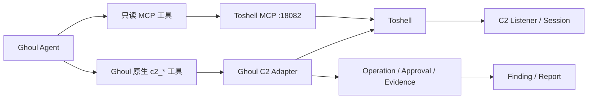
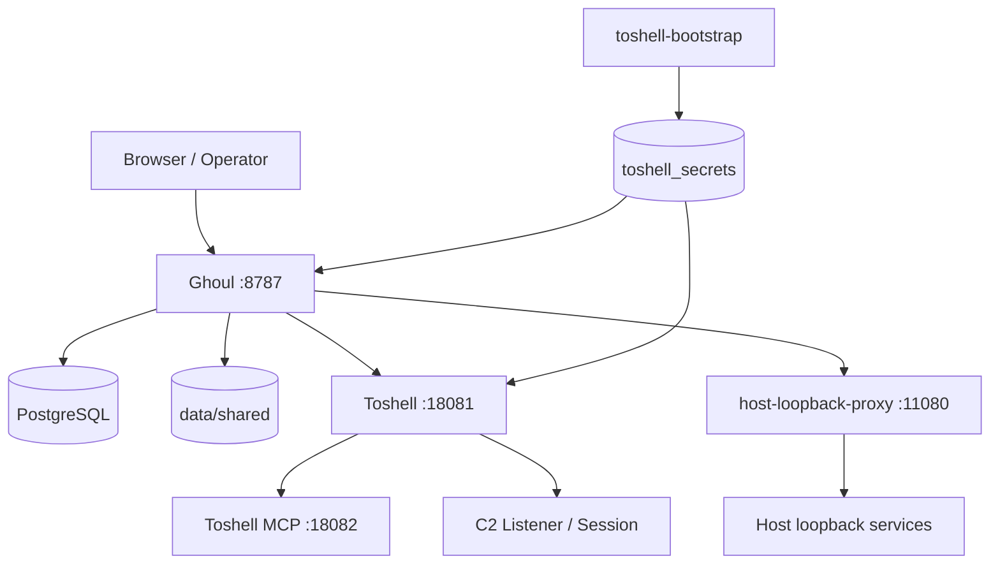
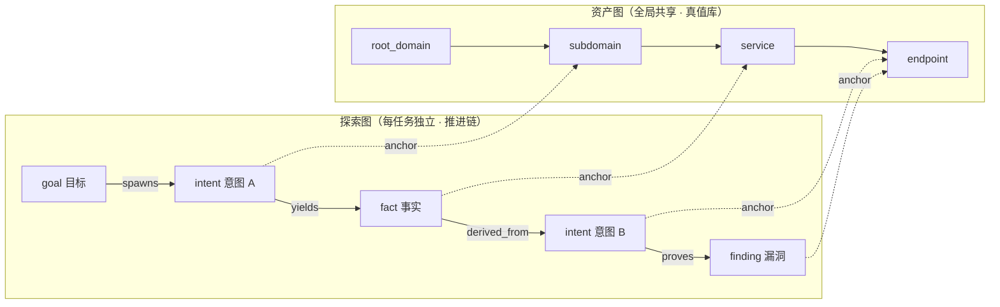
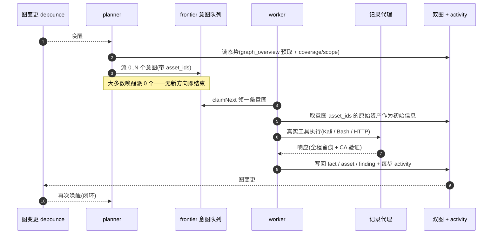
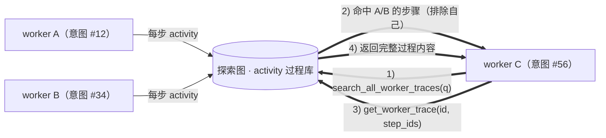
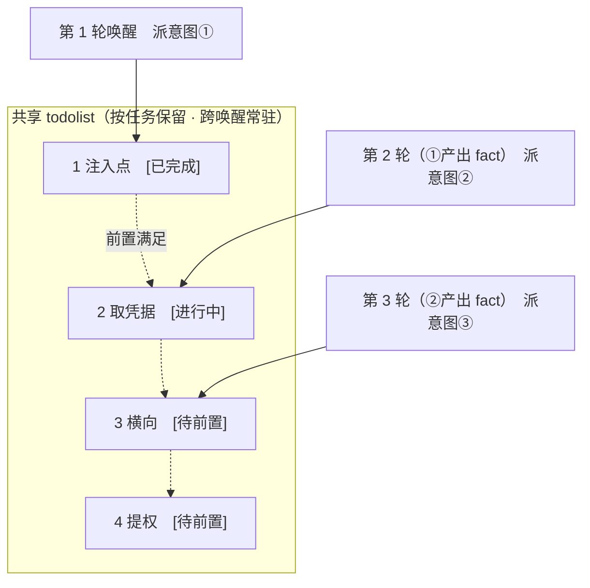

<div align="center">

# Ghoul

AI 自主渗透测试系统（Go 后端 + Next.js 前端）

> **Ghoul** 之名取自《东京喰种》中的“喰种”：不断吸收其他优秀项目中符合个人需求的功能，将其化为自身能力，在持续进化中变得更强。

🌐 **在线 Demo（模拟数据）**： [https://artex-demo.mhtsec.com](https://artex-demo.mhtsec.com)

📦 **Ghoul 由 ARTEX 演进而来，现为独立仓库：[vu1Art1st/Ghoul](https://github.com/vu1Art1st/Ghoul)。默认使用本地构建镜像 `ghoul:local`，不依赖 Docker Hub 账号；发布标签会推送到 GHCR `ghcr.io/vu1art1st/ghoul`。**

</div>

---

## 项目概览

Ghoul 面向**授权范围内的安全测试、靶场验证与本地研究**。系统把目标资产、任务推进、工具执行、漏洞证据和报告交付放进同一条可追踪链路，重点解决长任务中的上下文漂移、重复探索、证据不足和结果不可复核问题。

核心链路：

```text
任务目标与范围
  -> goals 目标拆解
  -> planner 生成意图
  -> worker 执行并写回探索图
  -> 资产图 / 探索图形成事实与血缘
  -> Finding、证据、流量、复测与归并
  -> DOCX 报告与任务归档
```

### 当前能力

| 模块 | 当前已落地能力 |
| --- | --- |
| Agent 主链路 | goals / planner / worker / mainagent；事件驱动 frontier；跨唤醒 todolist；重复调用拦截、空转收场、deadline 与暂停/恢复 |
| 资产与探索 | 全局资产图、每任务探索图、资产锚点、覆盖率与资产覆盖图 |
| 漏洞闭环 | 漏洞情报、证据硬闸、流量快照、验证/反证、复测、Finding 归并、显式派发与 DOCX 报告 |
| C2 | Toshell sidecar；13 个只读 MCP 工具；10 个 Ghoul 原生 `c2_*` 工具；审批、证据物化和 Finding 绑定 |
| 共享空间 | 审核发布的脚本、工具、Skill、模板与语言库；不可变版本、文件浏览、下载和按版本复制 |
| 运行时 | 共享 Python 优先，uv 管理 venv 与包；mise 管理 Java/Node.js/Go；共享运行时不可用时允许系统回退 |
| 宿主环境 | Agent 容器工具体检、白名单安装、安装任务、安装代理与 Linux `ghoul-hostd` |
| 知识沉淀 | 内部 PoC、CTF 赛题档案、公开漏洞情报，以及新建任务时的历史任务推荐 |
| 运维与安全 | JWT、HTTP Basic Auth、拦截审批、全局代理、出口探测、通知、日志、任务归档与页面一键更新 |

### 当前实现边界

- Docker 部署会启动 PostgreSQL、Toshell、宿主回环代理和 Ghoul；本地源码模式只启动 Ghoul，C2 与宿主能力需要自行提供对应依赖。
- C2 写操作继续由 Ghoul Adapter 管理审批和证据；监听器高级配置、插件、AV-Ops、驱动与注入等能力保留在 Toshell 控制台。
- 当前执行面提供每意图工作目录、流量记录代理、命令审批与范围校验；**每任务独立容器、网络命名空间和强制 egress 网关仍属于后续规划**。
- README 只描述当前代码已落地的能力。`docs/` 下的评估、比较和开发计划材料仅供本地开发参考，默认不纳入版本管理。

## 目录

- [截图预览](#截图预览)
- [界面导航](#界面导航)
- [安装](#安装)
- [更新升级](#更新升级)
- [配置](#配置)
- [C2 集成](#c2-集成)
- [共享空间与运行时](#共享空间与运行时)
- [PoC、赛题与任务关联](#poc赛题与任务关联)
- [系统技术架构](#系统技术架构)
- [开发](#开发)
- [许可与免责声明](#许可与免责声明)

## 截图预览

> 完整交互见[在线 Demo](https://artex-demo.mhtsec.com)（纯前端 + Mock 数据，无需后端）。

| 仪表盘（总览 / Token 消耗 / 活动流） | 任务列表 |
| :---: | :---: |
|  |  |

| 任务 · 执行过程（会话 / 工具调用） | 探索链路 |
| :---: | :---: |
|  |  |

| 发现 | 资产 |
| :---: | :---: |
|  |  |

| 资产覆盖图（力导向布局 · 已测高亮 · 节点折叠展开） |
| :---: |
|  |

| 流量录制 | 人在环路对话 |
| :---: | :---: |
|  |  |

| Agent 管理 | LLM 配置 |
| :---: | :---: |
|  |  |

| 拦截审批 | 后端日志 |
| :---: | :---: |
|  |  |


---

## 界面导航

侧边栏按“功能”和“系统”两组组织。常用入口如下：

| 区域 | 页面 | 用途 |
| --- | --- | --- |
| 功能 | 仪表盘 / 对话 / 任务 | 查看运行状态、与 Agent 交互、创建和控制任务 |
| 功能 | 发现 / 漏洞归并 / 流量 / 工具执行 | 复核漏洞、归并交付条目、查看流量和工具调用记录 |
| 功能 | C2 会话 | 查看 Toshell 健康、会话、监听器、事件、审批和操作证据 |
| 功能 | 资产 / 资产同步 / 工作空间 | 管理全局资产、同步 ScopeSentry、浏览任务文件 |
| 功能 | 共享空间 / PoC 与赛题 | 复用共享资产、检索内部 PoC 与 CTF 档案 |
| 系统 | LLM / Agent / MCP / Skill / 工具 | 配置模型、角色、外部工具与技能 |
| 系统 | 漏洞情报 / 宿主环境 / 通知推送 | 同步漏洞情报、体检运行环境、配置通知渠道 |
| 系统 | 拦截规则 / 资产拦截 / 审批记录 / 日志 / 系统配置 | 管理执行边界、审批、审计和运行参数 |

## 审批记录详情

全局「审批记录」、任务内「拦截审批」及对话中的审批卡片均支持展开查看详情。展示结构参考
[AegisHook 的审批详情组件](https://github.com/RuoJi6/AegisHook/blob/main/web/src/components/CallDetail.vue)，沿用 Ghoul 的组件和主题。


## 资产同步（ScopeSentry）

支持从 [ScopeSentry](https://github.com/Autumn-27/ScopeSentry) 直接同步资产数据，免去重复收集：

- 在「**资产同步**」页填 ScopeSentry 的地址与 API Key，接入数据源；
- 按**项目**或**任务**维度选择要同步的目标与资产类型（域名 / 子域 / IP / 端口 / 站点 / 端点…）；
- 一键导入并按公司资产范围归并，直接进入 Ghoul 的资产图供 agent 探索使用。

---

## 安装

> 依赖数据库 **PostgreSQL**；探索需配置 **LLM**（`ANTHROPIC_API_KEY` 或 `OPENAI_API_KEY`，也可在 UI 里配）。

### 方式一：一键安装脚本（推荐）

```bash
git clone https://github.com/vu1Art1st/Ghoul.git
cd Ghoul
./install.sh
```

脚本会：检测 / 自动安装 Docker → 让你选 **① 全部 Docker** 或 **② 本地编译运行**：

- **① 全部 Docker**：填一个 Postgres 密码（可回车随机）→ 自动写 `.env` → 从源码构建 `ghoul:local` → `docker compose up -d`。
- **② 本地运行**：选数据库（连已有 / 用 Docker 起一个）→ 生成 `config.json` → `go` 编译内嵌单二进制 → 启动。

装好后打开 **http://localhost:8787**（首次进入 `/setup` 设置管理员密码）。

Docker 模式会同时启动：

- `postgres`：Ghoul 业务数据库；
- `toshell-bootstrap`：首次生成 Toshell API Key、MCP Token、管理员密码和密钥修订号；
- `toshell`：C2 内核、REST/WS API、只读 MCP 和高级控制台；
- `host-loopback-proxy`：让容器访问宿主回环上的模型或本地服务，默认仅允许回环目标；
- `ghoul`：Web UI、API、Agent 引擎、审批和证据链。

本地源码模式只启动 Ghoul 本身。需要使用 C2、宿主环境安装或共享运行时完整能力时，优先使用 Docker 模式，或自行提供 PostgreSQL、Toshell、uv/mise 和宿主代理。

### 方式二：Docker Compose（手动）

```bash
git clone https://github.com/vu1Art1st/Ghoul.git
cd Ghoul
cp .env.example .env          # 填 POSTGRES_PASSWORD、可选 ANTHROPIC_API_KEY
docker compose build ghoul && docker compose up -d  # 本地构建 + 启动
# → http://localhost:8787
```

> 默认镜像名为 **`ghoul:local`**，由本机源码构建，不依赖 Docker Hub 账号。
> 可在 `.env` 中通过 `GHOUL_IMAGE` 和 `GHOUL_TAG` 修改镜像仓库名与标签。
> Toshell 使用 `TOSHELL_VERSION` 固定版本，首次启动由 `toshell-bootstrap` 自动生成密钥；无需手工创建 API Key。
> Dockerfile 为多阶段构建（前端静态导出 → Go 静态编译 → 运行镜像），默认走国内友好依赖源，可加 `--build-arg GOPROXY=... / --build-arg NPM_REGISTRY=...` 覆盖。

镜像已含常用工具（ripgrep/curl/vim/npm/nmap…）；`./skills` 与 `./data` 以绑定挂载持久化。

远程 MCP 可在系统设置中选择 `http`（Streamable HTTP）或 `sse`（旧版 SSE）。
旧版 SSE 服务通常使用 `GET /sse` 建立事件流，再通过服务返回的
`/message?sessionId=...` 接收 JSON-RPC 请求；配置时将 URL 填为 `/sse`，请求头按
`Authorization=Bearer <token>` 填写。

### 方式三：下载预编译二进制（Releases）

到 [Ghoul Releases](https://github.com/vu1Art1st/Ghoul/releases) 下载对应平台的 zip；如当前版本尚未发布预编译包，请使用方式二或方式四。解压后得到 `ghoul` + `start.sh`（Windows 为 `start.bat`）+ `skills/` + `config.example.json`：

```bash
cp config.example.json config.json   # 填好 database 连接
./start.sh                           # → http://localhost:8787
```

> 请用 `start.sh` / `start.bat` 启动，而不是直接跑 `./ghoul`。它是个守护脚本：程序退出后按退出码决定是否重新拉起，**页面上的[一键更新](#方式一页面一键更新推荐)靠它完成换装**。直接运行 `./ghoul` 时更新完就不会被拉起了。
> 后台常驻：`nohup ./start.sh >ghoul.log 2>&1 &`。

> 预编译包只包含 Ghoul 本体，不包含 Toshell、PostgreSQL 或宿主回环代理。需要完整 C2 能力时使用 Docker Compose，或按 [`integrations/toshell/README.md`](integrations/toshell/README.md) 连接外部 Toshell。

### 方式四：从源码编译单二进制

```bash
# 1) 前端静态导出
cd web && npm ci && npm run build:static && cd ..
# 2) 拷进内嵌目录
cp -r web/out server/webui/dist
# 3) 编译（-tags embedui 才内嵌前端）
CGO_ENABLED=0 go build -tags embedui -o ghoul ./cmd/ghoul
./start.sh
```

### 方式五：构建跨平台 Release 压缩包

`build.sh` 会先构建并嵌入前端，再使用 Go linker 去除调试信息，并将发布文件压缩为 zip。Release 模式默认生成 Linux amd64/arm64、macOS amd64/arm64 和 Windows amd64 的 zip 包：

```bash
./build.sh --release
# 产物：dist/ghoul-0.3.3-*.zip
```

UPX 自解压二进制可能与部分 Linux 内核、虚拟化环境或安全策略不兼容，因此默认不启用。可用 `GHOUL_TARGETS` 自定义目标；确认目标运行环境兼容时，可显式传入 `--upx` 进一步缩小二进制：

```bash
GHOUL_TARGETS=linux/amd64,windows/amd64 ./build.sh --release
./build.sh --target linux/amd64 --upx
```

---

## 更新升级

> 升级只换程序、不动数据：Postgres 数据卷 `pgdata`、`./data`（jwt.key / SQLite 等）、`./skills` 都会保留。**数据库迁移无需手动执行**——`ghoul` 每次启动会幂等重跑 `schema.sql`（含 `ADD COLUMN` / `CREATE INDEX IF NOT EXISTS`），即“重启即迁移”。升级前仍建议先备份 `./data` 与数据库。

### 方式一：页面一键更新（推荐）

在 **系统配置** 页（侧边栏「系统配置」→ `/system/settings`）的**版本与更新**卡片里，可以直接检查并安装新版本，无需登录服务器。

点「更新」后：下载当前平台的发布包 → 比对 Release 的 `SHA256SUMS` → 用 `-h` 冒烟测试新二进制 → 暂存为 `ghoul.new` → 程序退出，由 `start.sh` / `start.bat` 重新拉起并完成换装。页面会自动等到新版本上线后刷新。

- **失败不会留下坏程序**：校验或冒烟不通过就丢弃暂存件、继续跑当前版本；换装后的新版若连续 3 次启动失败，会自动回滚到 `ghoul.old`（失败的那个留作 `ghoul.failed` 供排查）。
- **随时可回退**：上一版本保留为 `ghoul.old`，卡片上有「回滚到上一版本」。注意数据库结构不会回退。
- **更新会中断正在运行的任务**——更新即重启，请在空闲时进行。
- **开发构建不给更新**：版本号是 `dev` 或 `git describe` 带后缀时禁用，避免正式版覆盖掉本地调试的二进制。
- **Docker 下只换程序、不换镜像**：镜像里的 playwright / nmap 等工具链不会跟着升级，且 `docker compose up -d` 重建容器后会退回镜像自带的版本。要连镜像一起升级请执行 `docker compose build ghoul && docker compose up -d ghoul`。
- 访问 GitHub 需要代理时，在同一页面配置**全局代理**即可，更新链路会走它。更新只从 GitHub 域名下载并强制 HTTPS。

### 方式二：一键更新脚本

```bash
cd Ghoul
./update.sh
```

默认执行 `git pull --ff-only` 拉取最新代码，然后本地构建 Docker 镜像并重启服务：

- **Docker（默认）**：`git pull --ff-only` → `docker compose build ghoul` → `docker compose up -d ghoul`（启动时自动迁移 schema）。
- **本地编译**：`./update.sh --local`，重建前端静态产物并重新编译 `./ghoul`（完成后通过 `./start.sh` 重启生效）。
- **跳过拉取**：`./update.sh --no-pull`，直接用当前工作区代码构建。
- **指定标签**：`./update.sh --tag v0.3.3`，构建为 `ghoul:v0.3.3`。

`update.sh` 默认只重建 Ghoul 镜像，不自动切换 Toshell 版本。升级 C2 sidecar 时：

```bash
# 修改 .env 中的 TOSHELL_VERSION / TOSHELL_RELEASE_BASE 后
docker compose build toshell
docker compose up -d toshell
docker compose ps
curl -fsS http://127.0.0.1:18081/api/v1/health
```

随后在系统「MCP」页刷新 Toshell 工具清单，并运行 `go test ./integrations/toshell/...` 检查契约变化。Toshell 升级不会修改 Ghoul PostgreSQL 中的审批、操作和证据记录。

### 方式三：Docker Compose（手动）

```bash
cd Ghoul
git pull                       # 更新 compose / 脚本（可选）
# 指定版本：在 .env 设 GHOUL_TAG=v0.2.0；不设则用 local
docker compose build ghoul
docker compose up -d ghoul     # 重启新镜像 → 自动迁移 schema
docker image prune -f          # 清理旧镜像（可选）
```

### 方式四：预编译二进制（Releases）

到 [Ghoul Releases](https://github.com/vu1Art1st/Ghoul/releases) 下载新版本 zip，停掉旧进程后覆盖 `ghoul` 与 `skills/`（保留你的 `config.json` 与 `data/`），重启即可：

```bash
cp -r <解压目录>/skills ./ && cp <解压目录>/ghoul ./
./start.sh
```

### 方式五：从源码编译

```bash
git pull
cd web && npm ci && npm run build:static && cd ..
cp -r web/out server/webui/dist
CGO_ENABLED=0 go build -tags embedui -o ghoul ./cmd/ghoul
# 重启 ./start.sh
```

---

## 配置

**数据库**（`config.json`，或用环境变量 `GHOUL_PG_DSN` 覆盖；旧 `ARTEX_PG_DSN` 仍兼容）：

```json
{
  "database": {
    "host": "127.0.0.1", "port": 5432,
    "user": "ghoul", "password": "yourpass",
    "dbname": "ghoul", "sslmode": "disable"
  }
}
```

**LLM**：`export ANTHROPIC_API_KEY=sk-...`（或 `OPENAI_API_KEY`），也可在 UI 的「LLM 配置」页填写。
可选：`GHOUL_LLM_PROVIDER` / `GHOUL_LLM_MODEL` / `GHOUL_LLM_BASE_URL` / `GHOUL_LLM_PROXY` / `GHOUL_LLM_STREAM`。

**环境变量**：新配置统一使用 `GHOUL_*`；迁移期继续兼容 `ARTEX_*`，且 `GHOUL_*` 优先。

| 用途 | 推荐变量 | 兼容变量 |
| --- | --- | --- |
| 配置文件路径 | `GHOUL_CONFIG` | `ARTEX_CONFIG` |
| PostgreSQL DSN | `GHOUL_PG_DSN` | `ARTEX_PG_DSN` |
| Skill 目录 | `GHOUL_SKILL_DIR` | `ARTEX_SKILL_DIR` |
| LLM Provider / Model / Base URL / Proxy | `GHOUL_LLM_*` | `ARTEX_LLM_*` |
| Docker 镜像仓库 / tag | `GHOUL_IMAGE` / `GHOUL_TAG` | `ARTEX_TAG` |
| 通知本地目标开关 | `GHOUL_NOTIFY_ALLOW_LOCAL` | `ARTEX_NOTIFY_ALLOW_LOCAL` |
| `/btw` 输出上限 | `GHOUL_BTW_MAX_OUTPUT_TOKENS` | `ARTEX_BTW_MAX_OUTPUT_TOKENS` |

Docker 模式会把 `./config.json` 只读挂载到 `/app/config.json`，并由 Compose 环境变量覆盖数据库和 C2 地址。Toshell 密钥由 `toshell-bootstrap` 写入 `toshell_secrets` 命名卷，不写入仓库或 `.env`。

**并发**：每个任务的 work agent 数在「系统设置」里配置（默认 3）。

**常用参数**：`./start.sh -addr :8787 -proxy :8788`（`-addr` 前端+API，`-proxy` 流量录制代理）。启动脚本会把参数原样透传给 `ghoul`。

### 反向代理部署（HTTPS / 只开放 443）

前端和 API/SSE 都由同一个后端端口（默认 `:8787`）提供，实时活动流默认走**同源**地址，因此**无需配置 `NEXT_PUBLIC_SSE_BASE`**，公网只开放 443、把 8787 留在内网即可。

SSE 是长连接 + 持续推送，反代**必须关闭缓冲**，否则浏览器能连上却收不到事件（表现为活动流一直转圈）。Nginx 示例：

```nginx
server {
    listen 443 ssl;
    server_name your.domain.com;
    # ssl_certificate / ssl_certificate_key ...

    location / {
        proxy_pass http://127.0.0.1:8787;
        proxy_set_header Host $host;
        proxy_set_header X-Forwarded-Proto $scheme;

        # SSE 关键项：关缓冲、长超时、HTTP/1.1
        proxy_buffering off;
        proxy_cache off;
        proxy_read_timeout 3600s;
        proxy_http_version 1.1;
        proxy_set_header Connection "";
    }
}
```

> 仅当 SSE 需要走与页面不同的来源（如独立子域）时，才在**构建期**设置 `NEXT_PUBLIC_SSE_BASE`（该变量在 `next build` 时固化进静态包，容器运行时再设无效）。

---

## C2 集成

### 当前架构

Ghoul 不重写 C2 内核，继续以 **Toshell** 作为唯一 C2 后端。默认 Docker 部署把 Toshell 作为独立 sidecar 启动，Ghoul 只负责策略、审批、证据、Finding 和报告闭环。

| 层 | 职责 |
| --- | --- |
| Toshell sidecar | 监听器、植入端、载荷、会话、任务、文件、隧道、插件、AV-Ops 和高级控制台 |
| Toshell 只读 MCP | 会话态势、结果回读、任务等待、插件/隧道查询和低风险只读能力 |
| Ghoul 原生 `c2_*` | Confirm/Danger 写操作、审批、证据物化、Finding 绑定和审计 |
| Ghoul UI | 会话查看/绑定、审批中心、操作详情、证据和 Toshell 深链接 |



### Docker 部署与密钥

`docker compose up -d` 会依次完成：

1. `toshell-bootstrap` 首次生成 API Key、MCP Token、管理员密码和密钥修订号；
2. 启动 Toshell 并等待 `/api/v1/health`；
3. 启动 Ghoul，读取 `file:` secret reference，注册 Toshell MCP 和 C2 Adapter；
4. 在 C2 页面显示 MCP 状态、工具缺失、实例健康和控制台入口。

Docker 模式默认设置 `GHOUL_C2_ENABLED=true`，因此只读会话、MCP 和审批中心可用；`GHOUL_C2_ALLOW_CONFIRM`、`GHOUL_C2_ALLOW_DANGER` 和 `GHOUL_C2_ALLOW_TUNNEL` 仍默认关闭。原生二进制或外部部署默认不启用 C2，需显式配置。

常用变量：

| 变量 | 作用 |
| --- | --- |
| `TOSHELL_VERSION` | Toshell 固定版本，默认 `v1.4.3` |
| `TOSHELL_RELEASE_BASE` | Toshell Release 下载地址 |
| `GHOUL_C2_ENABLED` | 是否启用 C2 Adapter |
| `GHOUL_C2_BASE_URL` | Toshell REST/WS 地址 |
| `GHOUL_C2_CONSOLE_URL` | Toshell 高级控制台地址 |
| `GHOUL_C2_API_KEY_REF` | API Key 的 `env:` 或 `file:` 引用 |
| `GHOUL_C2_MCP_URL` | Toshell MCP 地址 |
| `GHOUL_C2_MCP_TOKEN_REF` | MCP Token 的 secret reference |
| `GHOUL_C2_ALLOWED_HOSTS` | 允许连接的 Toshell 主机名 |
| `GHOUL_C2_ALLOW_INSECURE_HTTP` | 是否允许内网 HTTP sidecar |
| `GHOUL_C2_ALLOW_CONFIRM` / `GHOUL_C2_ALLOW_DANGER` | 是否允许 Confirm/Danger 操作，默认关闭 |
| `GHOUL_C2_ALLOW_TUNNEL` | 是否允许隧道操作，默认关闭 |

### 工具面与审批

- Toshell 全量工具不直接注入 Agent。只读 MCP 侧当前固定 13 个白名单工具，再由 Ghoul MCP 客户端做一次同名过滤。
- Ghoul 原生工具面当前为 10 个 `c2_*` 工具，覆盖会话、侦察、文件、进程、截图、命令、隧道、监听器和载荷。
- Planner 默认只加载 3 个只读工具；Worker/Pentest 根据任务绑定和 Skill 逐步加载，避免每轮注入全部 schema。
- Confirm/Danger 默认 fail-closed。Danger 需要两阶段审批；令牌绑定参数哈希、任务、会话和审批快照，并在数据库中只保存哈希。
- C2 输出统一做控制字符清理、凭据脱敏、不可信内容边界包装和大小限制；操作、审批和证据均保留审计记录。
- Toshell 高级控制台只通过新窗口打开，不使用 iframe。Ghoul 原生页面负责审批、证据和 Finding 绑定。

更完整的 sidecar 模板、契约快照和升级步骤见 [`integrations/toshell/README.md`](integrations/toshell/README.md)。

阶段性开发记录、测试基线和实施细节不再放入 README，统一保存在 `docs/` 下的本地开发备忘中，不纳入版本管理。

## 共享空间与运行时

共享空间用于跨任务复用经过审核的脚本、工具、Skill、模板、语言库和 CTF 报告。共享资产不随任务删除或归档消失，任务工作空间中的 `shared/` 是只读版本存储。

### 共享资产

- 在工作空间验证脚本后，可填写用途、入口、依赖和调用示例并发布到共享空间。
- 发布时拒绝符号链接、限制单次内容大小、计算内容哈希，并以不可变版本保存。
- Agent 通过 `shared_search`、`shared_get`、`shared_materialize` 检索、查看和复制指定版本到当前任务目录。
- 复制件可按任务修改，不会反向影响共享版本；任务也不会自动切换到后续版本。
- 资产详情支持文件树、文本预览、二进制下载、版本历史、启停和事件记录。
- `display_name` 与稳定路径 `name` 分离，支持中文显示名而不破坏任务目录和 Python 导入路径。

### Python 与其他运行时

- Python 解释器、venv 和包优先由 `uv` 管理，默认目录为 `data/shared/python/venvs/default`；旧 `data/shared/python/venv` 继续兼容。
- Java、Node.js、Go 和 uv 自身由 `mise` 管理，数据和 shim 保存在 `data/shared/mise`。
- Bash/PTY 通过实际存在的 `GHOUL_PYTHON` 和 `GHOUL_PYTHONPATH` 使用共享运行时；venv 缺失或损坏时不再注入空路径。
- `runtime_status` 返回解释器、来源、版本和降级原因；`runtime_ensure` 只接受固定 action，避免变成任意命令执行入口。
- 共享运行时不可用时允许回退到系统 Python、Java、Node.js；系统 Python 包安装只在前序共享安装失败后开放，并标记为 `system-install` / `ephemeral`。

### 宿主环境

- 系统「宿主环境」页展示 Agent 实际执行命令的环境；Docker 部署下指 Agent 容器，不是物理宿主机。
- 支持工具体检、白名单安装、批量安装、任务排队、取消、日志、退出码和重启后的中断标记。
- apt/dnf 与 `/usr/local/bin` 工具在 Docker 中使用容器内安装器；Linux 二进制发行包提供 `ghoul-hostd`。
- `ghoul-hostd` 只监听 Unix Socket，只接受目录内工具 ID，不接受自由命令；参考 [`deploy/ghoul-hostd.service`](deploy/ghoul-hostd.service)。
- Windows/macOS 提供体检与手工安装指引，不提供系统工具一键安装。
- 安装代理独立于目标流量代理，支持 http/https/socks5/socks5h 保存与连通性测试。

完整行为说明见 [`HOST_ENV_SHARED_SPACE.md`](HOST_ENV_SHARED_SPACE.md)。

## PoC、赛题与任务关联

PoC 与赛题不是新的权威事实源，而是基于 Finding、探索图、资产图和共享资产版本构建的可重建检索层。

- `poc_records` 按目标、产品、组件、版本、CVE/CWE、指纹和验证状态索引内部 PoC。
- 可执行文件通过 `shared_asset_id + version` 关联，复用后默认重新验证，不能把历史有效直接当成当前有效。
- `scope_type=ctf` 的赛题档案可保存赛事、题目、Flag、POA、完整 Writeup 和附件。
- 公开漏洞情报继续由 `vulnintel` 管理，内部 PoC 与公开 PoC 在检索页统一展示但保留来源字段。
- 新建任务时，系统根据目标、描述、域名/IP、产品和组件推荐最多 8 个历史任务，展示命中原因与置信度。
- 接受推荐后写入现有 `source_task_ids`，只读继承事实、Finding 和 PoC 引用；不复制凭据、流量、临时文件，也不自动扩大测试范围。

对应页面为「共享空间」和「PoC 与赛题」，Agent 侧通过 `knowledge_search`、`shared_*` 和任务关联能力使用这些数据。

## 开发

### 手动漏洞复测

任务详情的「复测」页签可分页选择本任务的漏洞、查看历次结论和证据，并手动发起复测。启动后保留当前页签，显示转圈图标和「复测中」；确认修复后同步更新漏洞状态。

在漏洞列表每行操作区点击「复测」，或在漏洞详情的「漏洞复测」区域点击「发起复测」，填写可选的修复版本、测试条件或限制，系统会创建独立的复测 Agent 会话，启动后保留当前页面。列表的平铺、按任务分组和资产视图均支持该入口；复测运行时显示转圈图标和「复测中」，需要查看时点击进入对应会话，结束后恢复「复测」。复测无需重新启动原扫描任务，结论分为「仍可复现」「已修复」「无法确认」，每次的结论、证据和会话链接保存在漏洞详情中。

新版后端首次启动会预置可编辑的「漏洞复测」（`retester`）Agent，可在 Agent 管理中配置提示词、LLM、运行预算和工具。默认使用其绑定的 LLM，未绑定则使用全局激活配置。复测会话成功完成且结论为「已修复」时，系统自动将漏洞处置状态改为「已修复」；执行中、失败、停止或其他结论保留原状态。原始证据和报告始终保留。也可在状态下拉菜单中手动选择「已修复」。同一漏洞正在复测时复用已有会话，停止、失败或服务重启后可重新发起。

本版历史记录通过漏洞详情和会话查看，暂未纳入漏洞报告导出或任务归档包，也未自动关联流量包。演示模式只生成明确标注的模拟记录，不请求真实目标。

### 本地运行与测试

```bash
./dev.sh    # 后端(:8787) + 流量代理(:8788) + 前端 next dev(:5173) → http://localhost:5173
```

- 后端：`go run ./cmd/ghoul`（不带 `-tags embedui` 则不内嵌前端）
- 前端：`cd web && npm run dev`（`/api` 反代到后端，带热更新）
- 测试：`go test ./...`；数据库集成测试请使用独立测试库并通过 `GHOUL_PG_DSN` 指定。
- Mock 预览（无后端）：`cd web && NEXT_PUBLIC_MOCK=1 npm run dev`
- 在线 Demo 重新部署（Cloudflare Pages，静态导出 + Mock 数据）：
  ```bash
  cd web && NEXT_PUBLIC_MOCK=1 npm run build:static
  CLOUDFLARE_API_TOKEN=<token> npx wrangler pages deploy out --project-name=artex-demo --branch=main
  ```

推荐使用仓库内的隔离测试入口，避免多个包共用数据库导致锁竞争：

```powershell
# Windows：自动创建/复用本地 ghoul_test 数据库，并以 -p 1 串行运行
pwsh -File scripts/test-windows.ps1
pwsh -File scripts/test-windows.ps1 ./server ./db
```

```bash
# Docker / WSL：使用 docker-compose.test.yml 启动独立 PostgreSQL
cp .env.test.example .env.test
./scripts/wsl-docker-test.sh targeted   # 定向回归
./scripts/wsl-docker-test.sh backend    # 后端全量，-p 1
./scripts/wsl-docker-test.sh shared     # 共享空间回归
```

前端检查：

```bash
pnpm --dir web exec tsc --noEmit
pnpm --dir web exec biome check src
```

> `docs/` 下的 C2 评估、方案对比和开发计划材料仅用于本地开发参考，默认不纳入版本管理；README 与代码仓库只发布已落地能力。

---

## 系统技术架构

Ghoul 是一套 **LLM 多 agent 驱动的自主渗透系统**：Go 单体后端（内嵌 Next.js 前端）+ PostgreSQL，agent 能力由 [`norma`](https://github.com/Autumn-27/norma) SDK 提供（`agentcore` / `tool` / `permission` / `harness` / `memory` / `transcript`）。核心是**双图架构**，以及围绕它的两条自主性机制：**worker 间过程级信息交换**与 **planner 多轮共享 todolist 稳定攻击链路**。

### 部署拓扑（Docker）



持久化边界：

- `pgdata`：PostgreSQL 数据；
- `toshell_secrets`：Toshell API Key、MCP Token、管理员密码和密钥修订号；
- `./toshell/configs`、`./toshell/data`、`./toshell/implants`、`./toshell/plugins`、`./toshell/logs`：Toshell 运行数据；
- `./data`、`./skills`、`./config.json`、`./jwt.key`：Ghoul 数据、技能、配置和签名密钥。

### 总体分层


| 层 | 职责 |
| --- | --- |
| **前端** | Next.js 静态导出，`go:embed` 内嵌进单二进制；可视化任务/资产/探索链路/覆盖图，人在环路对话 |
| **server** | `net/http` 路由 + JWT 鉴权 + SSE；`Manager` 托管任务、引擎、DB store 的生命周期 |
| **engine** | 每任务一个 `plannerLoop` + N 个 worker goroutine；意图领取、超时/暂停/drain |
| **agent** | goals / planner / worker / mainagent，`ToolSet` 把双图暴露成 LLM 工具 |
| **db** | 双图、任务、Finding、共享资产、C2、PoC 与审计数据的 Postgres 落地；schema 随 `go:embed` 每次启动幂等建表 |
| **C2** | Toshell sidecar 提供 C2 内核；Ghoul 负责只读 MCP、写操作审批、证据和 Finding 绑定 |
| **共享/运行时** | 共享资产版本、uv Python、mise 多语言运行时、PoC 与任务关联 |
| **宿主环境** | 工具体检、白名单安装、安装任务和 Linux `ghoul-hostd` |
| **支撑** | 记录型 MITM 代理、审批门、异步补全、MCP/技能/记忆/报告 |

### 双图架构：探索图 + 资产图

系统把「**目标是什么**」和「**测到了什么程度**」拆成两张相互独立、又通过锚点相连的图：

- **资产图（Asset Graph，全局共享）**：跨任务同一份的资产真值库。节点为 `root_domain / subdomain / ip / service / app / endpoint`，归属公司；域名→子域→服务→端点的父子关系与去重 key 全部由程序计算，agent 只提交原始信息。
- **探索图（Exploration Graph，每任务独立）**：一次任务的“思考与推进”过程。节点为 `goal（目标）/ intent（意图）/ fact（事实）/ finding（漏洞）/ hint（提示）`，靠 `spawns / derived_from / yields / proves` 等边连成**血缘链**，回答“哪个方向派生自哪些事实、产出了什么”。
- **两图靠锚点相连**：`exploration_anchors(node_id, asset_id)` 把意图/事实/漏洞锚定到具体资产上——于是既能从“探索方向”看它打的是哪些资产，也能从“某个资产”反查它在本任务被哪些意图测过、得出过哪些事实。这也支撑了**资产测试覆盖度**与**资产覆盖图**（范围内资产 + 已测高亮）。



> 分工：**planner** 读探索图态势、判目标、只在有未覆盖的新方向时派**意图**进 frontier；**worker** 领**一条意图**、用真实工具执行、把新资产/事实/漏洞写回两图后即停。资产图是共享事实，探索图是每任务的推进链。

### 引擎与意图生命周期（一次探索的闭环）

引擎是**事件驱动**的闭环：图一变就唤醒 planner，planner 派意图，worker 领意图执行并写回，写回又触发下一轮——直到目标被证明（`prove_goal`）。



### worker 间的过程级信息交换

一次深入的探索里，很多有价值的观察（某个报错、某段响应、某个隐藏参数）出现在一个 worker 的**执行过程**中，却未必被写成正式 fact。为避免重复劳动、让链路上的 worker 能站在彼此的肩膀上，worker 具备**跨 work 检索过程**的能力：

- `search_all_worker_traces(q)`：在**本任务其他 work 的执行过程**里按关键字检索（自动排除自己这条意图的步骤），命中项带 `intent_id`；
- `list_worker_traces` / `get_worker_trace(intent_id, step_ids=[…])`：先看有哪些 work 跑过，再取某个 work 具体几步的完整内容做细节交换。

这样即便探索图上还没有对应的 fact，后续 worker 也能复用他人过程中的观察——**信息在 worker 之间以“执行过程”为粒度流动**，而边界不变（每个 worker 仍只做自己领到的那条意图）。



### planner 多轮共享 todolist → 稳定的攻击链路

真实攻击链往往是**有前后依赖的多步序列**（如：发现注入点 → 拿到凭据 → 横向 → 提权），一次性把这些并行派下去只会乱套。planner 因此持有一份**按任务保留、跨唤醒共享的规划待办（todolist）**：

- planner 是事件驱动的——图一变就被唤醒，但**每次唤醒是全新会话**；共享的 todolist 让它把一条串行利用链**记录一次**、然后在后续多轮里**按依赖逐步派意图**，而不是把整条链在一轮里全部前置展开；
- 每轮只对「前置步骤已完成、其依赖的 fact 已存在」的下一步派意图，并随进展更新清单（把已被 fact 满足的步骤标完成）。



于是攻击链在“事件驱动 + 无状态会话”的环境下依然**稳定推进、不重复、不错序**——这是 Ghoul 能自主走完多步利用链的关键。

---

## 交流群

扫码关注微信公众号 **SecSentry**，在公众号后台私信即可入群交流。

<div align="center">


</div>

## 许可与免责声明

### 开源协议

本项目采用 **GNU Affero General Public License v3.0（AGPL-3.0）** 授权，完整条款见仓库根目录的 [LICENSE](LICENSE) 文件。

这意味着任何人都可以自由使用、修改和分发本项目，但**衍生作品必须同样以 AGPL-3.0 开源**；特别地，**若你修改本项目并通过网络（如部署为在线服务）向用户提供，也必须向这些用户公开对应的完整源码**。

> ⚠️ **重要提示**：开源协议本身不限制软件的使用用途。以下的「使用限制」与「免责声明」是作者对使用者的额外约定与郑重声明，请务必遵守。

**Ghoul 仅供个人学习、代码研究与本地技术验证使用，不得用于对任何线上系统或网站发起实际测试。**

### 允许使用范围

- 仅可用于**阅读、学习与研究本项目源码**，以及在**本地隔离环境**中进行技术原理验证；
- 适用于个人学习、学术研究、代码审阅等非攻击性用途。

### 禁止事项

- **严禁使用本工具对任何网站、线上服务或联网系统发起扫描、探测、利用或攻击**（无论是否获得授权、是否为自有资产）；
- 严禁将本工具用于任何实际的渗透测试、攻防对抗或生产环境；
- 严禁将本工具用于非法入侵、数据窃取、勒索、拒绝服务或任何破坏性、犯罪性活动；
- 严禁利用本工具从事违反所在国家/地区法律法规的行为。

### 合规责任

使用者须自行遵守所在国家/地区关于网络安全、数据保护与计算机犯罪的全部法律法规（在中国大陆包括但不限于《网络安全法》《数据安全法》《个人信息保护法》及相关司法解释）。**因使用本工具产生的一切法律责任与后果，均由使用者自行承担。**

### 免责声明

本项目按“现状（AS IS）”提供，不附带任何明示或默示的担保。作者及贡献者不对使用本工具（无论使用方式是否得当）所导致的任何直接或间接损失、数据丢失、系统损坏或法律纠纷承担责任。**下载、安装或使用本项目，即表示你已阅读、理解并同意上述全部条款。**

## 参考项目与来源声明

以下项目统一作为 Ghoul 的来源、对照或演进参考列出；具体代码吸收按合并计划和对应工作包逐项记录，未复制项目的许可证以各自仓库为准。

- [Ghoul](https://github.com/vu1Art1st/Ghoul)：本仓库，AGPL-3.0。
- [ARTEX](https://github.com/Autumn-27/ARTEX)：Ghoul 的上游演进基础，AGPL-3.0。
- [ARTEX-main](https://github.com/sharenjun/ARTEX-main)：可靠性、Planner handoff、完成审计、Worker 池和 Repeater 参考。
- [Pojun](https://github.com/chu0119/Pojun)：漏洞情报、证据硬闸、意图预算、DOCX 报告和 Skill 参考。
- [artex-ymh](https://github.com/panda0x123/artex-ymh)：LLM 墙钟、deadline、chains、RoE、伪装门控和 doctor 参考。
- [artex-ld](https://github.com/IcebergN2026/artex-ld)：意图审核、场景模板、Finding 派发和证据版本参考。
- [RuoJi6/ARTEX](https://github.com/RuoJi6/ARTEX)：Basic Auth、日历任务、代理池、Egress Probe 和 Finding 归并参考。
- [Toshell](https://github.com/iQingshan/Toshell)：唯一 C2 后端，锁定 `v1.4.3 / 8bf4643`，MIT。
- [ScopeSentry](https://github.com/Autumn-27/ScopeSentry)：资产同步参考。
- [AegisHook](https://github.com/RuoJi6/AegisHook)：审批详情组件展示结构参考。
- [norma](https://github.com/Autumn-27/norma)：Agent SDK 来源；上游已转为闭源，本仓库使用恢复后的 `v0.4.3` 模块。
- [Cairn](https://github.com/oritera/Cairn)：架构与交互参考。

### AGPL 来源与修改说明

Ghoul 的修改、分发和网络部署继续适用 AGPL-3.0。Toshell 通过独立 sidecar、REST/WS 与只读 MCP 集成；镜像基于上游固定 Release 下载并校验 `checksums.txt`，未复制、修改或静态链接 Toshell 源码。契约快照仅记录公开 API 响应。若后续复制或修改 Toshell 代码，必须保留其 MIT notice，并在本文件、发布说明和对应源文件中记录变更与日期。
