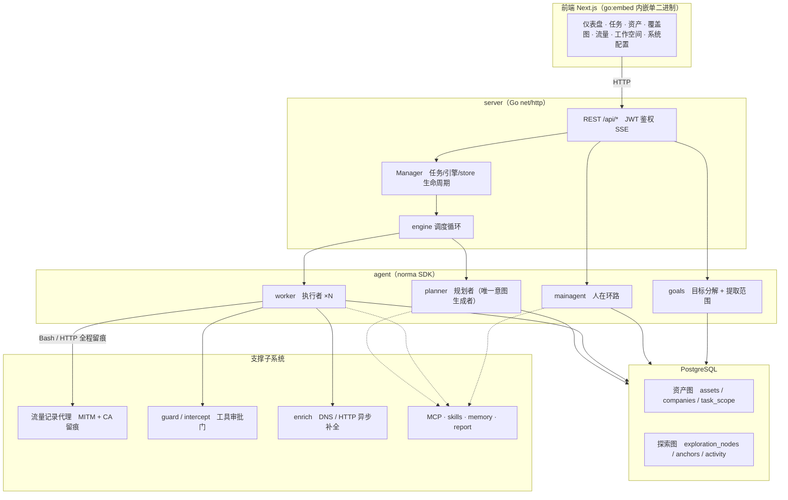
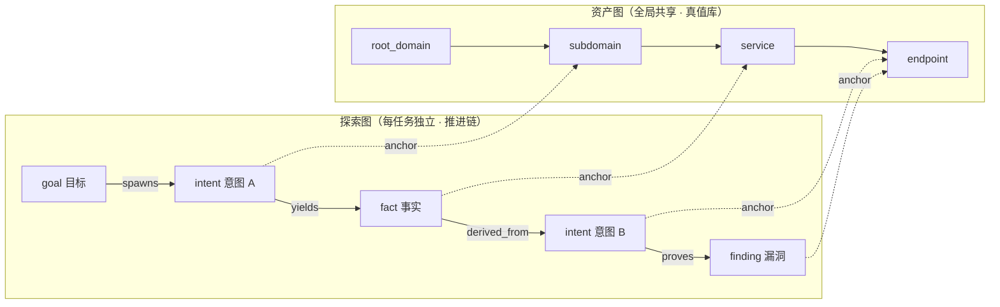
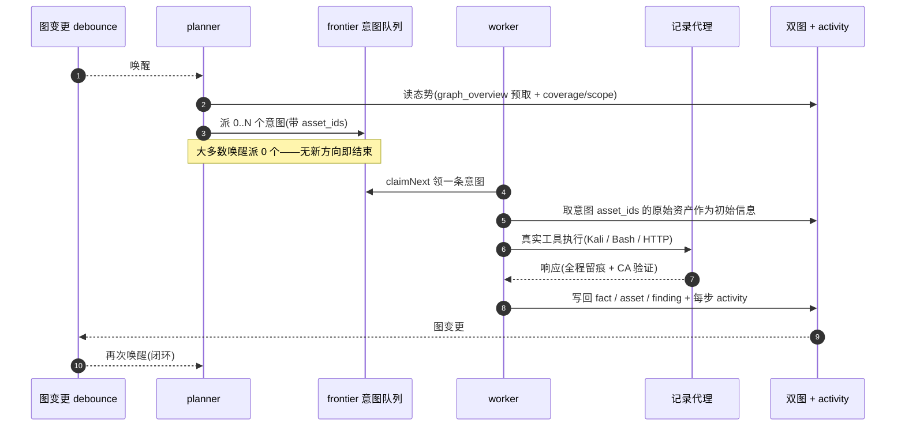
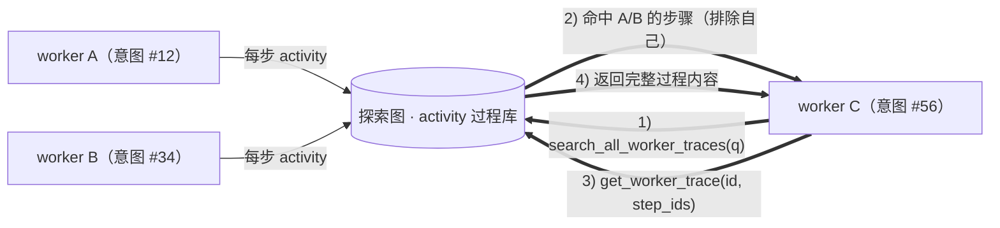
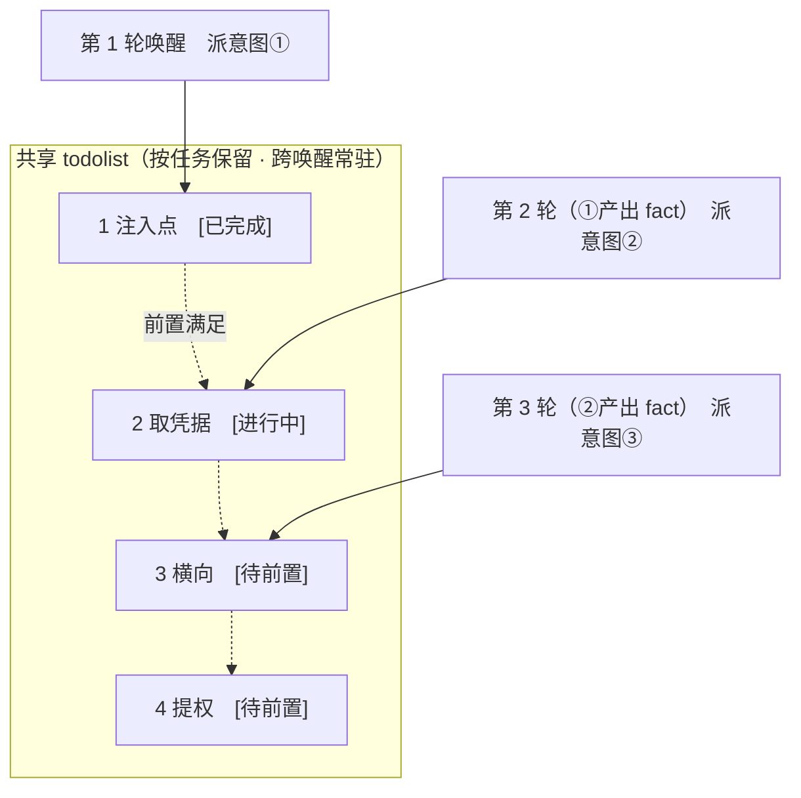

<div align="center">

# Ghoul

AI 自主渗透测试系统（Go 后端 + Next.js 前端）

> **Ghoul** 之名取自《东京喰种》中的“喰种”：不断吸收其他优秀项目中符合个人需求的功能，将其化为自身能力，在持续进化中变得更强。

🌐 **在线 Demo（模拟数据）**： [https://artex-demo.mhtsec.com](https://artex-demo.mhtsec.com)

📦 **Ghoul 由 ARTEX 演进而来，现为独立仓库：[vu1Art1st/Ghoul](https://github.com/vu1Art1st/Ghoul)。原 Docker 镜像源 `autumn27/artex` 已失效，现由本仓库维护为 `mianhuatang11/artex`；Docker Hub 拉取失败时，用 `docker compose build` 从源码本地构建，无需任何外部预构建产物。**

</div>

---

## 截图预览

> 完整交互见[在线 Demo](https://artex-demo.mhtsec.com)（纯前端 + Mock 数据，无需后端）。

| 仪表盘（总览 / Token 消耗 / 活动流） | 任务列表 |
| :---: | :---: |
|  |  |

| 任务 · 执行过程（会话 / 工具调用） | 探索链路 |
| :---: | :---: |
|  |  |

| 发现 | 资产 |
| :---: | :---: |
|  |  |

| 资产覆盖图（力导向布局 · 已测高亮 · 节点折叠展开） |
| :---: |
|  |

| 流量录制 | 人在环路对话 |
| :---: | :---: |
|  |  |

| Agent 管理 | LLM 配置 |
| :---: | :---: |
|  |  |

| 拦截审批 | 后端日志 |
| :---: | :---: |
|  |  |


---

## 审批记录详情

全局「审批记录」、任务内「拦截审批」及对话中的审批卡片均支持展开查看详情。展示结构参考
[AegisHook 的审批详情组件](https://github.com/RuoJi6/AegisHook/blob/main/web/src/components/CallDetail.vue)，沿用 ARTEX 的组件和主题：


## 资产同步（ScopeSentry）

支持从 [ScopeSentry](https://github.com/Autumn-27/ScopeSentry) 直接同步资产数据，免去重复收集：

- 在「**资产同步**」页填 ScopeSentry 的地址与 API Key，接入数据源；
- 按**项目**或**任务**维度选择要同步的目标与资产类型（域名 / 子域 / IP / 端口 / 站点 / 端点…）；
- 一键导入并按公司资产范围归并，直接进入 ARTEX 的资产图供 agent 探索使用。

---

## 安装

> 依赖数据库 **PostgreSQL**；探索需配置 **LLM**（`ANTHROPIC_API_KEY` 或 `OPENAI_API_KEY`，也可在 UI 里配）。

### 方式一：一键安装脚本（推荐）

```bash
git clone https://github.com/vu1Art1st/Ghoul.git
cd Ghoul
./install.sh
```

脚本会：检测 / 自动安装 Docker → 让你选 **① 全部 Docker** 或 **② 本地编译运行**：

- **① 全部 Docker**：填一个 Postgres 密码（可回车随机）→ 自动写 `.env` → `docker compose up -d`。
- **② 本地运行**：选数据库（连已有 / 用 Docker 起一个）→ 生成 `config.json` → `go` 编译内嵌单二进制 → 启动。

装好后打开 **http://localhost:8787**（首次进入 `/setup` 设置管理员密码）。

### 方式二：Docker Compose（手动）

```bash
git clone https://github.com/vu1Art1st/Ghoul.git
cd Ghoul
cp .env.example .env          # 填 POSTGRES_PASSWORD、可选 ANTHROPIC_API_KEY
docker compose up -d          # 拉取 mianhuatang11/artex 镜像 + postgres
# → http://localhost:8787
```

> 原镜像源 `autumn27/artex` 已从 Docker Hub 删除，镜像现由本仓库自维护为 **`mianhuatang11/artex`**。
> 镜像源不可用（或想自行改代码）时，本地从纯源码构建即可：`docker compose build && docker compose up -d`。
> Dockerfile 为多阶段构建（前端静态导出 → Go 静态编译 → 运行镜像），默认走国内友好依赖源，可加 `--build-arg GOPROXY=... / --build-arg NPM_REGISTRY=...` 覆盖。

镜像已含常用工具（ripgrep/curl/vim/npm/nmap…）；`./skills` 与 `./data` 以绑定挂载持久化。

远程 MCP 可在系统设置中选择 `http`（Streamable HTTP）或 `sse`（旧版 SSE）。
旧版 SSE 服务通常使用 `GET /sse` 建立事件流，再通过服务返回的
`/message?sessionId=...` 接收 JSON-RPC 请求；配置时将 URL 填为 `/sse`，请求头按
`Authorization=Bearer <token>` 填写。

### 方式三：下载预编译二进制（Releases）

到原仓库 [Releases](https://github.com/Autumn-27/ARTEX/releases) 下载对应平台的 zip（**本备份仓库不托管二进制**，若原 Releases 也失效请用方式二或方式四）：解压后得到 `artex` + `start.sh`（Windows 为 `start.bat`）+ `skills/` + `config.example.json`：

```bash
cp config.example.json config.json   # 填好 database 连接
./start.sh                           # → http://localhost:8787
```

> 请用 `start.sh` / `start.bat` 启动，而不是直接跑 `./artex`。它是个守护脚本：程序退出后按退出码决定是否重新拉起，**页面上的[一键更新](#方式一页面一键更新推荐)靠它完成换装**。直接运行 `./artex` 时更新完就不会被拉起了。
> 后台常驻：`nohup ./start.sh >artex.log 2>&1 &`。

### 方式四：从源码编译单二进制

```bash
# 1) 前端静态导出
cd web && npm ci && npm run build:static && cd ..
# 2) 拷进内嵌目录
cp -r web/out server/webui/dist
# 3) 编译（-tags embedui 才内嵌前端）
CGO_ENABLED=0 go build -tags embedui -o artex ./cmd/artex
./start.sh
```

### 方式五：构建跨平台 Release 压缩包

`build.sh` 会先构建并嵌入前端，再使用 Go linker 去除调试信息，并将发布文件压缩为 zip。Release 模式默认生成 Linux amd64/arm64、macOS amd64/arm64 和 Windows amd64 的 zip 包：

```bash
./build.sh --release
# 产物：dist/artex-0.3.3-*.zip
```

UPX 自解压二进制可能与部分 Linux 内核、虚拟化环境或安全策略不兼容，因此默认不启用。可用 `ARTEX_TARGETS` 自定义目标；确认目标运行环境兼容时，可显式传入 `--upx` 进一步缩小二进制：

```bash
ARTEX_TARGETS=linux/amd64,windows/amd64 ./build.sh --release
./build.sh --target linux/amd64 --upx
```

---

## 更新升级

> 升级只换程序、不动数据：Postgres 数据卷 `pgdata`、`./data`（jwt.key / SQLite 等）、`./skills` 都会保留。**数据库迁移无需手动执行**——`artex` 每次启动会幂等重跑 `schema.sql`（含 `ADD COLUMN` / `CREATE INDEX IF NOT EXISTS`），即“重启即迁移”。升级前仍建议先备份 `./data` 与数据库。

### 方式一：页面一键更新（推荐）

在 **系统配置** 页（侧边栏「系统配置」→ `/system/settings`）的**版本与更新**卡片里，可以直接检查并安装新版本，无需登录服务器。

点「更新」后：下载当前平台的发布包 → 比对 Release 的 `SHA256SUMS` → 用 `-h` 冒烟测试新二进制 → 暂存为 `artex.new` → 程序退出，由 `start.sh` / `start.bat` 重新拉起并完成换装。页面会自动等到新版本上线后刷新。

- **失败不会留下坏程序**：校验或冒烟不通过就丢弃暂存件、继续跑当前版本；换装后的新版若连续 3 次启动失败，会自动回滚到 `artex.old`（失败的那个留作 `artex.failed` 供排查）。
- **随时可回退**：上一版本保留为 `artex.old`，卡片上有「回滚到上一版本」。注意数据库结构不会回退。
- **更新会中断正在运行的任务**——更新即重启，请在空闲时进行。
- **开发构建不给更新**：版本号是 `dev` 或 `git describe` 带后缀时禁用，避免正式版覆盖掉本地调试的二进制。
- **Docker 下只换程序、不换镜像**：镜像里的 playwright / nmap 等工具链不会跟着升级，且 `docker compose up -d` 重建容器后会退回镜像自带的版本。要连镜像一起升级仍请用 `docker compose pull artex && docker compose up -d artex`。
- 访问 GitHub 需要代理时，在同一页面配置**全局代理**即可，更新链路会走它。更新只从 GitHub 域名下载并强制 HTTPS。

### 方式二：一键更新脚本

```bash
cd Ghoul
./update.sh
```

脚本先可选 `git pull` 拉取最新代码，再让你选 **① Docker 更新** 或 **② 本地编译更新**（与 `install.sh` 对应）：

- **① Docker**：可指定目标镜像 tag（回车沿用 `.env` 的 `ARTEX_TAG`，缺省 `latest`）→ `docker compose pull` → `docker compose up -d`（换新镜像重启即自动迁移）。
- **② 本地**：重建前端静态产物 → 重新编译 `./artex`（完成后重启进程生效）。

### 方式三：Docker Compose（手动）

```bash
cd Ghoul
git pull                       # 更新 compose / 脚本（可选）
# 指定版本：在 .env 设 ARTEX_TAG=v0.2.0；不设则用 latest
docker compose pull artex
docker compose up -d artex     # 换新镜像重启 → 自动迁移 schema
docker image prune -f          # 清理旧镜像（可选）
```

### 方式四：预编译二进制（Releases）

到 [Releases](https://github.com/Autumn-27/ARTEX/releases) 下载新版本 zip，停掉旧进程后覆盖 `artex` 与 `skills/`（保留你的 `config.json` 与 `data/`），重启即可：

```bash
cp -r <解压目录>/skills ./ && cp <解压目录>/artex ./
./start.sh
```

### 方式五：从源码编译

```bash
git pull
cd web && npm ci && npm run build:static && cd ..
cp -r web/out server/webui/dist
CGO_ENABLED=0 go build -tags embedui -o artex ./cmd/artex
# 重启 ./start.sh
```

---

## 配置

**数据库**（`config.json`，或用环境变量 `ARTEX_PG_DSN` 覆盖）：

```json
{
  "database": {
    "host": "127.0.0.1", "port": 5432,
    "user": "artex", "password": "yourpass",
    "dbname": "artex", "sslmode": "disable"
  }
}
```

**LLM**：`export ANTHROPIC_API_KEY=sk-...`（或 `OPENAI_API_KEY`），也可在 UI 的「LLM 配置」页填写。
可选：`ARTEX_LLM_PROVIDER` / `ARTEX_LLM_MODEL` / `ARTEX_LLM_BASE_URL` / `ARTEX_LLM_PROXY`。

**并发**：每个任务的 work agent 数在「系统设置」里配置（默认 3）。

**常用参数**：`./start.sh -addr :8787 -proxy :8788`（`-addr` 前端+API，`-proxy` 流量录制代理）。启动脚本会把参数原样透传给 `artex`。

### Toshell C2 集成（Phase 0）

Ghoul 将 Toshell 作为唯一 C2 后端，但两者保持独立进程和独立数据库。Phase 0 已冻结 Toshell `v1.4.3`（commit `8bf4643c1affbe109993123475422f6d26897903`）的 REST 契约，不复制 Toshell 源码，也不在 Ghoul 页面中 iframe 嵌入其控制台。

```json
{
  "c2": {
    "enabled": false,
    "provider": "toshell",
    "base_url": "http://127.0.0.1:18081",
    "api_key_ref": "env:TOSHELL_API_KEY",
    "allow_confirm": false,
    "allow_danger": false
  }
}
```

- C2 默认关闭；未知 provider、关闭适配器或未开启 Confirm 时，写入能力会自动收敛为关闭。
- `api_key_ref` 只能是 secret reference，禁止填写 Toshell API Key 明文。
- 已保存 `/api/v1/health`、`/api/v1/mcp/tools`、`/api/v1/sessions` 契约快照，并验证 sidecar 健康检查。
- Toshell 全量 38 个工具估算为 `10,705` tokens（含安全余量 `13,917`）；Ghoul 只暴露 8 个原生 `c2_*` 工具，估算 `955` tokens（含安全余量 `1,242`，预算 `2,000`）。
- Planner 默认只加载 `c2_session_list`、`c2_session_context`、`c2_recon` 三个只读工具。
- Ghoul UI 负责会话查看/绑定、审批、常用操作和证据；载荷构建、监听器高级配置、插件、AV-Ops、BYOVD/EDR/PPL、驱动和注入保留在 Toshell 控制台。

接入说明、sidecar 模板、快照刷新和契约测试见 [`integrations/toshell/README.md`](integrations/toshell/README.md)。本轮新增与修改的 Ghoul 代码继续按 AGPL-3.0 发布；Toshell 仍为 MIT，未将其源码纳入 Ghoul 二进制。

> Phase 0 测试记录：`go test ./config ./integrations/toshell/...` 通过。全仓基线中，除 `server` 包依赖本机 PostgreSQL 配置以及 4 个既有 Windows 路径分隔符断言外，其余包通过；这些既有环境/平台问题不属于本次 C2 改动。

### 可靠性基础（Phase 1）

Phase 1 已合并长任务可靠性、预算、恢复和运维访问控制。所有能力均保持 Toshell 为唯一 C2 后端，没有引入 Pojun/artex-ymh 的监听器、植入端或隧道实现。

- **Planner handoff**：跨唤醒 todolist 持久化到 PostgreSQL，版本 CAS 防止并发覆盖；恢复失败只降级为内存规划，不影响业务图。
- **完成审计**：`prove_goal` 拒绝推断事实、空证据和 `partial/blocked` 检查点，避免提前收官。
- **Worker 预算与空转控制**：意图 token 软预算触发一次写回收尾提醒；相同工具和参数连续调用第 3 次起拦截，最多拦截 2 次；连续无写回触发 `idle_stop`。
- **Deadline 冻结感知**：VM/宿主机挂起造成超长睡眠时，按超睡时长顺延内存 deadline，避免恢复后误判任务超时。
- **执行模式**：目标明确要求“仅漏洞验证、不拿权限、不横向”时，Planner 注入最高优先级模式约束。
- **HTTP Basic Auth**：独立于 Ghoul 登录账号的访问门，支持密码哈希、HMAC 隔离的 HttpOnly Cookie、即时启用/关闭和凭据轮换失效。
- **Egress Probe 与代理池**：全局代理可测试出口 IP/延迟；关闭流量捕获时可按轮询使用代理池，捕获开启时仍由全局代理作为 MITM 上游。
- **Repeater**：服务端直连、禁止环境代理/重定向/CONNECT，逐 DNS 地址校验任务范围、拦截规则和元数据地址，并限制请求/响应大小。
- **日历任务**：复用 Ghoul 现有 trigger scheduler 的持久化触发模型，不额外复制一套重叠调度器。

验证：`go build ./...`、`go vet ./...`、定向可靠性测试和 `pnpm exec tsc --noEmit` 通过。来源包括 ARTEX-main、Pojun、artex-ymh、artex-ld、RuoJi6/ARTEX；本轮新增与修改代码继续按 AGPL-3.0 发布。

### 证据与漏洞闭环（Phase 2）

Phase 2 在现有 `findings` 主表上统一了发现、证据、验证、复测、归并、派发和报告链路，没有引入第二套 Finding 数据模型。

- **漏洞情报库**：支持 NVD、CISA KEV、GHSA、公开 PoC 和 nuclei 模板树同步；提供 `search_vulns`、`get_vuln`、`get_poc` 工具和系统「漏洞情报」页面，支持手动同步、中断、状态水位与组件检索。
- **证据硬闸**：critical/high 必须有机械可复现证据；纯版本/banner 匹配不能直接判高危；凭据类漏洞必须记录实际登录成功或有效会话。重复上报按任务内指纹合并，并保留二次确认证据。
- **统一证据时间线**：流量证据继续使用带哈希的快照和版本 CAS；命令输出、文件摘要、截图等通用证据写入 `finding_evidence`，两类证据通过同一 API 汇总展示，变更均递增 Finding 证据版本。
- **验证与反证**：验证结论保存 `verified / false_positive / inconclusive`，要求至少一条实际反证排查项；按漏洞类别生成反证 checklist，并保存同类场景的转向提示。
- **Finding 归并**：`finding_cases` 将同一根因的多次观测归并为交付条目，成员仍指向原始 Finding；支持人工归并、移出、统一报告版本和审计事件。
- **显式派发**：已确认 Finding 可派发回原任务继续验证或利用，派发记录冻结当时的证据版本并写入审计。
- **DOCX 报告**：任务总报告和单漏洞报告可导出 Word，包含统一报告、证据、流量绑定、复测记录、资产名称和证据截图引用。
- **工具与 Skill**：新增 `component-vuln-intel` Skill，Planner/Worker/Pentest 默认可见，情报工具按 agent 绑定加载。

验证：`go test ./vulnintel ./report ./findingverify ./agent ./db`、后端编译和 `pnpm exec tsc --noEmit` 通过。来源包括 Pojun、ARTEX-main、artex-ymh、artex-ld、RuoJi6/ARTEX；本轮新增与修改代码继续按 AGPL-3.0 发布，Toshell 仍保持独立 MIT sidecar 边界。

### C2 只读接入（Phase 3）

Phase 3 通过独立 Toshell REST/WS 客户端完成只读接入，Toshell 仍是唯一 C2 后端，Ghoul 不复制其源码、不暴露 API Key，也不把 38 个原始 MCP 工具注册给 Agent。

- **REST 客户端**：支持 `health`、`sessions`、`tasks`、`listeners`、`channels/health`，API Key 只接受 `env:` / `file:` secret reference，GET 请求带有限重试，写接口不进入只读客户端。
- **同步与恢复**：启动后全量对账；30 秒周期对账；消费 `/api/v1/ws/events` 的 `session_online`、`session_offline`、`task_completed`、`task_failed`；WS 断线后保留最后事件键并全量对账，避免重复事件和孤儿状态。
- **会话绑定**：`c2_sessions`、`c2_session_bindings`、`c2_event_cursor`、`c2_events`、`c2_tasks`、`c2_listeners` 持久化到 PostgreSQL；未绑定会话不会出现在 Worker 的 C2 工具面。
- **只读页面**：`/function/c2` 展示实例健康、会话、监听器、任务摘要、事件和任务/资产绑定；不 iframe 嵌入 Toshell 控制台。
- **Planner 工具面**：`c2_session_list`、`c2_session_context`、`c2_recon` 以 deferred host tool 加载；Planner 默认 3 个，Worker 仅在任务已有绑定会话时获得同一裁剪面。`c2_recon` 在 Phase 3 只返回白名单动作和现有摘要，不创建 Toshell 任务。
- **Token 基线**：Planner 只读 3 工具 schema 为 `327` tokens（含 1.3 安全余量 `426`），低于 `2,000` schema 预算；记录见 [`integrations/toshell/contract/phase3_readonly_baseline.json`](integrations/toshell/contract/phase3_readonly_baseline.json)。

验证：`go test ./integrations/toshell/client ./integrations/toshell/contract`、后端编译和 `pnpm exec tsc --noEmit` 通过。Phase 3 不执行 Confirm/Danger 操作；审批式操作和证据物化在 Phase 4 落地。来源包括 Toshell、ARTEX-main、Pojun、artex-ymh、artex-ld、RuoJi6/ARTEX；Toshell 仍为独立 MIT sidecar，未纳入 Ghoul 二进制。

### 反向代理部署（HTTPS / 只开放 443）

前端和 API/SSE 都由同一个后端端口（默认 `:8787`）提供，实时活动流默认走**同源**地址，因此**无需配置 `NEXT_PUBLIC_SSE_BASE`**，公网只开放 443、把 8787 留在内网即可。

SSE 是长连接 + 持续推送，反代**必须关闭缓冲**，否则浏览器能连上却收不到事件（表现为活动流一直转圈）。Nginx 示例：

```nginx
server {
    listen 443 ssl;
    server_name your.domain.com;
    # ssl_certificate / ssl_certificate_key ...

    location / {
        proxy_pass http://127.0.0.1:8787;
        proxy_set_header Host $host;
        proxy_set_header X-Forwarded-Proto $scheme;

        # SSE 关键项：关缓冲、长超时、HTTP/1.1
        proxy_buffering off;
        proxy_cache off;
        proxy_read_timeout 3600s;
        proxy_http_version 1.1;
        proxy_set_header Connection "";
    }
}
```

> 仅当 SSE 需要走与页面不同的来源（如独立子域）时，才在**构建期**设置 `NEXT_PUBLIC_SSE_BASE`（该变量在 `next build` 时固化进静态包，容器运行时再设无效）。

---


## 开发

### 手动漏洞复测

任务详情的「复测」页签可分页选择本任务的漏洞、查看历次结论和证据，并手动发起复测。启动后保留当前页签，显示转圈图标和「复测中」；确认修复后同步更新漏洞状态。

在漏洞列表每行操作区点击「复测」，或在漏洞详情的「漏洞复测」区域点击「发起复测」，填写可选的修复版本、测试条件或限制，系统会创建独立的复测 Agent 会话，启动后保留当前页面。列表的平铺、按任务分组和资产视图均支持该入口；复测运行时显示转圈图标和「复测中」，需要查看时点击进入对应会话，结束后恢复「复测」。复测无需重新启动原扫描任务，结论分为「仍可复现」「已修复」「无法确认」，每次的结论、证据和会话链接保存在漏洞详情中。

新版后端首次启动会预置可编辑的「漏洞复测」（`retester`）Agent，可在 Agent 管理中配置提示词、LLM、运行预算和工具。默认使用其绑定的 LLM，未绑定则使用全局激活配置。复测会话成功完成且结论为「已修复」时，系统自动将漏洞处置状态改为「已修复」；执行中、失败、停止或其他结论保留原状态。原始证据和报告始终保留。也可在状态下拉菜单中手动选择「已修复」。同一漏洞正在复测时复用已有会话，停止、失败或服务重启后可重新发起。

本版历史记录通过漏洞详情和会话查看，暂未纳入漏洞报告导出或任务归档包，也未自动关联流量包。演示模式只生成明确标注的模拟记录，不请求真实目标。

### 本地运行与测试

```bash
./dev.sh    # 后端(:8787) + 流量代理(:8788) + 前端 next dev(:5173) → http://localhost:5173
```

- 后端：`go run ./cmd/artex`（不带 `-tags embedui` 则不内嵌前端）
- 前端：`cd web && npm run dev`（`/api` 反代到后端，带热更新）
- 测试：`go test ./...`
- Mock 预览（无后端）：`cd web && NEXT_PUBLIC_MOCK=1 npm run dev`
- 在线 Demo 重新部署（Cloudflare Pages，静态导出 + Mock 数据）：
  ```bash
  cd web && NEXT_PUBLIC_MOCK=1 npm run build:static
  CLOUDFLARE_API_TOKEN=<token> npx wrangler pages deploy out --project-name=artex-demo --branch=main
  ```

---

## 系统技术架构

ARTEX 是一套 **LLM 多 agent 驱动的自主渗透系统**：Go 单体后端（内嵌 Next.js 前端）+ PostgreSQL，agent 能力由 [`norma`](https://github.com/Autumn-27/norma) SDK 提供（`agentcore` / `tool` / `permission` / `harness` / `memory` / `transcript`）。核心是**双图架构**，以及围绕它的两条自主性机制：**worker 间过程级信息交换**与 **planner 多轮共享 todolist 稳定攻击链路**。

### 总体分层



| 层 | 职责 |
| --- | --- |
| **前端** | Next.js 静态导出，`go:embed` 内嵌进单二进制；可视化任务/资产/探索链路/覆盖图，人在环路对话 |
| **server** | `net/http` 路由 + JWT 鉴权 + SSE；`Manager` 托管任务、引擎、DB store 的生命周期 |
| **engine** | 每任务一个 `plannerLoop` + N 个 worker goroutine；意图领取、超时/暂停/drain |
| **agent** | goals / planner / worker / mainagent，`ToolSet` 把双图暴露成 LLM 工具 |
| **db** | 双图的 Postgres 落地（pgx）；schema 随 `go:embed` 每次启动幂等建表 |
| **支撑** | 记录型 MITM 代理、审批门、异步补全、MCP/技能/记忆/报告 |

### 双图架构：探索图 + 资产图

系统把「**目标是什么**」和「**测到了什么程度**」拆成两张相互独立、又通过锚点相连的图：

- **资产图（Asset Graph，全局共享）**：跨任务同一份的资产真值库。节点为 `root_domain / subdomain / ip / service / app / endpoint`，归属公司；域名→子域→服务→端点的父子关系与去重 key 全部由程序计算，agent 只提交原始信息。
- **探索图（Exploration Graph，每任务独立）**：一次任务的“思考与推进”过程。节点为 `goal（目标）/ intent（意图）/ fact（事实）/ finding（漏洞）/ hint（提示）`，靠 `spawns / derived_from / yields / proves` 等边连成**血缘链**，回答“哪个方向派生自哪些事实、产出了什么”。
- **两图靠锚点相连**：`exploration_anchors(node_id, asset_id)` 把意图/事实/漏洞锚定到具体资产上——于是既能从“探索方向”看它打的是哪些资产，也能从“某个资产”反查它在本任务被哪些意图测过、得出过哪些事实。这也支撑了**资产测试覆盖度**与**资产覆盖图**（范围内资产 + 已测高亮）。



> 分工：**planner** 读探索图态势、判目标、只在有未覆盖的新方向时派**意图**进 frontier；**worker** 领**一条意图**、用真实工具执行、把新资产/事实/漏洞写回两图后即停。资产图是共享事实，探索图是每任务的推进链。

### 引擎与意图生命周期（一次探索的闭环）

引擎是**事件驱动**的闭环：图一变就唤醒 planner，planner 派意图，worker 领意图执行并写回，写回又触发下一轮——直到目标被证明（`prove_goal`）。



### worker 间的过程级信息交换

一次深入的探索里，很多有价值的观察（某个报错、某段响应、某个隐藏参数）出现在一个 worker 的**执行过程**中，却未必被写成正式 fact。为避免重复劳动、让链路上的 worker 能站在彼此的肩膀上，worker 具备**跨 work 检索过程**的能力：

- `search_all_worker_traces(q)`：在**本任务其他 work 的执行过程**里按关键字检索（自动排除自己这条意图的步骤），命中项带 `intent_id`；
- `list_worker_traces` / `get_worker_trace(intent_id, step_ids=[…])`：先看有哪些 work 跑过，再取某个 work 具体几步的完整内容做细节交换。

这样即便探索图上还没有对应的 fact，后续 worker 也能复用他人过程中的观察——**信息在 worker 之间以“执行过程”为粒度流动**，而边界不变（每个 worker 仍只做自己领到的那条意图）。



### planner 多轮共享 todolist → 稳定的攻击链路

真实攻击链往往是**有前后依赖的多步序列**（如：发现注入点 → 拿到凭据 → 横向 → 提权），一次性把这些并行派下去只会乱套。planner 因此持有一份**按任务保留、跨唤醒共享的规划待办（todolist）**：

- planner 是事件驱动的——图一变就被唤醒，但**每次唤醒是全新会话**；共享的 todolist 让它把一条串行利用链**记录一次**、然后在后续多轮里**按依赖逐步派意图**，而不是把整条链在一轮里全部前置展开；
- 每轮只对「前置步骤已完成、其依赖的 fact 已存在」的下一步派意图，并随进展更新清单（把已被 fact 满足的步骤标完成）。



于是攻击链在“事件驱动 + 无状态会话”的环境下依然**稳定推进、不重复、不错序**——这是 ARTEX 能自主走完多步利用链的关键。

---

## 交流群

扫码关注微信公众号 **SecSentry**，在公众号后台私信即可入群交流。

<div align="center">


</div>

## 许可与免责声明

### 开源协议

本项目采用 **GNU Affero General Public License v3.0（AGPL-3.0）** 授权，完整条款见仓库根目录的 [LICENSE](LICENSE) 文件。

这意味着任何人都可以自由使用、修改和分发本项目，但**衍生作品必须同样以 AGPL-3.0 开源**；特别地，**若你修改本项目并通过网络（如部署为在线服务）向用户提供，也必须向这些用户公开对应的完整源码**。

> ⚠️ **重要提示**：开源协议本身不限制软件的使用用途。以下的「使用限制」与「免责声明」是作者对使用者的额外约定与郑重声明，请务必遵守。

**ARTEX 仅供个人学习、代码研究与本地技术验证使用，不得用于对任何线上系统或网站发起实际测试。**

### 允许使用范围

- 仅可用于**阅读、学习与研究本项目源码**，以及在**本地隔离环境**中进行技术原理验证；
- 适用于个人学习、学术研究、代码审阅等非攻击性用途。

### 禁止事项

- **严禁使用本工具对任何网站、线上服务或联网系统发起扫描、探测、利用或攻击**（无论是否获得授权、是否为自有资产）；
- 严禁将本工具用于任何实际的渗透测试、攻防对抗或生产环境；
- 严禁将本工具用于非法入侵、数据窃取、勒索、拒绝服务或任何破坏性、犯罪性活动；
- 严禁利用本工具从事违反所在国家/地区法律法规的行为。

### 合规责任

使用者须自行遵守所在国家/地区关于网络安全、数据保护与计算机犯罪的全部法律法规（在中国大陆包括但不限于《网络安全法》《数据安全法》《个人信息保护法》及相关司法解释）。**因使用本工具产生的一切法律责任与后果，均由使用者自行承担。**

### 免责声明

本项目按“现状（AS IS）”提供，不附带任何明示或默示的担保。作者及贡献者不对使用本工具（无论使用方式是否得当）所导致的任何直接或间接损失、数据丢失、系统损坏或法律纠纷承担责任。**下载、安装或使用本项目，即表示你已阅读、理解并同意上述全部条款。**

---

## 参考项目与来源声明

以下项目统一作为 Ghoul 的来源、对照或演进参考列出；具体代码吸收按合并计划和对应工作包逐项记录，未复制项目的许可证以各自仓库为准。

- [Ghoul](https://github.com/vu1Art1st/Ghoul)：本仓库，AGPL-3.0。
- [ARTEX](https://github.com/Autumn-27/ARTEX)：Ghoul 的上游演进基础，AGPL-3.0。
- [ARTEX-main](https://github.com/sharenjun/ARTEX-main)：可靠性、Planner handoff、完成审计、Worker 池和 Repeater 参考。
- [Pojun](https://github.com/chu0119/Pojun)：漏洞情报、证据硬闸、意图预算、DOCX 报告和 Skill 参考。
- [artex-ymh](https://github.com/panda0x123/artex-ymh)：LLM 墙钟、deadline、chains、RoE、伪装门控和 doctor 参考。
- [artex-ld](https://github.com/IcebergN2026/artex-ld)：意图审核、场景模板、Finding 派发和证据版本参考。
- [RuoJi6/ARTEX](https://github.com/RuoJi6/ARTEX)：Basic Auth、日历任务、代理池、Egress Probe 和 Finding 归并参考。
- [Toshell](https://github.com/iQingshan/Toshell)：唯一 C2 后端，锁定 `v1.4.3 / 8bf4643`，MIT。
- [ScopeSentry](https://github.com/Autumn-27/ScopeSentry)：资产同步参考。
- [AegisHook](https://github.com/RuoJi6/AegisHook)：审批详情组件展示结构参考。
- [norma](https://github.com/Autumn-27/norma)：Agent SDK 来源；上游已转为闭源，本仓库使用恢复后的 `v0.4.3` 模块。
- [Cairn](https://github.com/oritera/Cairn)：架构与交互参考。

### AGPL 来源与修改说明

Ghoul 的修改、分发和网络部署继续适用 AGPL-3.0。Toshell 通过独立 sidecar 和 REST 集成，本轮没有复制、修改或静态链接 Toshell 源码；契约快照仅记录公开 API 响应。若后续复制或修改 Toshell 代码，必须保留其 MIT notice，并在本文件、发布说明和对应源文件中记录变更与日期。
## C2 审批式操作（Phase 4）

Phase 4 已把 Toshell Confirm/Danger 操作纳入 Ghoul 的策略、审批和证据链：

- `c2_operations`、`c2_operation_approvals`、`c2_evidence` 记录任务/会话绑定、参数哈希、幂等键、审批快照、Toshell task id、物化证据和 Finding 关联。
- 策略层校验任务范围、RoE、session binding、工具等级和滑动窗口限流；Confirm/Danger 默认 fail-closed，Danger 需要两阶段审批。
- 审批令牌使用服务端 HMAC、短 TTL、参数哈希、任务/会话快照绑定；数据库只保存令牌哈希，令牌由已认证审批中心签发并一次性消费。
- `c2_file_list`、`c2_process_list`、`c2_screenshot`、`c2_tunnel` 为 Confirm 工具；`c2_exec` 为 Danger 工具；读取型 `c2_recon` 可执行但只返回摘要并把输出物化。
- 输出经过 ANSI/控制字符清理、凭据脱敏、注入边界包装和大小限制；人工操作统一写入 `actor=user`、`source=manual`。
- `/system/c2/approvals` 提供审批中心，`/function/c2/operations/[id]` 提供操作详情；Toshell 管理台仅通过新窗口链接打开，不使用 iframe。

验证：`go test ./integrations/toshell/approval ./integrations/toshell/policy ./integrations/toshell/sanitize ./integrations/toshell/client ./config`、后端编译和 `pnpm exec tsc --noEmit` 通过。参考项目与 AGPL 来源说明见本文件末尾“参考项目与源码引用”一节。
