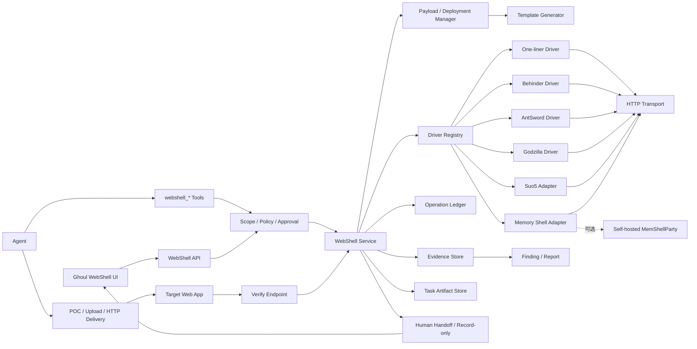

# Ghoul WebShell 管理功能规划

> 状态：Draft v2
> 日期：2026-11-10
> 定位：Agent-first、Headless-first、UI-optional 的 WebShell 会话与操作管理能力
> 调研依据：见 [WEBSHELL_RESEARCH_NOTES.md](./WEBSHELL_RESEARCH_NOTES.md)

## 1. 结论摘要

Ghoul 不应把现成 WebShell GUI、第三方 MCP 或 CLI 原样接入 Agent。正确做法是：

1. Agent 负责生成 WebShell payload、调用现有 POC/上传/HTTP 工具落地、验证连接，并把成果登记为 Ghoul session。
2. Ghoul 原生负责会话、任务绑定、审批、幂等、证据和清理。
3. 用统一 Driver 适配一句话、冰蝎、蚁剑、哥斯拉、Suo5 和内存马。
4. Suo5 优先复用 MIT 的 `zema1/suo5` Go 模块。
5. 哥斯拉、冰蝎、一句话和蚁剑使用 Ghoul 原生 Go Driver，只借鉴 MIT 项目的协议行为和 fixture。
6. 内存马生成通过可选的、自托管的 MemShellParty 服务完成，不把公开生成服务作为生产依赖。
7. 后两个无许可证的哥斯拉项目只能作为功能清单参考，禁止复制源码、二进制或 payload。
8. 人工在 Ghoul UI 中同步看到 Agent 创建的 payload、session 和操作结果，可以接管、继续使用，或导出给原版冰蝎/哥斯拉/蚁剑加载器。
9. Agent 默认不直接看到密码、key、Cookie、审批 token、本地任意路径或第三方原始 MCP；凭据由 Ghoul 生成和保存，人工按需揭示。

这不是一个 GUI 功能，而是一个远程操作内核：

```text
Payload/Deployment -> WebShell Driver -> Session Service
                   -> Policy/Approval -> Operation/Evidence
                   -> Agent Tools / Human Handoff / UI
```

核心业务闭环是：

```text
Agent 选择 payload
  -> Ghoul 生成随机凭据和 artifact
  -> Agent 通过 POC/上传/RCE 工具把 artifact 落到目标
  -> Agent 调用 verify
  -> Ghoul 创建 task-bound WebShell session
  -> Agent 使用 recon/file/db/exec/tunnel 继续内网操作
  -> 人工在 UI 同步查看、接管、导出或用原版加载器连接
```

## 2. 调研结论

本轮通过 `http://127.0.0.1:12306` 代理实际拉取并检查了参考项目的默认分支和关键源码。完整 commit、许可证和问题记录见 [WEBSHELL_RESEARCH_NOTES.md](./WEBSHELL_RESEARCH_NOTES.md)。

### 2.1 可借鉴

| 项目 | 可借鉴内容 | Ghoul 使用方式 |
|---|---|---|
| EtherGhost | 会话接口、PHP/Behinder 协议、文件分块、测试环境 | 协议与测试参考，不嵌入 |
| memshell-party-cli | 协议注册表、结构化结果、OP log、重定向/代理策略 | Agent 工具和协议契约参考 |
| CyberStrikeAI | 连接级 AI 上下文、项目/RBAC、OS/编码探测、终端和文件 UI | 产品基线对照，保留其连接工作流 |
| Suo5 | 成熟 HTTP 隧道、SOCKS5/Forward、连接模式 | 直接复用 MIT Go 模块 |
| MemShellParty | Java 内存马生成能力 | 可选自托管生成服务 |
| AntSword | 编码器/解码器分类和插件生态 | 协议与编码器测试参考 |
| GodzillaSuper | 功能目录、内存马生命周期、终端会话 | 仅需求参考，无许可证 |
| Godzilla-MCP-Headless | stdio/HTTP 无头 MCP 形态 | 仅交互形态参考，无许可证 |

### 2.2 不能直接采用

1. `GodzillaSuper` 和 `Godzilla-MCP-Headless` 没有许可证。
2. 哥斯拉系 MCP 暴露大量高危工具，且存在凭据通过详情接口返回给调用方的问题。
3. `Godzilla-MCP-Headless` 的 HTTP 模式没有鉴权，默认监听 `0.0.0.0`。
4. `memshell-party-cli` 的 `target_list` 会返回已保存的完整凭据。
5. `EtherGhost` 支持任意 PHP eval、反向 Shell、TCP 发送和动态加载 encoder/decoder，不能作为 Agent 的直接工具面。
6. `jiushill/godzilla-mcp` 虽在 README 中声称 MIT，但仓库没有 LICENSE 文件，协议实现也明显简化，不能作为可靠基线。
7. `qtc-de/webshell-cli` 是 GPL-3.0，且只支持自带 Shell，不适合复制实现。
8. CyberStrikeAI 的 WebShell 实现只覆盖普通 `pass + cmd` 一句话：`manage_webshell_add` 只登记已有连接，不生成 payload，不支持冰蝎/哥斯拉/蚁剑加密协议、Suo5 或内存马。

### 2.3 设计必须吸收的事实

- 哥斯拉首次请求需要上传 payload class，后续请求依赖会话 Cookie 和序列化参数。
- 冰蝎需要按请求构造 class、处理 AES/XOR、base64/raw 和响应 envelope。
- Suo5 需要握手、连接模式探测、CookieJar、心跳、分块和本地 SOCKS5/Forward 生命周期。
- 大型文件不能走模型上下文，应直接落到 Ghoul artifact/evidence 或任务 workspace。
- 第三方 CLI/MCP 的凭据目前大多明文保存或直接返回给调用方，Ghoul 必须主动消除该接口。
- 目标端字符集、WAF、Nginx 缓冲、重定向、TLS 和动态 Cookie 都会改变协议行为。
- CyberStrikeAI 证明“连接级 AI 上下文 + 9 工具面”可用，但它的密码明文存储、ad hoc URL 执行和直接文本返回不适合作为 Ghoul 的安全基线。

## 3. 功能目标

1. Agent 能生成、记录、验证和使用由当前任务创建的 WebShell。
2. Agent 创建的 session 自动同步到 Ghoul 任务工作区，人工可以看到同一份成果。
3. 人工可以把 Agent session 标记为“接管”“导出给原版加载器”或“仅记录”。
4. 对常见 WebShell 提供统一的连接测试、能力探测、健康状态和操作入口。
5. 支持受控的侦察、文件、数据库、命令、隧道和内存马操作，用于后续内网渗透。
6. 所有写操作和危险操作进入 Ghoul 审批账本。
7. 原始输出、文件、数据库结果和隧道记录物化为证据，可关联 Finding。
8. 新增协议不需要扩大 Agent 工具面。
9. 默认关闭，默认最小权限，失败时 fail-closed。
10. 对未授权目标、内部地址、宿主机任意路径和本地代理滥用进行限制。

### 3.1 三种工作模式

| 模式 | 行为 | 适用场景 |
|---|---|---|
| Agent-managed | Agent 生成、落地、验证并继续使用 session；人工可同步接管 | 主路径，自动化测试和后续内网操作 |
| Record-only | Agent 只记录 URL、类型、连接说明和备注；人工使用原版加载器 | 兼容已有工具、人工接管或 Agent 不具备协议驱动时 |
| Imported-managed | 人工或 Agent 导入已有 session，并补齐凭据后由 Ghoul 管理 | 已有 WebShell 复用、手工接管后继续自动化 |

Record-only 是一种 session 状态，不是另一套系统。它必须能升级为 Imported-managed，避免“记录完就失去自动化能力”。

### 3.2 人机同步

人工 UI 至少显示：

- 谁创建的 payload；
- 目标、类型、编码、上传路径和时间；
- session 状态、最后验证时间和能力；
- Agent 已执行的操作和待审批操作；
- 原始加载器连接信息；
- 是否已被人工接管、导出或标记为仅记录；
- 关联的 evidence、资产和 Finding。

## 4. 非目标

- 不在 WebShell 模块内部重写完整漏洞利用引擎；payload 落地优先复用 Ghoul 的 POC、Bash、HTTP 和文件上传能力。
- 首期只实现模板化 payload，不实现任意自定义 WebShell 生成器。
- 首期不实现完整 GUI 式文件管理器和插件市场。
- 不把 GodzillaSuper、Godzilla-MCP-Headless 或 memshell-party-cli 的原始 MCP 直接注册进 Ghoul。
- 不执行未知 Node.js/Python 编码器或插件。
- Agent 不直接读取目标密码、AES key、Cookie、MCP token；这些值由 Ghoul 生成和管理。
- 不允许 Agent 直接指定宿主机任意本地路径。
- 不允许第三方 MCP 自行绕过 Ghoul 的 Confirm/Danger 策略。

## 5. 架构决策

### 5.1 选择原生核心，不做 WebShell sidecar

理由：

- Ghoul 是 Go 项目，已有 C2 原生工具、审批和证据模式。
- 现有 Python/Node/Java 参考项目没有同时满足许可证、无头、审批和证据要求。
- 原生 Go Driver 更容易做任务绑定、context 取消、限流、速率控制和服务重启恢复。
- Suo5 已经是 MIT Go 模块，可以直接作为依赖或受控子进程。
- 内存马生成保留为可选外部服务，因为其 Java 生态复杂度和更新频率高于核心会话层。

### 5.2 目标架构



### 5.3 模块划分

建议使用现有 Go 代码边界：

```text
internal/webshell/
  types.go                 # Session, Capability, Operation types
  driver.go                # 基础 Driver 接口
  registry.go              # Driver 注册表
  transport.go             # HTTP/TLS/proxy/cookie/redirect limits
  service.go               # 会话生命周期、并发、幂等
  policy.go                # action-level risk
  payload/
    generator.go           # 模板化 payload
    deployment.go          # payload/deployment 状态
    handoff.go             # 原版加载器交接
  drivers/
    oneliner/
    behinder/
    antsword/
    godzilla/
  suo5/                    # zema1/suo5 适配器
  generator/
    memsparty/             # 可选自托管生成服务

db/webshell.go             # profiles/sessions/bindings/operations/evidence
db/webshell_*.go
server/webshell_api.go
server/webshell_tools.go
server/webshell_service.go
web/src/app/(main)/function/webshell/
web/src/app/(main)/system/webshell/
```

## 6. Driver 接口

### 6.1 基础 Driver

Driver 负责协议身份、探测、初始化和关闭，不直接操作数据库：

```go
type Driver interface {
    Name() string
    Version() string
    Probe(ctx context.Context, profile Profile) (*ProbeResult, error)
    Open(ctx context.Context, session *Session) (OpenedSession, error)
}

type OpenedSession interface {
    Capabilities() []Capability
    Close() error
}
```

### 6.2 按能力拆分接口

不要用一个通用的 `Execute(action, params)` 接收任意动作。每个能力独立接口，便于按角色绑定和按 action 计算风险：

```go
type ExecDriver interface {
    Exec(ctx context.Context, req ExecRequest) (*ExecResult, error)
}

type FileDriver interface {
    ListDir(ctx context.Context, path string) ([]DirEntry, error)
    ReadFile(ctx context.Context, path string, maxBytes int64) (*FileResult, error)
    WriteFile(ctx context.Context, path string, artifactID string) (*WriteResult, error)
    DeleteFile(ctx context.Context, path string) error
}

type DatabaseDriver interface {
    ListDatabases(ctx context.Context) ([]string, error)
    ListTables(ctx context.Context, database string) ([]string, error)
    ReadSchema(ctx context.Context, database string) (*SchemaResult, error)
    ExecSQL(ctx context.Context, sql string) (*DBResult, error)
}

type TunnelDriver interface {
    Start(ctx context.Context, req TunnelRequest) (*TunnelStatus, error)
    Status(ctx context.Context, tunnelID string) (*TunnelStatus, error)
    Stop(ctx context.Context, tunnelID string) error
}

type MemoryDriver interface {
    List(ctx context.Context) ([]MemoryShell, error)
    Inject(ctx context.Context, req MemoryInjectRequest) (*OperationResult, error)
    Remove(ctx context.Context, id string) (*OperationResult, error)
}
```

核心服务根据 session 的 `capabilities` 断言具体接口。缺失能力必须返回明确的 unsupported 错误，不允许猜测或自动降级。

### 6.3 Driver manifest

每个 Driver 发布 manifest：

```json
{
  "name": "godzilla",
  "version": "1.0.0",
  "family": "java",
  "actions": {
    "probe": "read",
    "recon": "read",
    "file_list": "confirm",
    "file_read": "confirm",
    "file_write": "danger",
    "db_schema": "confirm",
    "db_exec": "danger",
    "exec": "danger",
    "tunnel_start": "danger",
    "memory_list": "confirm",
    "memory_inject": "danger",
    "memory_remove": "danger"
  },
  "secret_fields": ["password", "secret_key", "cookie", "header_value"],
  "max_session_concurrency": 1,
  "requires_cookie_jar": true
}
```

Driver 只能建议 action，最终风险等级由 Ghoul 的内置策略表决定。

## 7. 协议适配决策

### 7.1 One-liner

支持：

- PHP 一句话；
- Linux 命令一句话；
- 基础 POST/GET/Header 传参；
- 明确声明的 encoder/decoder。

约束：

- 不执行任意 eval 字符串；
- 不通过 Node.js/Python 动态加载 encoder；
- 编码器采用内置枚举或签名插件；
- 响应必须有唯一定界和错误分类；
- 默认只支持命令、目录、文件读取和基础系统信息。

### 7.2 Behinder

参考：

- EtherGhost 的 PHP/JSP Behinder 实现；
- memshell-party-cli 的 Behinder envelope、分块和完整性校验。

首期动作：

- 连接测试；
- 系统信息；
- 文件列表/读取；
- 目录写、上传、下载、删除；
- 命令执行；
- 数据库只读与写操作。

约束：

- 支持 base64/raw request encoding 探测；
- 每个 session 固定协议参数，不允许每次动作自由切换；
- 分块上传失败必须返回“远端文件可能不完整”；
- 下载必须有本地 SHA256、大小和证据记录。

### 7.3 AntSword

首期不把 AntSword 放在 P0，原因：

- encoder/decoder 生态复杂；
- 常见实现依赖 Node.js 执行 JS；
- 动态插件会扩大本地代码执行面。

后续方案：

- 内置常用 base64/xor/chr 等声明式编码器；
- 插件必须签名并声明输入/输出类型；
- 禁止通过 `nodejs_eval` 执行任意第三方脚本；
- 使用 AntSword/ EtherGhost 的脱敏样例作为 fixture。

### 7.4 Godzilla

这是首期最重要的协议之一。

核心流程：

1. 用密码和 key 计算会话密钥和响应包装；
2. 首次请求上传 payload class；
3. 保存服务端返回的 Cookie；
4. 后续请求序列化方法名和参数；
5. 解包、解密、解压并解析结果。

实现约束：

- 每个 session 维护独立 CookieJar 和密钥状态；
- 同一 session 的 bootstrap 和后续请求串行化；
- 禁止在不同 session 间复用 Cookie；
- 支持 UTF-8/GBK 等平台编码；
- payload class/asset 必须做独立许可证和来源审查；
- 只采用 MIT 许可或自行编写的协议资产；
- 不复用无许可证 GodzillaSuper/Headless 的 payload、jar 或 MCP 实现。

### 7.5 Suo5

复用 `github.com/zema1/suo5/suo5`：

- 使用 `Suo5Config`；
- 使用 `Connect(ctx, config)`；
- 使用 `Suo5Client`；
- 使用 `ctrl` 中的 SOCKS5/Forward handler 或等价内部封装；
- 支持 `auto/full/half/classic`；
- 支持 CookieJar、浏览器头、上游代理、心跳和 excluded domains。

Ghoul 外层必须增加：

- 本地监听只允许 `127.0.0.1`，随机端口；
- 本地 SOCKS5 认证；
- 目标 allowlist/排除域名；
- 最大连接数、最大流量、最大持续时间；
- 任务结束自动回收；
- 操作和流量摘要写入 evidence；
- 前端只显示状态和连接计数，不默认展示完整代理凭据。

版本注意：

- Suo5 当前 `go.mod` 要求 Go 1.26.5，Ghoul 当前为 Go 1.26.3；
- 优先升级 Go 后直接作为模块依赖；
- 如暂不升级，使用固定版本 CLI 作为受控子进程，不通过第三方 MCP。

### 7.6 内存马

内存马不是普通文件操作，单独建模。

推荐：

- 使用自托管 `MemShellParty` 生成 payload；
- 只允许固定镜像 digest 和 `MEMPARTY_API_URL`；
- 禁止默认调用公开 `party.mem.mk`；
- 生成的 class/jar 进入 Ghoul artifact 存储；
- 注入前后记录容器、context path、class、hash 和健康状态；
- 卸载失败时，状态必须保持 `unknown` 并进入清理清单；
- 注入、卸载、配置修改全部为 Danger。

首期支持：

- List/health；
- 记录人工注入结果；
- 生成 payload；
- 注入和卸载放在后续阶段。

## 8. 数据模型

WebShell 使用独立的 `webshell_*` 表，不复用或重载 `c2_*` 表。C2 与 WebShell 的执行源、会话语义和风险目录不同。Phase 0-3 不重构现有 C2；如后续需要，只抽取审批 token/HMAC 这类纯函数，不把 C2 operation service 直接复用为 WebShell service。

### 8.1 `webshell_profiles`

连接配置模板，必须把凭据与配置分离：

- `id`
- `name`
- `driver`
- `endpoint`
- `method`
- `request_template`
- `encoding_config`
- `secret_ref`
- `credential_version`
- `credential_mode`：`generated|external_ref|none`
- `origin`：`agent_generated|manual|imported`
- `managed`：是否允许 Agent 通过 Driver 操作
- `proxy_ref`
- `tls_config`
- `created_by`
- `created_at`
- `updated_at`

`secret_ref` 只允许：

- `env:NAME`
- `file:PATH`
- Ghoul 内部 `vault:webshell/<profile-id>`，保存由 Ghoul 随机生成的凭据

禁止：

- 明文 password/key/cookie；
- 将 secret 放入 request template；
- 让 Agent 自行选择或读取 password/key；
- 让 Agent 覆盖已有 profile 的 secret。

Agent 可以请求 Ghoul 创建一个 `generated` profile，但凭据由服务端随机生成并只写入内部 vault。Agent 只收到 `profile_id` 和后续 `session_id`。

### 8.2 `webshell_sessions`

- `id`
- `profile_id`
- `driver`
- `driver_version`
- `endpoint`
- `target_host`
- `target_ip`
- `asset_id`
- `company_id`
- `language`
- `server`
- `os`
- `arch`
- `username`
- `cwd`
- `capabilities_json`
- `status`
- `fingerprint`
- `last_seen_at`
- `last_error`
- `raw_hash`
- `metadata_json`
- `created_by`：`agent|human`
- `origin`：`agent_generated|manual|imported`
- `managed`：`true|false`
- `visibility`：`task|shared`
- `source_payload_id`
- `source_deployment_id`
- `handoff_status`：`none|available|claimed|exported`
- `claimed_by`
- `claimed_at`
- `created_at`
- `updated_at`

不保存 password、key、Cookie 或完整认证 header。Cookie 只保存在加密的运行时状态或短期 secret store。

`managed=false` 的 session 就是 Record-only：只保存目标、类型、备注、原始加载器连接说明和可选密文交接包，不允许 Agent 调用 `webshell_exec/file/db/tunnel/memory`。它可以在人工补齐凭据后升级为 `managed=true`。

### 8.2.1 `webshell_payloads`

记录 Agent 创建的 payload：

- `id`
- `task_id`
- `profile_id`
- `driver`
- `language`
- `encoding`
- `cryptions`
- `template`
- `artifact_id`
- `class_name`
- `sha256`
- `secret_ref`
- `status`：`generated|deploying|deployed|verified|abandoned`
- `created_by`
- `created_at`
- `verified_at`

Agent 只接收 `payload_id` 和 `artifact_id`。payload 内嵌的目标密码/key 由服务端随机生成，不返回 Agent。

### 8.2.2 `webshell_deployments`

- `id`
- `payload_id`
- `task_id`
- `target_asset_id`
- `endpoint`
- `method`
- `delivery_tool`
- `delivery_operation_id`
- `status`：`pending|uploaded|unreachable|verified|failed`
- `evidence_id`
- `error`
- `started_at`
- `verified_at`

`delivery_tool` 记录 Agent 使用了哪个 POC、Bash、HTTP 或文件上传能力。payload 落地和 session verify 是分开的状态，避免把“上传成功”误认为“WebShell 可用”。

### 8.3 `webshell_session_bindings`

- `session_id`
- `task_id`
- `asset_id`
- `company_id`
- `binding_reason`
- `bound_by`
- `bound_at`
- `expires_at`
- `active`

同一 session 只允许一个 active binding。Agent 工具必须通过 binding + task + scope 三重校验。

### 8.4 `webshell_operations`

- `id`
- `session_id`
- `binding_id`
- `task_id`
- `tool`
- `action`
- `level`
- `actor`
- `source`
- `params_json`
- `params_hash`
- `idempotency_key`
- `status`
- `approval_required`
- `approval_stages`
- `scope_snapshot`
- `artifact_id`
- `output_summary`
- `output_sha256`
- `error`
- `requested_at`
- `approved_at`
- `dispatched_at`
- `completed_at`
- `expires_at`

状态：

- `pending_approval`
- `approved`
- `dispatching`
- `running`
- `completed`
- `failed`
- `denied`
- `expired`
- `cancelled`

### 8.5 `webshell_operation_approvals`

沿用 Ghoul C2 审批模式：

- HMAC 签名；
- 单次使用；
- TTL 60-3600 秒；
- params hash；
- session/task/scope snapshot 绑定；
- 只保存 token hash；
- Danger 两个独立阶段；
- 拒绝或过期不可恢复。

### 8.5.1 `webshell_handoffs`

供人工同步接管使用：

- `session_id`
- `format`：`behinder|godzilla|antsword|one_liner|suo5|generic`
- `encrypted_blob`
- `reveal_policy`：`owner_only|shared_task`
- `created_by`
- `created_at`
- `revealed_at`
- `revoked_at`

交接包可以包含 URL、密码、key、Cookie、请求头和加载器参数。它必须加密保存，只在人工显式揭示或复制时解密，不能进入 Agent 工具响应、日志或操作摘要。

### 8.6 `webshell_evidence`

- `operation_id`
- `session_id`
- `task_id`
- `finding_id`
- `kind`
- `title`
- `mime`
- `content`
- `storage_ref`
- `sha256`
- `size`
- `redacted`
- `metadata_json`
- `created_at`

### 8.7 `webshell_memory_shells`

- `session_id`
- `operation_id`
- `component`
- `container`
- `context_path`
- `injection_type`
- `injector`
- `class_name`
- `class_hash`
- `status`
- `injected_at`
- `last_checked_at`
- `remove_hint`
- `evidence_id`

### 8.8 `webshell_tunnels`

- `session_id`
- `operation_id`
- `mode`
- `listen_addr`
- `listen_port`
- `target_scope`
- `status`
- `connections`
- `bytes_up`
- `bytes_down`
- `started_at`
- `last_heartbeat_at`
- `expires_at`
- `error`

## 9. Agent 工具面

### 9.1 工具数量

第三方 MCP 的 29/56/70+ 工具面不适合直接进入模型上下文。建议核心工具不超过 9 个，其中载荷/部署工具按需延迟加载。

| 工具 | 默认等级 | Planner | Worker | Pentest | 说明 |
|---|---|---|---|---|---|
| `webshell_session` | read | 是 | 是 | 是 | list/context/health |
| `webshell_recon` | read | 是 | 是 | 是 | 白名单只读侦察 |
| `webshell_operation` | read | 是 | 是 | 是 | 操作状态和证据摘要 |
| `webshell_file` | confirm/danger | 否 | 是 | 是 | list/read/write/upload/delete |
| `webshell_db` | confirm/danger | 否 | 是 | 是 | schema/query/exec |
| `webshell_exec` | danger | 否 | 是 | 是 | 单次命令 |
| `webshell_tunnel` | read/danger | 否 | 是 | 是 | status/start/stop |
| `webshell_memory` | confirm/danger | 否 | 是 | 是 | list/inject/remove |
| `webshell_payload` | confirm/danger | 否 | 是 | 是 | generate/record/verify/abandon，deferred |

### 9.2 Action-level policy

| 工具/action | 等级 | 说明 |
|---|---|---|
| `webshell_session/list` | read | 只列出绑定会话 |
| `webshell_session/context` | read | 不返回秘密和完整认证信息 |
| `webshell_session/health` | read | 连接测试，有速率限制 |
| `webshell_payload/generate` | confirm | 生成随机凭据和 artifact，不返回 secret |
| `webshell_payload/record_external` | danger | 记录外部已落地 WebShell；默认 record-only |
| `webshell_payload/verify` | read | 验证已落地 payload 并创建 managed session |
| `webshell_payload/abandon` | confirm | 标记 payload 不再使用，不删除证据 |
| `webshell_recon/system_info` | read | 白名单只读 |
| `webshell_recon/processes` | read | 只返回摘要或证据引用 |
| `webshell_recon/network` | read | 只返回摘要或证据引用 |
| `webshell_operation/status` | read | 只返回摘要和 evidence ref |
| `webshell_file/list` | confirm | 目录枚举 |
| `webshell_file/read` | confirm | 大文件转为 evidence |
| `webshell_file/write` | danger | 写前/写后 hash |
| `webshell_file/upload` | danger | 只接受 Ghoul artifact |
| `webshell_file/delete` | danger | 必须记录目标 |
| `webshell_db/schema` | confirm | 元数据 |
| `webshell_db/query` | danger | SQL 一律按危险动作处理 |
| `webshell_exec/run` | danger | 两阶段审批 |
| `webshell_tunnel/status` | read | 只读状态 |
| `webshell_tunnel/start` | danger | 需 `allow_tunnel` |
| `webshell_tunnel/stop` | confirm | 关闭隧道 |
| `webshell_memory/list` | confirm | 枚举内存马 |
| `webshell_memory/inject` | danger | 需 `allow_memory` |
| `webshell_memory/remove` | danger | 需 `allow_memory` |
| `webshell_payload/deploy_request` | danger | 可选：请求 Ghoul 调度 POC/上传工具落地 |

### 9.3 工具参数约束

- 所有操作都使用 `session_id`，不接受 URL、密码、key、Cookie。
- `webshell_payload/generate` 不接受 password/key；目标凭据由 Ghoul 生成并写入内部 vault。
- `webshell_payload/verify` 只接受 `payload_id`、`deployment_id` 和 `endpoint`，不返回凭据。
- `webshell_payload/record_external` 默认只能创建 `managed=false` 的 record-only session；升级为 managed 必须人工补齐凭据。
- 文件上传使用 `artifact_id`，不使用任意 `local_path`。
- 文件下载返回 `evidence_ref`，不返回大段文件内容。
- SQL 不接受“请自动判断是否只读”，默认按 Danger 处理。
- `webshell_payload` 只接受已注册的生成器 preset，不接受任意模板或任意 class。
- 工具不允许传 `risk_level`、`approval_token`、`force` 等策略绕过参数。
- 核心工具 schema 目标保持在 2,000 estimated tokens 以内，并在 CI 中记录 baseline，避免后续 Driver 增长导致 Agent 上下文膨胀。

### 9.4 工具返回

```json
{
  "operation_id": 123,
  "status": "pending_approval",
  "tool": "webshell_exec",
  "action": "run",
  "level": "danger",
  "approval_required": true,
  "approval_stages": 2,
  "session_id": "ws-...",
  "output_summary": "",
  "evidence_refs": [],
  "note": "Use the Ghoul WebShell approval center. Approval tokens and credentials are never returned to the agent."
}
```

完成后：

```json
{
  "operation_id": 123,
  "status": "completed",
  "exit_code": 0,
  "output_summary": "uid=33(www-data) gid=33(www-data)",
  "truncated": false,
  "evidence_refs": ["ws-evidence-456"],
  "warnings": []
}
```

## 10. 操作流程

### 10.1 Agent 创建 WebShell

1. Agent 调用 `webshell_payload/generate`，选择 Driver、语言、编码和模板。
2. Ghoul 在服务端生成随机 password/key，写入 `vault:webshell/<profile-id>`，Agent 不接收 secret。
3. Ghoul 生成 payload artifact，返回 `payload_id`、`artifact_id` 和部署要求。
4. Agent 使用现有 POC、Bash、HTTP 或文件上传工具，把 artifact 落到目标。
5. Agent 把目标 URL、请求方式、header/Cookie 参数和 `deployment_id` 提交给 `webshell_payload/verify`。
6. Ghoul 从 vault 读取凭据，执行真实协议 probe。
7. probe 成功后创建 `managed=true` session，并自动绑定当前 task/asset/company。
8. UI 同步出现“Agent 创建的 WebShell”，人工可以查看、接管、导出或继续追加备注。

生成、部署、验证是三个独立状态。上传成功但 probe 失败时，不能把 session 标为 online，也不能给 Agent 开启后续操作。

### 10.1.1 Record-only 与人工接管

1. Agent 可以调用 `webshell_payload/record_external` 记录由其他工具落地的 WebShell。
2. 默认创建 `managed=false` record-only session，只保存 endpoint、类型、备注和人工补充的连接说明。
3. 人工在 UI 中确认凭据后，可以把 record-only 升级为 managed session。
4. 人工可以生成 `webshell_handoffs`，将 payload、endpoint、认证参数、编码和请求头交给原版加载器。
5. handoff 明文只在人工揭示/复制时出现，不进入 Agent 响应和日志。

### 10.1.2 人工新增与管理

人工仍可创建 profile、导入已有 session、修改 TTL、绑定资产和撤销 Agent session。Agent 的 profile 写权限由 `allow_agent_payload_generate` 和 `allow_agent_session_create` 控制，不能覆盖人工配置。

### 10.1.3 原版加载器交接格式

| 加载器 | 交接字段 |
|---|---|
| 冰蝎 | URL、password、PHP/JSP 类型、请求编码、必要 header/Cookie |
| 哥斯拉 | URL、password、key、payload 类型、cryption、header/Cookie、WebSocket/Upgrade 参数 |
| 蚁剑 | URL、password、Shell 类型、encoder/decoder、请求方法、参数名 |
| 一句话 | URL、HTTP 方法、参数位置、参数名、编码方式 |
| Suo5 | URL、HTTP 方法、header/Cookie、连接模式、代理备注 |

交接信息由 `webshell_handoffs.encrypted_blob` 保存。UI 可以提供复制按钮、JSON 导出和“在本地打开原版工具”的提示，但不在 Ghoul 进程内启动第三方 GUI。

### 10.2 只读操作

1. Agent 调用 `webshell_recon`。
2. 策略检查 task binding、RoE、session status 和 scope。
3. Driver 执行白名单动作。
4. 原始结果 sanitize 后写入 evidence。
5. Agent 只接收摘要和 evidence 引用。

### 10.3 Confirm 操作

1. Agent 调用 `webshell_file/list`。
2. 创建 `pending_approval` operation。
3. 生成单次 token，只发送到审批中心。
4. 人工批准后服务端执行。
5. 原始目录和错误写入 evidence。
6. Agent 通过 `webshell_operation` 查询状态。

### 10.4 Danger 操作

1. 默认关闭。
2. 需要 `allow_confirm=true` 且 `allow_danger=true`。
3. 生成两个独立审批阶段。
4. 两个阶段绑定相同 params hash、session、task 和 scope。
5. 任一阶段拒绝或过期则终止。
6. 完成后禁止自动重试；需要重新发起新 operation。

### 10.5 内存马生命周期

1. 生成 payload，记录 hash 和来源。
2. 注入前记录容器、context path 和已知 Servlet/Filter 基线。
3. 注入后健康检查。
4. 写入 `webshell_memory_shells`。
5. 卸载或标记 `unknown`。
6. 任务结束前展示未清理清单。

### 10.6 隧道生命周期

1. 开启前验证目标 scope、端口和持续时间。
2. 本地监听限制在 `127.0.0.1`。
3. 本地 SOCKS5 默认启用认证。
4. 设置最大连接数、最大流量和过期时间。
5. 任务取消或结束时自动关闭。
6. 记录连接数、流量、错误和关闭原因。

## 11. API 与 UI

### 11.1 API

```text
GET  /api/webshell/status
GET  /api/webshell/security

GET  /api/webshell/profiles
POST /api/webshell/profiles
PUT  /api/webshell/profiles/:id
DEL  /api/webshell/profiles/:id

GET  /api/webshell/payloads
POST /api/webshell/payloads/generate
GET  /api/webshell/payloads/:id
POST /api/webshell/payloads/:id/verify
POST /api/webshell/payloads/:id/abandon

GET  /api/webshell/sessions
POST /api/webshell/sessions/test
GET  /api/webshell/sessions/:id
POST /api/webshell/sessions/:id/bind
POST /api/webshell/sessions/:id/unbind
POST /api/webshell/sessions/:id/claim
POST /api/webshell/sessions/:id/record-only

GET  /api/webshell/handoffs
POST /api/webshell/sessions/:id/handoff
POST /api/webshell/handoffs/:id/reveal
POST /api/webshell/handoffs/:id/revoke

GET  /api/webshell/operations
POST /api/webshell/operations
GET  /api/webshell/operations/:id
POST /api/webshell/operations/:id/execute
POST /api/webshell/operations/:id/approve
POST /api/webshell/operations/:id/reject
POST /api/webshell/operations/:id/cancel

GET  /api/webshell/evidence
GET  /api/webshell/tunnels
GET  /api/webshell/memory-shells
GET  /api/webshell/events
GET  /api/webshell/ws
```

### 11.2 页面

- `/function/webshell`：会话列表、状态、绑定；
- `/function/webshell/payloads`：Agent 创建的 payload 和部署状态；
- `/function/webshell/sessions/[id]`：详情；
- `/function/webshell/profiles`：人工配置；
- `/function/webshell/handoffs`：交接记录；
- `/system/webshell/approvals`：审批中心；
- `/system/webshell/security`：安全自检。

会话详情 tabs：

- Overview：目标、运行时、能力、指纹、最后在线；
- Handoff：原始加载器连接信息、导出格式和揭示记录；
- Recon：系统、进程、网络、环境；
- Files：目录、读取、上传、下载、删除；
- Database：库、表、schema、SQL；
- Shell：终端交互，Danger 动作显式阻断；
- Tunnel：Suo5 状态和连接；
- Memory：内存马清单、健康检查、卸载；
- Operations：状态、审批、错误；
- Evidence：原始证据和 Finding 关联。

UI 应遵守 Ghoul 现有操作型界面：密集、可扫描、可重复操作，不复制第三方 GUI。

会话列表必须区分：

- `Agent created`
- `Agent managed`
- `Human claimed`
- `Record-only`
- `Imported-managed`

人工点击 `Take over` 只改变控制权和展示状态，不复制会话数据，也不破坏 Agent 后续使用的权限。

## 12. 安全边界

### 12.1 默认配置

```json
{
  "webshell": {
    "enabled": false,
    "allow_confirm": false,
    "allow_danger": false,
    "allow_tunnel": false,
    "allow_memory": false,
    "allow_agent_payload_generate": false,
    "allow_agent_session_create": false,
    "allow_agent_record_external": false,
    "allow_external_mcp": false,
    "allow_public_generator": false,
    "allow_unscoped_sessions": false,
    "danger_approvals": 2,
    "approval_ttl_seconds": 300,
    "max_operations_per_minute": 30,
    "max_response_bytes": 262144,
    "max_artifact_bytes": 67108864,
    "max_concurrent_per_session": 1,
    "allowed_hosts": [],
    "allow_insecure_http": false,
    "tls_ca_file": ""
  }
}
```

### 12.2 Secret

- Agent 可以请求生成 payload/session，但不读取、不写入 secret；
- payload 凭据由 Ghoul 生成并保存在内部 vault；
- profile 只保存 secret ref；
- 运行时 Cookie/密钥只存在受控缓存；
- secret 不进入日志、错误、operation summary、evidence 或前端持久化；
- dump/profile export 默认剔除 secret 字段；
- `file:` secret 在 Unix 上必须拒绝 group/world 可读文件。
- 远程输出统一视为不可信数据。可复用现有 `sanitize.Text` 的 ANSI 清理、secret 脱敏和截断能力，但 WebShell 使用独立的 `UNTRUSTED REMOTE OUTPUT` 边界，不改变 C2 现有提示。

### 12.3 目标范围和 SSRF

- 只允许 `http/https`，WebSocket 明确允许 `ws/wss`；
- 解析后的 IP 必须通过 allowlist 和 RoE；
- 默认阻断 loopback、link-local、metadata 和未授权私网；
- 重定向后重新校验目标；
- 禁止自动跟随 30x 到范围外地址；
- 代理只使用 profile 显式配置；
- 默认忽略系统 `HTTP_PROXY/HTTPS_PROXY`，防止 shell 流量意外泄漏到全局代理；
- DNS rebinding 测试必须覆盖。

### 12.4 本地文件和 artifact

- Agent 不能传本地任意路径；
- 上传使用 task artifact；
- 下载进入 evidence 或临时 artifact；
- 临时文件必须有 TTL 和清理；
- 文件名、MIME、大小和 hash 校验；
- 二进制内容不进入模型上下文。

### 12.5 外部 MCP

如果后续需要接入第三方 MCP：

- 只能通过 Ghoul 的 MCP adapter；
- 默认关闭；
- 只允许明确 allowlist 的只读工具；
- 禁止 `add/edit/delete/exec/upload/download/generate/config/plugin/settings` 等工具；
- 返回结果必须过滤 secret；
- 第三方 MCP 不得直接调用写操作；
- 工具 schema 必须小于预算；
- 所有产物由 Ghoul 落证据，不信任第三方日志。

## 13. 复用策略

| 能力 | 决策 |
|---|---|
| 会话、绑定、审批、证据、artifact | Build |
| One-liner Driver | Build |
| Behinder Driver | Build，参考 MIT 实现 |
| Godzilla Driver | Build，参考 MIT 协议行为和 fixture |
| AntSword Driver | 后续 Build，先不做动态 JS |
| Suo5 | Reuse `zema1/suo5` |
| 内存马生成 | Optional self-hosted MemShellParty |
| 第三方 GUI | Not integrated |
| 第三方 MCP | Read-only adapter only |
| 第三方 CLI | 只作为可选生成器/验证器，不进入 Agent 工具面 |

### 13.1 CyberStrikeAI 对标后的取舍

保留：

- 连接级 Agent 上下文：选中 session 后把 `connection_id`、目标 OS、编码、当前目录和能力注入 Agent。
- 约 9 个工具的紧凑面：4 个操作工具加 5 个会话管理工具，而不是几十个细碎工具。
- `webshell:read/write/delete` 资源权限、项目绑定、owner 和资源级访问控制。
- 密码在 API/UI 中掩码；内部执行时从受控对象读取真实凭据。
- OS auto 探测、UTF-8/GBK/GB18030 自动解码。
- 前端 xterm、文件管理器、数据库面板和 AI 会话历史。

必须超越：

- CyberStrikeAI 的 `manage_webshell_add` 只是登记已有 URL 和 password，不生成 payload、不部署、不验证 artifact。
- 它只实现 `pass=<password>&<cmd_param>=<command>` 的普通一句话，不覆盖冰蝎、哥斯拉、蚁剑加密协议。
- 文件操作通过 shell 命令实现，不是每一类 WebShell 的原生协议能力。
- 没有 Suo5、内存马、原版加载器 handoff、WebShell 专用 evidence/Finding 链。
- password 明文存 SQLite；连接创建/删除有审计，但 exec/file 没有专用 operation ledger。
- 允许带 URL 和凭据的 ad hoc exec，不符合 Ghoul 的 task-bound session 模型。

因此 Ghoul 的定位不是“CyberStrikeAI 的复刻”，而是：

```text
CyberStrikeAI 的连接管理与 AI 体验
  + Agent 生成/部署 WebShell
  + 原生冰蝎/哥斯拉/蚁剑协议
  + Suo5 内网隧道
  + Secret vault / Operation Ledger / Evidence
  + 原版加载器 handoff
```

## 14. 分阶段实施

### Phase 0：决策和契约

目标：

- 固定许可证和依赖策略；
- 定义 Driver manifest；
- 定义 session/operation/evidence schema；
- 建立 fixture 目录；
- 确认 Go 版本与 Suo5 模块兼容性。
- 建立 Agent 工具 schema token baseline。

交付：

- `internal/webshell` 骨架；
- DB migration；
- action risk 表；
- secret ref 和 URL 校验；
- 受控 lab 计划。

验收：

- 无网络也能跑 fixture；
- 未知 Driver/action 默认拒绝；
- secret 不出现在日志和测试快照中；
- 未绑定 session 不可见；
- 核心工具 schema 不超过预算。

### Phase 1：Agent 创建和记录 WebShell

目标：

- Agent 生成模板化 payload 和随机凭据；
- Agent 记录部署结果并创建 task-bound session；
- 人工可同步接管、导出或把 session 设为 record-only；
- 支持 One-liner、Behinder、Godzilla 的连接测试；
- Suo5 连接测试。

交付：

- `/function/webshell`；
- `webshell_payload/generate|record_external|verify`；
- `webshell_session`、`webshell_operation`；
- `webshell_handoffs` 和原版加载器导出；
- 健康状态、指纹、能力；
- `webshell_security`。

验收：

- Agent 不能指定或读取 password/key，不能覆盖人工 profile；
- Agent 创建的 session 自动出现在任务 UI；
- record-only session 可被人工升级为 managed；
- 原版加载器交接信息只对授权人工揭示；
- Agent 看不到未绑定 session；
- 明细接口不返回凭据；
- 只读工具无审批 token。

### Phase 2：Confirm 只读操作

目标：

- 系统信息、进程、网络、文件列表、文件读取、数据库 schema；
- 单阶段审批；
- evidence 物化。

交付：

- `webshell_recon`；
- `webshell_file/list|read`；
- `webshell_db/schema`；
- 文件浏览器、审批中心。

验收：

- 所有 Confirm 操作创建 pending operation；
- 参数篡改使审批失效；
- 大文件/二进制安全截断；
- 原始输出可追溯。

### Phase 3：Danger 写操作

目标：

- 命令执行；
- 文件写、上传、删除；
- 数据库写；
- 双阶段审批、幂等、禁止自动重试。

交付：

- `webshell_exec`；
- `webshell_file/write|upload|delete`；
- `webshell_db/query|exec`；
- 写前/写后 hash；
- 任务 artifact。

验收：

- 默认配置下所有 Danger 操作被拒绝；
- 两阶段审批缺一不可；
- 失败可恢复并保留错误证据；
- 请求参数和结果不能越过 scope。

### Phase 4：Suo5 隧道

目标：

- 复用 `zema1/suo5`；
- SOCKS5 和 forward；
- 本地监听、认证、scope、流量和 TTL 限制；
- 任务结束自动关闭。

交付：

- `webshell_tunnel`；
- 隧道 UI；
- 连接/流量/错误指标；
- 隧道 evidence。

验收：

- 默认只监听 127.0.0.1；
- 无认证模式默认拒绝非 loopback；
- 不能转发 scope 外目标；
- 任务取消后无残留监听。

### Phase 5：内存马

目标：

- 自托管 MemShellParty 生成器；
- memory shell 生命周期；
- 注入、检查、卸载；
- 清理清单和残留风险。

交付：

- `webshell_memory`；
- `webshell_memory_shells`；
- 自托管生成器适配；
- Memory UI。

验收：

- 默认关闭；
- 生成、注入、卸载均进入审批和 evidence；
- 未清理内存马在任务结束前显式提示；
- 公开生成服务默认禁用。

### Phase 6：扩展和加固

目标：

- AntSword 编码器白名单；
- 可选只读 MCP adapter；
- 插件签名；
- fuzz、SSRF、secret、限流、恢复和 UI 验收。

验收：

- `go test ./...`；
- `go vet ./...`；
- `pnpm exec tsc --noEmit`；
- 关键流程 E2E；
- 无 high/critical 安全问题；
- README 参考项目与开源说明更新。

## 15. 测试方案

### 15.1 协议 fixture

为每个 Driver 保存脱敏 fixture：

- 请求；
- 响应；
- 标准化结果；
- capability；
- 错误分类；
- 期望风险等级；
- 重试行为。

fixture 不得包含真实目标、Cookie、密码或 key。

### 15.2 本地 lab

- PHP-CLI 和 PHP-FPM；
- Tomcat 9 `javax`；
- Tomcat 10 `jakarta`；
- Nginx + Tomcat 缓冲；
- Apache + PHP-FPM；
- One-liner GET/POST/Header；
- Behinder base64/raw；
- Godzilla HTTP 和 WebSocket；
- Suo5 auto/full/half/classic。

### 15.3 安全测试

- Agent 读取其他 task 的 session；
- profile/session 机密字段泄露；
- approval token 重放；
- params hash 不一致；
- 过期 token；
- redirect 跨范围；
- DNS rebinding；
- metadata/loopback SSRF；
- 任意本地路径；
- 大响应和压缩炸弹；
- 并发写同一 session；
- 隧道残留；
- 内存马未卸载；
- OP log/evidence secret 泄漏。

## 16. MVP 建议

MVP 只做：

1. One-liner、Behinder、Godzilla 三个 Driver；
2. Agent 生成模板化 payload，随机凭据留在 Ghoul；
3. Agent 记录部署结果、验证并创建 task-bound session；
4. 人工同步查看、接管、导出给原版加载器，或创建 record-only session；
5. Agent `webshell_session`、`webshell_recon`、`webshell_payload`、`webshell_operation`；
6. Confirm 文件列表/读取和数据库 schema；
7. evidence 物化和 Finding 关联；
8. 审批中心；
9. Suo5 只做连接测试，不开放隧道；
10. 不开放内存马和任意 payload 生成。

MVP 明确不做：

- AntSword 动态 encoder；
- Agent 自定义任意 payload 模板；
- Agent 读取或覆盖人工 profile 的 secret；
- 外部 MCP 全量接入；
- 公共 MemShellParty；
- 本地任意文件路径；
- 内置完整漏洞利用链；payload 落地复用现有 POC/上传/HTTP 工具。

## 17. 资源估算

以下为相对估算，实施前需按团队规模和协议兼容范围调整：

| Phase | 规模 | 主要不确定性 |
|---|---|---|
| Phase 0 | 1-2 周 | 许可证、payload 资产和 Go/Suo5 兼容 |
| Phase 1 | 2-3 周 | 三种协议连接测试和 Cookie/字符集 |
| Phase 2 | 3-4 周 | 文件、DB schema、审批和 evidence |
| Phase 3 | 3-4 周 | 双阶段审批、幂等和写操作 |
| Phase 4 | 1-3 周 | Suo5 模块或子进程集成 |
| Phase 5 | 4-6 周 | 内存马生成器、生命周期和清理 |
| Phase 6 | 2-4 周 | 安全加固、插件和全量测试 |

## 18. 风险清单

| 风险 | 影响 | 缓解 |
|---|---|---|
| 无许可证项目被误用于源码/资产 | 法律和分发风险 | 建立许可证门禁，只用 MIT/自研 |
| Godzilla payload 资产授权不清 | 供应链和分发风险 | 独立审查，优先自研或用户自备 |
| Secret 进入 Agent/日志/evidence | 凭据泄露 | 只保存 ref，统一过滤和测试 |
| 第三方 MCP 绕过审批 | 越权执行 | 不直接接入，只做只读 adapter |
| Agent 指定本地路径 | 宿主文件写入 | 使用 artifact id 和沙箱 workspace |
| Suo5 成为任意内网跳板 | 横向移动风险 | scope、exclude、TTL、连接和流量上限 |
| 内存马无法卸载 | 目标不稳定和残留风险 | 生命周期表、健康检查、清理清单 |
| 协议变体或 WAF 变化 | 连接/执行失败 | fixture、错误分类和版本化 Driver |
| 大文件占满内存 | 服务崩溃 | 流式落盘、分块、大小上限 |
| 全局代理泄漏流量 | 目标数据泄露 | profile 专用代理，默认忽略系统 proxy |

## 19. 待确认问题

1. MVP 是否把 AntSword 推迟到 Phase 6？
2. Godzilla payload class 是自研、MIT 资产复用，还是由用户提供？
3. Suo5 是直接升级 Go 后作为模块依赖，还是先子进程接入？
4. 内存马生成器是否允许外部 self-hosted 服务，还是必须内嵌 Ghoul？
5. Agent 创建的 session 是默认自动绑定当前 task，还是必须人工确认后才进入共享任务视图？建议自动绑定，人工可撤销。
6. payload 生成后，是 Agent 自行调用现有 POC/上传工具落地，还是由 Ghoul 增加统一的 `deploy_request` 调度？建议 MVP 先由 Agent 调度现有工具。
7. 原版加载器交接是否只需要复制/导出，还是需要尝试调用本地冰蝎/哥斯拉/蚁剑协议处理器？建议先做结构化交接，不嵌入 GUI。
8. Record-only session 是否允许 Agent 后续自动升级，还是只能人工补凭据后升级？建议只允许人工升级。
9. 文件上传是否只允许 task artifact，还是需要独立的 Ghoul artifact 库？
10. SQL 是否一律 Danger，还是增加经过 AST 验证的 read-only 模式？
11. 是否需要把 WebShell 操作和 C2 操作统一为通用 `remote_operations` 表？
12. UI 第一版是否需要 xterm 终端，还是先做单次命令和结果查看？

## 20. 最终建议

采用以下决策：

1. **Ghoul 原生核心**，不引入 WebShell sidecar 作为主路径。
2. **Suo5 直接复用 MIT Go 模块**。
3. **Godzilla/Behinder/One-liner 原生 Go Driver**，使用 MIT 项目的协议行为和 fixture。
4. **AntSword 延后**，避免动态 JS 编码器扩大攻击面。
5. **MemShellParty 只做可选自托管生成后端**。
6. **第三方 MCP 默认禁用**，如接入只允许白名单只读工具。
7. **工具面上限 8 + 1 个按需加载的 payload/deployment 工具**。
8. **凭据、审批 token、本地路径永远不进入 Agent 上下文；人工通过 handoff 获取原版加载器参数**。
9. **第一阶段完成 Agent 生成、落地记录、验证和 task-bound session，再进入只读侦察**。
10. **每个 Driver 以脱敏 fixture 和本地 lab 作为发布门禁**。

这样既能保留 Agent 自动测试和内网利用的意义，又能在需要时把成果交给人工使用原版加载器，而不是在“纯 Agent”与“纯记录”之间二选一。

## 21. 自动渗透收益评估

以满分 100 分评估该功能对 Ghoul 自动渗透能力的增量价值：

| 方案 | 预估分数 | 说明 |
|---|---:|---|
| 只记录 URL/连接信息 | 40 | 人工仍需接管，Agent 无法自动验证和利用 |
| CyberStrikeAI 式连接管理 | 68-72 | 有 AI 命令、文件和 UI，但仅普通一句话，缺少创建和隧道 |
| Ghoul 方案但仅做一句话管理 | 75 | 改善人机协同和证据，但协议面不足 |
| Ghoul Agent-created + 多协议 + handoff | 88 | 主目标，覆盖创建、验证、操作、接管 |
| 再加入 Suo5、内存马、内部资产图谱 | 92 | 接近完整后渗透闭环 |

88 分的主要来源：

- 把一次性 Web POC 变成可持续执行节点；
- 打通 Agent 创建、验证、内网操作和人工接管；
- 支持文件、数据库、命令和隧道后渗透；
- 将操作、证据和 Finding 纳入统一审计；
- 不牺牲原版冰蝎/哥斯拉/蚁剑的用户习惯。

剩余的 12 分主要被以下因素限制：

- WebShell 仍是低权限、易失、易被查杀的入口；
- payload 部署依赖现有 POC/上传能力；
- 多协议兼容和测试成本高；
- 审批、Scope 和 Secret 边界会限制全自动速度；
- 不是所有 Web 漏洞都能稳定落地为可用 WebShell。
